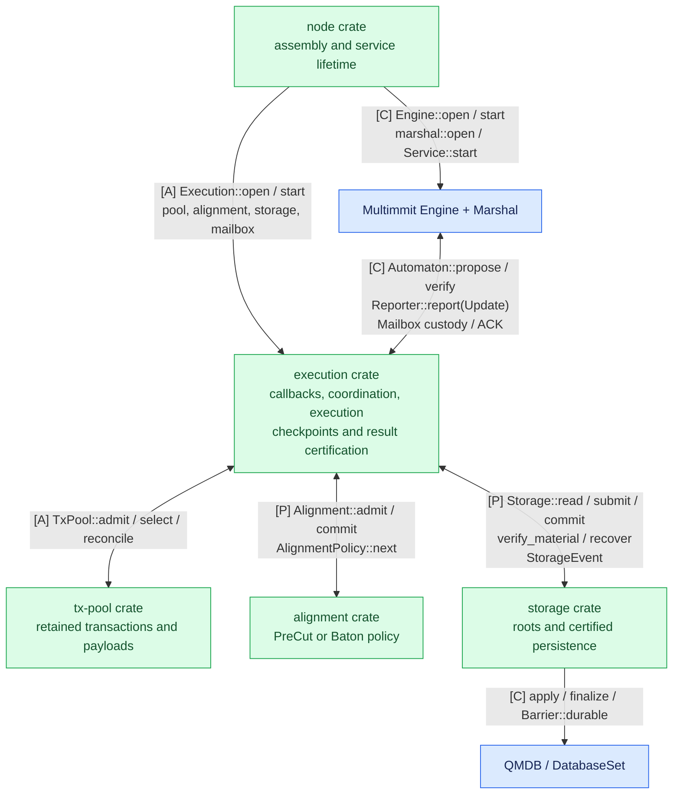

# Architecture

**Node connects native consensus; TxPool retains transactions; Alignment selects work; Execution coordinates and executes; Storage persists certified state.** Execution implements existing Automaton/Reporter callbacks and owns retained delivery/ACKs, checkpoints and result certification. The five crates communicate through the contracts below.

Diagram labels: **[C]** existing Commonware interface; **[A]** App-owned processing; **[P]** proposed App trait; **[X]** required native extension; **wire** peer message. See the [communication reference](../03-reference/01-communication-contracts.md#diagram-notation) for call/event notation.

## Application composition

[Open full-size diagram](../assets/diagrams/diagram-01.svg)

Blue boxes are existing Commonware modules. Green boxes show the five crate responsibilities; coordination and execution/result workers share the Execution crate. Alignment consumes a read-only execution projection and returns an intent; Execution rechecks and claims it. Storage implements the contract defined by Execution, including import/recovery, so dependency direction remains acyclic. Crate separation does not prescribe one actor per crate. Keep slow execution and storage work off native callback intake.

## Responsibilities and communication

| Component | Responsibility | Communication |
|---|---|---|
| [Multimmit](../../node/README.md#multimmit) | Producer lanes, DA, views and native finality | Calls App Automaton; sends Activity and relay requests to Marshal |
| [Marshal](../../node/README.md#marshal-custody) | Full blocks, native history, backfill and ordered delivery | Custody mailbox calls; indexed Update and application ACK |
| [Node](../../node/README.md) | Transport, construction and supervised service lifetime | Connects existing Engine/Marshal and injects pool/policy/storage into Execution |
| [TxPool](../../tx-pool/README.md#pool) | Admission, retained candidates and bounded selection | Transactions in; proposal batches out; durable outcomes for maintenance |
| [Alignment](../../alignment/README.md#alignment) | Eligible pending work and finalized-order reflection | `admit/commit`; public `next` selects an intent from the execution view |
| [Execution](../../execution/README.md#coordination) | Native callbacks, coordination/ACKs, transaction computation, checkpoints and result certification | Exact-parent jobs, StateChanges, prepared roots, verified commit requests and checkpoint installation |
| [Storage](../../storage/README.md#persistence) | Roots, material checks, persistence and recovery | `read/submit/commit/verify_material/recover`; retained events |
| [Result certification and state sync](../../execution/README.md#certification) | Execution verifies certificates; Storage persists matching direct or imported material | Verified Storage commit → durable checkpoint → Execution installation and App ACK |

The current source is [Commonware checkout 6233438](https://github.com/0xEyrie/monorepo/tree/6233438985d8249d2b2bc1204191d5d405652288). Current Multimmit Marshal replaces the older proposed application body service and ordinary Baton-owned order-delivery machinery. Historical research pinned to `534af0e` remains useful for its stated questions, but does not describe this new assembly.

## Inputs and outputs between components

`Automaton` connects App's pool and payload validation to Multimmit; Marshal connects block custody and canonical delivery to App. The [App callback flows](../../execution/README.md#coordination) define staging, all `verify` origins, scheduler admission, asynchronous application and ACK handling.

## Data, control, and canonical paths

| Path | Flow | Established fact |
|---|---|---|
| Payload | Pool → propose → Marshal custody and relay | Exact block bytes retained and disseminated |
| Native consensus | Header/DA/view/certificate planes → native machine | Authenticated lane and ordering facts |
| Speculation | Usable candidate → App scheduler → exact-parent execution | Completed local effects for a particular path |
| Baton control | Intended-order report → bounded selection → advisory direction | Execution intention; no finality or result proof |
| Canonical delivery | Native history → Marshal → indexed Update → Alignment::commit(ordered) | Continuous finalized ordering, independent of execution progress |
| Application durability | Execution effects → Storage preparation → Execution certification → Storage Committed event → ACK | Recoverable certified state, outputs, certificate evidence and applied position |
| Execution catch-up | Storage checkpoint → Execution owner → Execution installation | Skip the exact covered input and resume from its usable state view |
| Result certification | Peer Apps exchange signatures over the exact statement | `f+1` matching distinct signatures plus irrevocable order/base establish the research result endpoint |

Body custody, speculation, native finality, result certification and local durable application are separate facts. Body/header ancestry does not supply the cross-lane execution state parent. Only matching exact input/base/runtime permits reuse.

## Workers and decision authority

Use short App handlers to admit work and update metadata; run transaction computation, report-candidate evaluation and storage operations through appropriate Commonware tasks. Bound queues and retained bytes. Canonical deliveries need a non-dropping inbox matched to Marshal's ordinary delivery window, with old/new window overlap explicitly handled during floor/import transitions; best-effort speculation may defer or forgo work when its own budget is exhausted.

The scheduler selects pending jobs, while shared execution state owns checkpoints and stale-worker fences. The canonical writer serializes state mutation, including certified imports. Reports and advisory direction cannot gate canonical delivery, result certification, state sync or ACK. Physical pruning waits for reference/retention obligations even after logical conflicting-branch removal.

Root preparation remains separate from transaction computation. Reuse QMDB directly instead of requiring every speculative attempt to return a Merkleized result through the full glue actor. Root-deferred branching still needs a concrete application integration; existing sealed-parent fork APIs do not solve it automatically.

## Pre-cut and full Baton

Pre-cut is an independent scheduler configuration with no Baton reports/direction or policy hook. Both modes preserve started local work and sort only eligible pending candidates; both reconcile against the same authoritative Marshal Update stream.

Baton additionally needs actual leader context and authenticated native policy adoption to preserve a chosen prefix in canonical order. Existing Automaton methods are producer-payload callbacks, and current Marshal interprets the native fixed order. An app-only scheduler can guide speculation; full Baton requires specific native/Marshal changes and proofs. Do not reorder already delivered Updates to simulate that missing integration. [Direction and the native gap](../../alignment/README.md#alignment-existing-callbacks-versus-the-native-policy-gap) states the outstanding contract.
