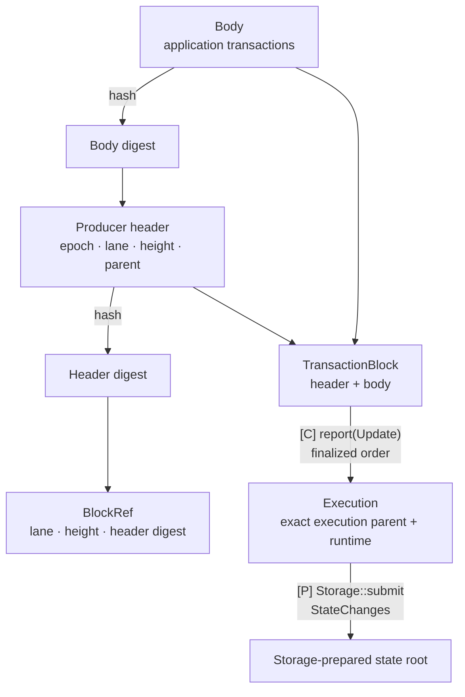

# Roles and terminology

**Network assembles TxPool, Alignment, Execution and Storage with the existing Multimmit and Marshal.** These five crates divide application responsibilities. The native App role is implemented by Execution; crate boundaries do not require separate actors.

## Block identity and execution state

[Open full-size diagram](../assets/diagrams/diagram-23.svg) · [PNG](../assets/diagrams/diagram-23.png)

The producer header identifies the block in its lane. The execution parent identifies the state on which that block runs; a digest or output index alone cannot replace it.

## Roles and terms

| Owner or internal part | Responsibility |
|---|---|
| Multimmit Engine | Native producer signing, DA, leader proposal/voting, finality and safety recovery |
| Multimmit Marshal | Complete-block custody/broadcast/backfill, ordinary native total-order interpretation, indexed delivery and durable ACK cursor |
| Network | Assemble the five crates, native services and transport; supervise startup and shutdown |
| TxPool | Validate and retain/share transactions by type; select eligible type pools for the proposal epoch/lane and reconcile durable outcomes from all lanes |
| Alignment: PreCut | Admit eligible pre-cut candidates, preserve started prefix and sort pending work, reconcile finalized input |
| Alignment: Baton | The same local scheduling foundation plus intended-order reports, bounded direction selection and advisory handling |
| Execution | Own Automaton/Update callbacks, coordination and ACK tokens; compute transaction effects and manage in-memory checkpoints; read pinned cold state, submit StateChanges with exact ordered-range metadata and install committed checkpoints |
| Storage | Own root preparation, material checks, persistence, import/recovery records and usable durable checkpoint views |
| Execution result processing | Execution-owned signing, peer collection and full f+1 certificate verification before Storage commit |

The scheduler mode is chosen for the application configuration. Pre-cut has no Baton instance, report windows, direction messages or native prefix-policy modification. Both modes use the same body, pool, execution backend and storage resources. The concrete global comparator, scheduler resource limits and backend remain open.

`Automaton`, `Relay` and `Reporter` are existing Commonware traits. Marshal provides the reusable body Relay and a native-activity Reporter. Execution implements Automaton and an Update Reporter; an optional native-activity handle can observe additional native activity. Different `Reporter::Activity` types require different concrete handle types when forwarding into the same App.

Engine [derives Validator when the configured scheme's `me()` returns a participant, or Observer otherwise](https://github.com/0xEyrie/monorepo/blob/6233438985d8249d2b2bc1204191d5d405652288/consensus/src/multimmit/engine/mod.rs#L615); the epoch's separate [`producer_chain(participant)` mapping](https://github.com/0xEyrie/monorepo/blob/6233438985d8249d2b2bc1204191d5d405652288/consensus/src/multimmit/config/protocol.rs#L202) supplies an optional local producer lane, so a validator need not be a producer.

| Data or term | Meaning and completion condition |
|---|---|
| Body digest | Hash commitment to the application payload returned by `Automaton::propose` |
| Producer header | Native epoch/chain/height/parent plus body digest; does not contain the transaction body |
| Header digest | Hash of the full producer header, including epoch/context and body digest; this is the digest requested by Relay |
| `BlockRef` | Structured producer chain, chain-local height and header digest used for exact block lookup; epoch is committed by that digest, not a separate field |
| `TransactionBlock` | Complete header plus application body; Marshal stores and broadcasts this value |
| `Custody` | Token returned after accepted `stage_block` work; its successful wait establishes durable recovery |
| `verify(true)` | Valid payload with required local custody; it does not establish execution completion or finality |
| Eligible candidate | App-retained exact validated block facts satisfying its authentication, ancestry and scheduling requirements |
| Global rule | Shared deterministic ordering for eligible not-yet-started work; preserve the started/completed prefix `F` |
| Report / direction | Authenticated intended order / leader's advisory scheduling suggestion; neither is execution proof or finality |
| Prepared policy candidate | Completed bounded planning result for possible future native authenticated adoption; current native policy integration is missing |
| `Update` | Marshal's complete finalized block with canonical `OutputIndex` and `Exact` acknowledgement |
| Execution checkpoint | Completed work for an exact base state, ordered prefix and runtime; reusable only under the same context |
| StateChanges | Execution-to-storage payload of deterministic application changes; job/context is bound by App, while storage roots/batches/checkpoints are built by Storage |
| AppliedCheckpoint | Storage-supplied exact certified durable prefix and usable read-only state view; Execution installs it to skip covered work |
| `Alignment::commit(ordered)` | Notification of exact finalized ordering; no execution, f+1 or state-durability wait |
| `Storage::read(view, key)` | Cold read at a pinned exact base after Execution overlays miss; unavailable view and I/O failure are errors |
| `Storage::submit(executed, changes)` | Accepted exact ordered execution progress; retention is not durable commit or permission to prune memory |
| `Storage::commit(verified)` | Execution-verified result submitted for persistence; acceptance is not durable completion |
| `StorageEvent::Prepared / Committed` | Ready commitments for signing / certified durable state with a usable checkpoint; only Committed permits covered Update ACKs |
| Applied record | App's certified durable state/output/applied-index/block-identity/certificate/provenance linkage |
| Delivery ACK | Local completion signal after matching f+1 certification and durable state application; Marshal persists its cursor separately |
| Execution statement / result certificate | Full exact input/base/runtime/result subject / f+1 eligible distinct signatures on that same subject |

A producer lane's header parent is distinct from an execution predecessor across lanes. The body digest, header digest, leader proposal identity, canonical output index and application state root identify different facts. A native [`View`](https://github.com/0xEyrie/monorepo/blob/6233438985d8249d2b2bc1204191d5d405652288/consensus/src/types.rs#L257) counts consensus attempts within one epoch, producer height counts blocks in one lane, and Marshal's [`OutputIndex`](https://github.com/0xEyrie/monorepo/blob/6233438985d8249d2b2bc1204191d5d405652288/consensus/src/multimmit/marshal/types.rs#L53) counts blocks in the finalized output stream. An integer output index alone is not a state root or a cryptographic block identity.

The immutable ordering frontier ends the input prefix that future direction cannot rearrange. The local started prefix `F` can include speculation and is not canonical finality. Marshal's delivery cursor and the App's applied record are also separate: a crash can require redelivery of input already durably applied.

Mapping earlier names to the current composition

| Earlier design name | Current location |
|---|---|
| BlockService / body custody adapter | Existing Multimmit Marshal plus App body codec and validity logic |
| Orderer / Baton confirmed delivery | Existing Multimmit Marshal for ordinary native order |
| Earlier broad TxPool / Execution / Storage / Baton traits | Concrete pool/execution code; public Alignment and AlignmentPolicy for scheduling; Storage read/submit/commit with retained events for state access and persistence |
| Planner / ResultService / Runtime | Internal bounded planning, result handling and transaction computation; Commonware runtime still supplies task/I/O primitives |
| StoredBody / CandidateBlock events | Internal retained custody and eligibility facts; no mandatory new public event API |
| Execution::commit / CommitResult | Internal processing of Marshal Update through the App canonical writer and durable applied record |
| Baton::on_block / on_commit | Internal candidate admission and optional scheduling progress handling |

The historical paper and preserved reviews retain their original terminology and source pin. Current connection details are in [Baton integration](../../execution/README.md#coordination), [body flow](../02-e2e/02-block-exchange.md), and [canonical delivery](../02-e2e/06-ordered-application.md).
