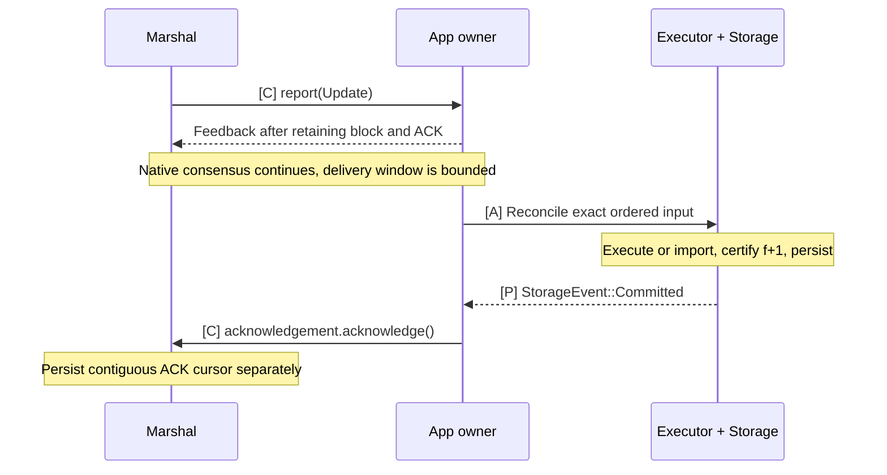

# Marshal: ordered delivery and ACK

**Existing Multimmit Marshal sends the App complete blocks in canonical order.** Connect `Reporter<Activity = marshal::Update<Block>>` to an App output ingress. The App uses that sequence to select/reuse/repair execution, durably applies it, then acknowledges. Baton scheduling does not reconstruct or reorder this stream.

## Delivery and two durability points

[Open full-size diagram](../assets/diagrams/diagram-25.svg) · [PNG](../assets/diagrams/diagram-25.png)

A crash between App durability and Marshal cursor durability can redeliver an already-applied block. Match its recovered identity and ACK without applying it twice.

## Communication interfaces

| Direction | Call or value | Completion means |
|---|---|---|
| Multimmit → Marshal | Native `Reporter::report(Activity)` | Native observations feed Marshal's history/custody machinery; this is not an App state commit |
| Marshal → App owner | `Reporter::report(Update)` → `Feedback` | Complete indexed block and Exact token retained by App |
| App owner → Marshal | `update.acknowledgement.acknowledge()` | That exact delivery is covered by certified durable App state |
| App import/recovery coordination → Marshal | Existing floor operations | Native delivery recovery only; matching durable App state is established separately |

Marshal owns native history interpretation, dense delivery, its outstanding ACK window and its cursor. The App owner retains tokens and drives execution/storage; Marshal does not execute transactions or verify App execution certificates.

## Consensus and Baton integration

Native Engine finality is sparse and chain-local. Marshal verifies L-QCs, resolves history and ancestry, derives continuous native order, obtains bodies and assigns `OutputIndex`. Its supplied service already owns these responsibilities. `Activity::LeaderFinalized` is an observation of native finality; `Update` is the App's canonical ordered input. [Native finality boundary](https://github.com/0xEyrie/monorepo/blob/6233438985d8249d2b2bc1204191d5d405652288/consensus/src/multimmit/mod.rs#L93), [Marshal ownership](https://github.com/0xEyrie/monorepo/blob/6233438985d8249d2b2bc1204191d5d405652288/consensus/src/multimmit/marshal/mod.rs).

An Update contains:

| Field | App interpretation |
|---|---|
| `index: OutputIndex` | Position in the canonical finalized output stream |
| `block: Arc<Block>` | Complete native header and application body |
| `acknowledgement: Exact` | Retain until the App has durably applied this block |

[Update definition](https://github.com/0xEyrie/monorepo/blob/6233438985d8249d2b2bc1204191d5d405652288/consensus/src/multimmit/marshal/types.rs#L128).

`Reporter::report` is synchronous. Its handler retains the full Update and wakes App processing; it does not run transaction execution or wait for disk I/O inline. The App processes the next canonical index against its durable applied position. A matching already-applied identity can be acknowledged on replay. A new index selects the exact-parent valid speculative result or executes/repairs the required suffix; the same application writer commits state and linked applied-position metadata. A gap or conflicting identity stops application, rather than guessing an order.

An Update can be App's first encounter with that block, including for an Observer or skipped speculation. Perform the application checks needed for execution, or reuse exact validated work, without requiring an earlier local `verify` or scheduler entry. Marshal's authoritative local order does not implement App transaction semantics; App does not need a second native proof/order verifier.

The retained stream first informs `Alignment::commit(ordered)` of continuous finalized ordering without waiting for execution. Executor verifies matching `f+1` result certification before requesting Storage commit, for direct work and imports alike. Only after certified application durability does App consume the token with `acknowledge()`. Completed speculation cannot bypass the certificate gate. The token itself performs no I/O and does not make state durable.

### Delivery backpressure and recovery

Marshal can report multiple Updates before receiving their ACKs, up to configured `max_pending_acks`. It advances the oldest contiguous acknowledged prefix and synchronizes its own durable cursor separately. Native voting, views and finality do not await application ACKs. A full delivery window pauses further App delivery, while native consensus continues. [Delivery loop](https://github.com/0xEyrie/monorepo/blob/6233438985d8249d2b2bc1204191d5d405652288/consensus/src/multimmit/marshal/actors/delivery/actor.rs#L235), [ACK window](https://github.com/0xEyrie/monorepo/blob/6233438985d8249d2b2bc1204191d5d405652288/consensus/src/multimmit/marshal/actors/delivery/acks.rs#L1).

For ordinary delivery within one generation, give Updates a non-dropping owned queue whose capacity accounts for that delivery window; do not share a lossy notification queue. Delivery checks `Feedback::Closed`, but a `Backoff` return does not request an Update retry. Keep its ACK while queued and while application work runs. All cloned Exact handles must acknowledge; dropping any unacknowledged clone cancels the waiter and fails delivery. [Report handling](https://github.com/0xEyrie/monorepo/blob/6233438985d8249d2b2bc1204191d5d405652288/consensus/src/multimmit/marshal/actors/delivery/actor.rs#L303), [Exact semantics](https://github.com/0xEyrie/monorepo/blob/6233438985d8249d2b2bc1204191d5d405652288/utils/src/acknowledgement.rs#L38).

A crash after App state is durable but before Marshal's ACK cursor is durable can redeliver the block. Persist enough exact applied identity/state/certificate linkage to verify replay without applying transaction effects twice or collecting fresh signatures. An ACK must not mean only that the Update entered an inbox or reached Alignment: the contract requires **certified durable application**. Marshal's cursor storage and App state storage are separate transactions. Coordinate state-sync floor installation with matching certified durable App state and fence older workers/updates before changing writer authority.

The next bounded signing unit must fit the active delivery capacity. Execute its internal blocks on private checkpoints and sign its result before applying the whole certified unit; ACK covered Updates afterwards. Input needed for certification must not depend on those same ACKs. See the [certification-unit contract](10-result-processing.md#certification-units-and-delivery-progress).

A floor installation resets Marshal's delivery generation and discards its old waiters; it does not remove Update values already retained by App. The new generation can deliver another window, so `max_pending_acks` alone does not bound old plus new App-held work. Update has no generation field. App owns the floor/import lifecycle and must serialize and fence that handoff, reconcile old retained input/tokens, and budget any overlap before resuming ordinary delivery. Exact switching and crash sequencing remain implementation work. [Native reset](https://github.com/0xEyrie/monorepo/blob/6233438985d8249d2b2bc1204191d5d405652288/consensus/src/multimmit/marshal/actors/delivery/actor.rs#L423).

The example's headless reporter immediately acknowledges synthetic output; it has no transaction-state database. Use it as a wiring example, not an application durability contract. [Example output reporter](https://github.com/0xEyrie/monorepo/blob/6233438985d8249d2b2bc1204191d5d405652288/examples/log-multimmit/src/application/reporter.rs#L33).

## Reuse proof verification and storage

| Existing Marshal component/API | Supplied responsibility | App responsibility |
|---|---|---|
| `SchemeVerifier`, backfill and synchronizer | Verify native evidence; fetch certificates/history/bodies; reconstruct native order | Supply the configured trusted committee/scheme and bounded body codec |
| Catalog and custody stores | Persist complete blocks, committed output rows, native recovery material and floors | Implement application validity; retain independent execution material as needed |
| Delivery and ACK cursor | Ordered Update window, cursor sync and restart redelivery | Exact application-state apply, durable applied identity, idempotent replay, ACK |
| `floor_at`, `install_floor`, `prune` | Verified Marshal floor/recovery/retention operations; ordinary pruning respects its current ACK cursor | Coordinate imported application state and App retention/writer fences |

Reuse these owners directly. A second Baton proof archive, global-order interpreter, delivery cursor database or public Orderer contract would duplicate existing code. [Mailbox APIs](https://github.com/0xEyrie/monorepo/blob/6233438985d8249d2b2bc1204191d5d405652288/consensus/src/multimmit/marshal/mailbox.rs#L449).

Fresh-namespace `Start::Floor { floor_generation, floor }` is a caller-authenticated import: authenticate the anchor signature and bind the emitted frontier and positive monotone `floor_generation` to the App snapshot before opening. `Config::validate` and `marshal::open` check structure/history linkage, not that anchor's signature; a recovered checkpoint takes precedence over Start. For a peer-served floor, the native source recommends `Start::Genesis` followed by verified `install_floor`. Reuse that verifier path while App authenticates and durably installs the matching state; no second App order interpreter is needed. [Startup authority](https://github.com/0xEyrie/monorepo/blob/6233438985d8249d2b2bc1204191d5d405652288/consensus/src/multimmit/marshal/config.rs#L164).

Current Marshal follows native history traversal and positional/extension passes, including final-sweep halt conditions. It does not expose an App-selected ordering comparator. Missing required history or included bodies cannot be treated as empty slots. [Native order reconstruction](https://github.com/0xEyrie/monorepo/blob/6233438985d8249d2b2bc1204191d5d405652288/consensus/src/multimmit/marshal/protocol/order.rs#L361).

Full Baton needs authenticated prefix/policy semantics added consistently to native proposal construction, validation, continuation/recovery and Marshal's interpretation. `Update` does not carry that missing policy automatically. App must never implement Baton by sorting finalized Updates. Those [native integration obligations](../04-reference/05-native-open-decisions.md#todo-bind-baton-prefix-and-policy-to-cut-proposals) remain open; basic PreCut and App execution can attach to the existing stream today.
