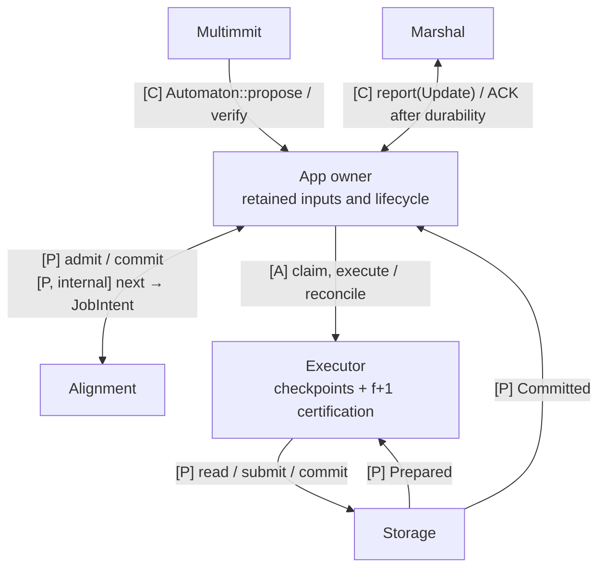
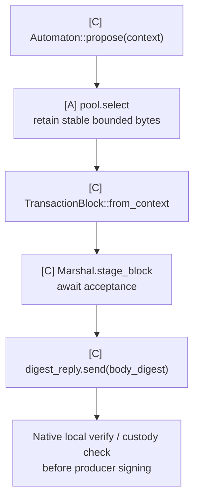
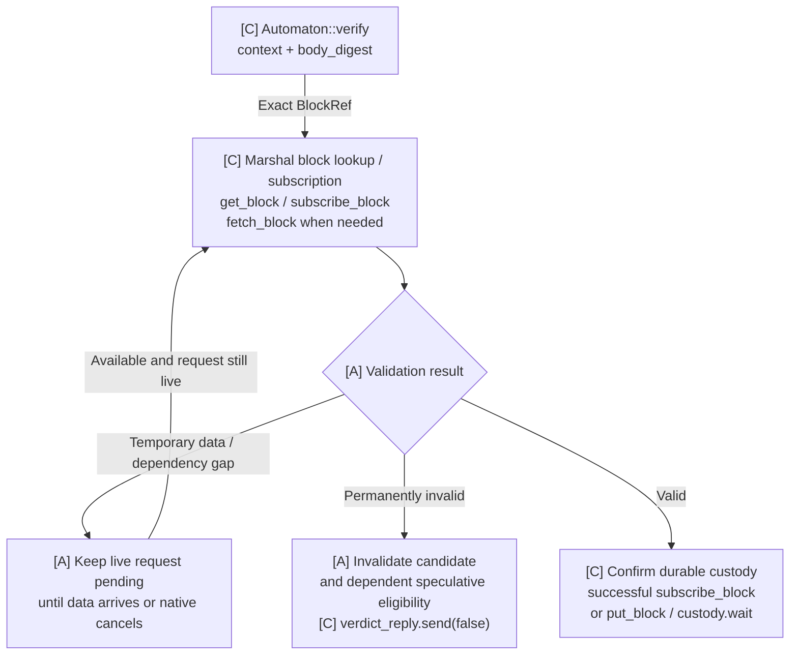
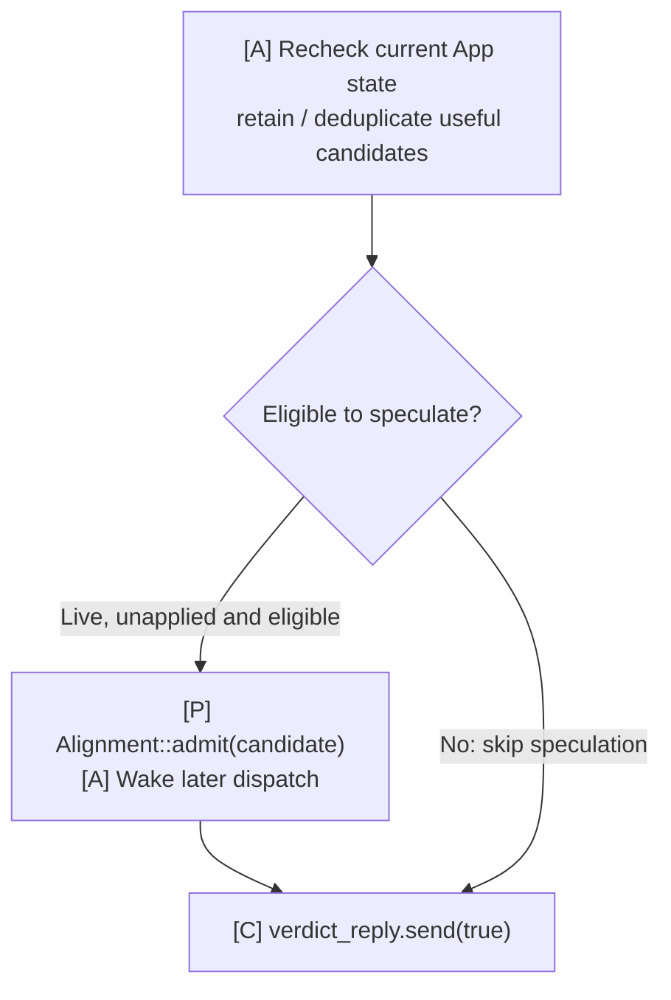
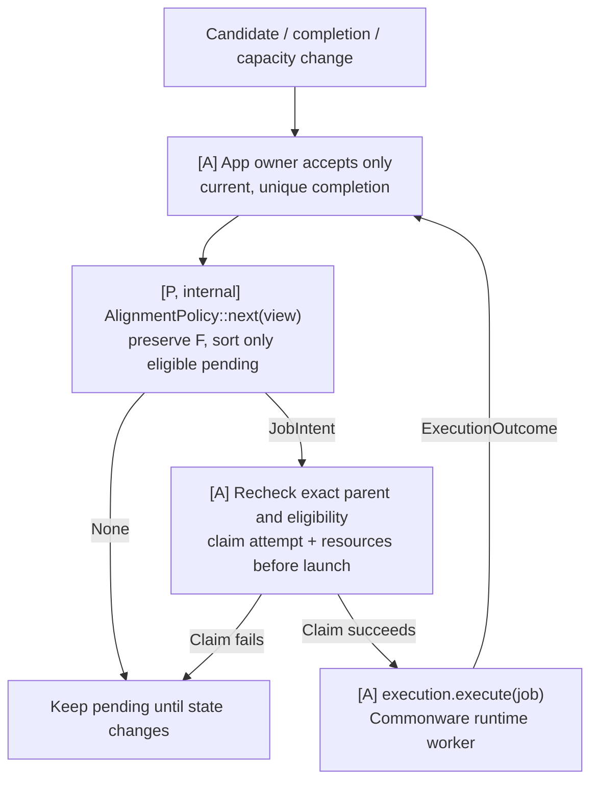
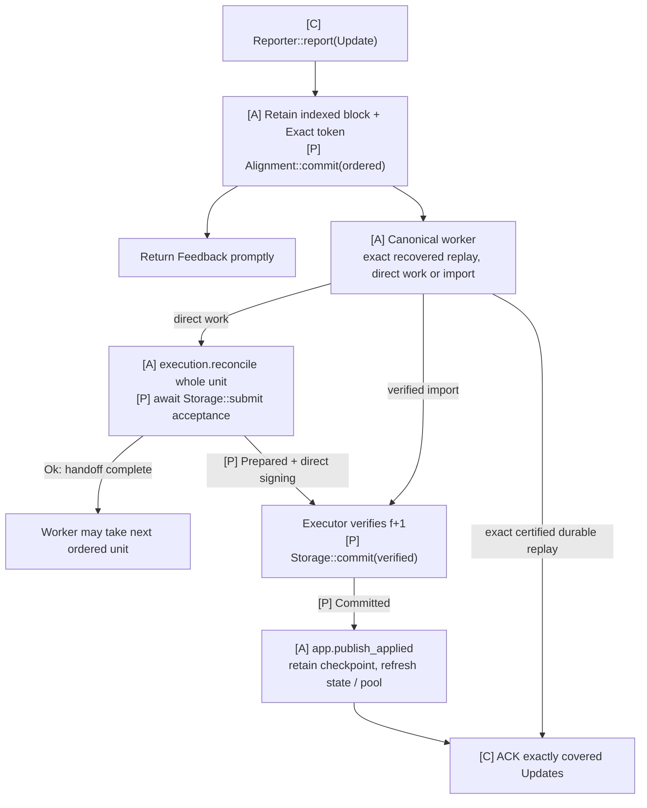

# App: Multimmit integration

**One App connects Multimmit callbacks and Marshal deliveries to TxPool, Alignment, Executor and Storage.** The shared App owner coordinates lifecycle, dispatch and retained Update tokens; callback handles are its entry points. Existing Multimmit Marshal supplies block custody, body exchange and ordered delivery.

Read the composition and communication table first, then follow [`propose`](#automatonpropose-pool-to-staged-block), [`verify`](#automatonverify-validity-custody-and-scheduling) and [`report(Update)`](#marshal-reportupdate-canonical-input-and-ack). [Startup](#assemble-before-opening-the-engine) explains when those entry points become available.

## One owner, independent work

[Open full-size diagram](../assets/diagrams/diagram-26.svg) · [PNG](../assets/diagrams/diagram-26.png)

The owner retains Update tokens and coordinates completions. Its short intake handlers stay available while body retrieval, transaction work and storage I/O run.

The name `App` below means the application being designed. Inside it, **Alignment layer** owns callback/delivery handling and scheduling; **App Executor** owns transaction computation, in-memory checkpoints and result certification; **Storage** owns root preparation, persistent state and checkpoint material import/recovery. The pool remains a separate App responsibility. These are responsibility groups, not mandated processes. The native `AppExecutor` runs local `Automaton::propose/verify` jobs; it does not execute application transactions. See the [responsibility map](../04-reference/01-communication-contracts.md#consensus-alignment-and-app-executor).

This design uses the current local Commonware checkout, [6233438](https://github.com/0xEyrie/monorepo/tree/6233438985d8249d2b2bc1204191d5d405652288). Earlier research against `534af0e` predates its Multimmit Marshal. Application scheduling, the transaction runtime and Baton policy integration described here remain to be implemented.

## Responsibilities

| Owned responsibility | What the App owner coordinates |
|---|---|
| Native callback intake | Route payload construction/validation to the pool and custody path |
| Speculative dispatch | Admit eligible candidates, request a policy intent, recheck context and claim resources before launch |
| Ordered input | Retain complete indexed Updates and tokens; immediately reflect continuous ordering in Alignment |
| Independent completions | Accept current execution results and route Storage events without blocking other intake |
| Durable publication | Retain/forward usable checkpoints, ACK covered Updates and schedule pool maintenance |
| Lifecycle | Recovery readiness, stale-worker fencing, retained queues and shutdown |

The callback handles and shared owner are coordination roles inside App. The proposed `Alignment`/internal `AlignmentPolicy` and `Storage` contracts connect the policy and state responsibilities; concrete pool, execution and result helpers remain private. [Architecture](../01-overview/01-architecture.md) shows the composition.

Pre-cut and Baton share the same execution, certification and storage path. Pre-cut has no Baton instance, reports, directions or native policy change. Baton adds intended-order collection and advisory direction; authenticated native policy adoption remains separate unfinished work.

## Communication interfaces

| Direction | Interface or value | Completion means |
|---|---|---|
| Multimmit → App | `Automaton::propose(ctx)` | Returned receiver later yields the staged body digest |
| Multimmit → App | `Automaton::verify(ctx, body_digest)` | Returned receiver later yields the validity/custody verdict, independently of execution |
| Marshal → App | `Reporter::report(Update)` | Full indexed block and ACK token retained; `Feedback` completes the handoff |
| App → TxPool | `pool.select` / `pool.reconcile` | Stable proposal bytes / maintenance from durable outcomes |
| App → Alignment | `admit(candidate)`, `commit(ordered)` | Eligible candidate retained or finalized ordering reflected |
| App dispatch → Alignment policy | Internal `AlignmentPolicy::next(view)` | `JobIntent` or `None`; the owner still claims the job |
| App → Executor | `execution.execute/reconcile` | Exact-parent `ExecutionOutcome` / ordered StateChanges |
| App → Storage | `Storage::submit/commit` | Work or evidence retained; events complete later stages |
| Storage → App → Executor | `StorageEvent::Committed(applied)`, then `execution.install_checkpoint` | Certified durable identity published and a usable execution base handed over |
| App → Marshal | `update.acknowledgement.acknowledge()` | Matching delivery covered by certified durable App state |

The flows below expand each callback’s ownership, waits and failure paths. The [Rust reference](../04-reference/02-rust-signatures.md) contains existing signatures. The [communication reference](../04-reference/01-communication-contracts.md) defines exact values and completion/failure contracts. **[C]** is existing Commonware, **[P]** a proposed contract, **[A]** private App behavior and **[X]** unfinished native work. These names identify responsibilities rather than requiring one public trait per connection.

Use Marshal's existing `Relay` implementation. Its broadcast key is the **full header/block digest**, which locates the staged full block; this differs from the body digest returned by `propose` and passed to `verify`. The native wire carries signed headers separately from the Marshal body broadcast. A receiver may therefore have the header before the body. [Body flow](02-marshal-custody.md) explains these identities and custody stages.

`Reporter` has an associated `Activity` type. One concrete Rust type cannot implement it twice with two different associated types. Give the same App owner two small typed handles if it needs both native observations and Marshal deliveries. This is ordinary mailbox wiring, not another service layer.

Cloned callback handles route to the same App state. For `propose` and `verify`, return the receiver promptly and run the pending request work shown below as bounded async jobs. Body/custody waits leave the App owner free to handle intake and completions; completed jobs re-enter that owner before updating shared state. The [existing example mailbox](https://github.com/0xEyrie/monorepo/blob/6233438985d8249d2b2bc1204191d5d405652288/examples/log-multimmit/src/application/mailbox.rs#L148) uses this handoff.

## Automaton::propose: pool to staged block

[Open full-size diagram](../assets/diagrams/diagram-49.svg) · [PNG](../assets/diagrams/diagram-49.png)

Selection and proposal do not retire transactions; cleanup follows canonical durable outcomes.

`stage_block(...).await` accepts custody work; the returned custody handle is the later durable-completion boundary. `put_block(...).await` combines staging and waiting. The native local `verify` must confirm validity and durable custody before local signing. If App promises durability earlier in its own propose implementation it may wait there, but selecting a batch or accepting staging alone is not a disk flush.

Transient absence of transactions or backpressure follows the callback's request lifetime and configured producer behavior. Do not invent an empty-block policy or treat local storage failure as successful custody. A failed mutable-storage operation is a fatal/recovery condition for that storage instance.

## Automaton::verify: validity, custody and scheduling

The callback starts a bounded verification job and returns its receiver promptly. The job follows this flow; its waits leave the App event loop available.

### Verification entry points

`verify` is not a network-receive notification. Current Multimmit invokes it in three places:

- **Remote producer path:** native authentication/eligibility admits a header before the voter asks App to verify its payload. Duplicates, malformed packets and not-yet-eligible headers do not map one-to-one to calls.
- **Local producer path:** after `propose`, native code calls `verify` as a custody check **before signing the local header**.
- **Recovery:** `Engine::open` rechecks retained payload obligations before actors start.

Interpret successful **live** verification according to the node's role:

| Role | Candidate interpretation |
|---|---|
| Validator with a local producer lane | `context.chain() != local producer chain` can identify other-lane work |
| Nonproducing validator | Live validation still exists; there is no local lane to exclude |
| `Role::Observer` | No live per-chain validation; normally enter through Marshal Update unless an explicit authenticated early-candidate intake is added |

The callback has no origin or recovery flag. Track native role/lane and App lifecycle explicitly; those checks filter speculation, not the native custody verdict.

A local pre-sign body can be prepared locally. If report eligibility requires an authenticated native header, promote it only when that evidence is available. `TransactionProposed` and `ProtocolAccepted` are useful best-effort observations; missed hints may reduce speculation but cannot block canonical processing.

### Payload and custody

[Open full-size diagram](../assets/diagrams/diagram-20.svg) · [PNG](../assets/diagrams/diagram-20.png)

Derive the exact `BlockRef` from `context.header(body_digest)` using App's configured hasher. Check the body's digest, context and payload rules. Start an explicit fetch when needed **before waiting for the subscription to complete**. A successful subscription already establishes custody; lookup/fetch alone does not.

### Candidate admission and verdict

After validity and durable custody are confirmed, re-enter the App owner. Applied position or lifecycle may have changed while the job waited.

[Open full-size diagram](../assets/diagrams/diagram-21.svg) · [PNG](../assets/diagrams/diagram-21.png)

**`true` means valid payload and durable custody.** Admission only updates pending candidate state. [Later dispatch](#dispatch-after-verification) waits for the exact execution parent and resources; the verdict does not wait for transaction execution, result roots, reports or directions.

The actual `verify` future returns `oneshot::Receiver<bool>`; App later sends the verdict through the paired sender. `false` means permanent invalidity, not “body has not arrived,” “worker busy” or “speculation failed.” A canceled request stops its pending job; custody failure cannot become `true`, and mutable-store failure requires recovery of that instance. See [the body API guide](02-marshal-custody.md#use-marshals-existing-body-apis) for the fetch-first custody path and superseded subscription handling.

The shared Automaton documentation describes single-shot verification and terminal closure. Current Multimmit's remote chain plane has a narrower implementation exception: a closed receiver becomes `Unavailable`, eligibility returns to `Ready`, and verification can be dispatched again within the same run. Local uncanceled custody failure is fatal; recovery also requires `true`. Do not rely on closure as a portable retry mechanism, and deduplicate repeated live calls as well as recovery. [Remote dispatch](https://github.com/0xEyrie/monorepo/blob/6233438985d8249d2b2bc1204191d5d405652288/consensus/src/multimmit/actors/voter/chain_plane.rs#L522), [eligibility transition](https://github.com/0xEyrie/monorepo/blob/6233438985d8249d2b2bc1204191d5d405652288/consensus/src/multimmit/machine/eligibility.rs#L352).

Use payload validity rules that can legitimately be checked at this boundary. Producer context does not specify the final cross-lane state. State-dependent transaction outcomes belong to execution against the chosen exact parent; a speculative revert or conflict does not retroactively make an otherwise valid payload malformed.

The scheduler's pending entry is not a finished execution result. Native remote dispatch can occur while the producer parent's own validation is pending; it does not prove all predecessor bodies are ready. App checks candidate ancestry/body readiness and the execution checkpoint separately. Admission is an inexpensive local state update. Keep speculative capacity separate from custody and canonical delivery: when a speculative budget is exhausted, retain/coalesce a deferred candidate where the chosen bounded policy permits, or forgo that speculative opportunity. Do not send `false` or wait for execution just to obtain a speculation slot. Marshal's later canonical Update remains authoritative even if a block was never speculated.

Deduplicate candidates across concurrent verification, local proposal, activity hints and recovery. Repeated verification refreshes candidate facts; it does not reset an existing execution attempt to pending. Match exact epoch/context/block identity and exclude already applied speculative work using current owner state after asynchronous custody completes. Canonical application may have advanced while verification waited. Already-applied or unscheduled does not mean invalid payload: complete a still-required custody verdict honestly while skipping speculative admission. If a required producer parent is permanently invalid, dependent candidates remain ineligible even if their own payload bytes passed validation. Apply the [role and lifecycle checks](#when-speculative-execution-begins) to admission, independently of the custody verdict.

### Dispatch after verification

[Open full-size diagram](../assets/diagrams/diagram-50.svg) · [PNG](../assets/diagrams/diagram-50.png)

An unfinished parent or exhausted worker capacity keeps dependent work pending. Claims bind exact input state, runtime, ordered prefix and local attempt; scheduling selection alone starts no work.

Computation runs through Commonware runtime workers, outside the native callback and App's short admission handlers. App retains the execution tree, completed effects and worker fences; the scheduler chooses pending work using that state. Claiming the job prevents another wakeup from starting the same attempt; distinct exact-parent repair work remains distinguishable. A failed launch or a current attempt ending without reusable output must settle its ownership once and re-evaluate work from the last valid checkpoint. Release claims/resources only after work never started or has safely terminated; dropping a waiter alone does not prove submitted CPU work stopped. Retain required canonical input for the chosen repair/recovery path. Correlate the current local attempt as well as exact input/parent/runtime: a matching generation alone does not make duplicate completion safe. The scheduler does not interpret the native producer header's `parent` as an application state root.

## Marshal report(Update): canonical input and ACK

Marshal calls `Reporter::report` synchronously with an `Update` containing `index`, `Arc<TransactionBlock>` and `acknowledgement: Exact`. Acknowledge that exact delivery only after App has verified a matching `f+1` execution-result certificate and durably applied the covered input.

`Alignment::commit(ordered)` reflects finalized ordering as soon as continuous indexed input is retained, without waiting for execution or certification. The canonical worker reuses an exact matching result or completes/repairs the required work.

The trusted local Marshal stream supplies the ordering authority; App checks its exact range against the recovered application checkpoint. Update is not a portable finality proof and does not carry execution state, runtime, result certificate or Baton policy. A peer-sent object with the same fields cannot substitute for this local callback. External evidence export remains a separate open contract, not a second verifier required for ordinary App delivery.

[Open full-size diagram](../assets/diagrams/diagram-51.svg) · [PNG](../assets/diagrams/diagram-51.png)

Submission pending/rejection retains the unit and retryable changes. The worker advances only after Storage accepts; certification and flush proceed separately. The owner retains every ACK token, forwards the durable checkpoint to Executor and recovers on storage-instance failure.

An Update may be App's first encounter with the block, including for an observer or skipped speculation. Canonical processing cannot require an earlier `verify` call or scheduler entry: it performs the application checks needed for execution, or reuses exact validated work. This does not add another Automaton callback.

The public [`Storage`](../04-reference/01-communication-contracts.md#proposed-storage-interface) contract owns root preparation and durable application authorized by Executor. Executor supplies StateChanges with exact executed-range metadata; Storage prepares storage commitments; Executor collects and verifies evidence before requesting commit. The retained Update owner forwards the `Committed` event's checkpoint to Executor and handles ACK. Storage submission can precede certification and durability; neither acceptance alone authorizes ACK. A call into this trait never waits for Alignment approval.

Do not put application execution inside `report` or return an async future from it. App can pipeline receipt and computation while preserving canonical application order. Reports/direction planning cannot approve or gate this worker. App's capacity policy must also let required custody and canonical execution, root preparation and durability make progress under sustained optional load. Speculation, report verification and planning cannot indefinitely monopolize the resources that work needs.

| Event | What it proves | What can continue |
|---|---|---|
| `report(Update)` returns | App accepted the delivery into its retained path | Native consensus and other delivery slots |
| App finishes matching transaction work | A result exists for the exact execution context | Root preparation and result signing; canonical apply awaits certification |
| Executor verifies matching `f+1` certificate | Exact ordered input/base/result is certified | Writer may apply matching material after its authority checks |
| App completes certified durable apply and ACKs | App can recover this applied input and certification evidence | Marshal releases acknowledged window capacity in contiguous order |
| Marshal syncs its delivery cursor | Marshal can recover its acknowledged delivery position | Recovery from the persisted cursor and permitted pruning |

Within one active delivery window, Marshal can report up to `max_pending_acks` outstanding Updates. A full window pauses further App delivery; native voting, leader finality and producer progress do not wait for these ACKs. Retain every accepted Update and its Exact token in a queue sized for that window. `Closed` terminates delivery; `Backoff` does not retry a dropped Update. Every Exact clone must acknowledge, and dropping an unacknowledged clone cancels its live waiter.

ACK is an in-memory signal after App durability. Marshal subsequently persists its own cursor, so a crash between those boundaries can redeliver already-applied input. Compare recovered position and exact identity before ACKing replay; do not duplicate effects. A gap or conflicting identity stops application for recovery/error handling. An included block with a missing body is never an empty slot.

For floor/import transitions, the active-window bound does not cover old Updates still retained by App after Marshal resets its window. Update has no generation field. Serialize the transition through App ownership: fence/reconcile old inputs and tokens against matching durable App state, or explicitly budget bounded overlap before accepting a fresh window. The [detailed handoff](09-result-processing.md#coordinate-the-app-checkpoint-with-marshal) remains implementation work.

Result certification precedes canonical application for both direct and imported work: irrevocable exact input/base/runtime plus `f+1` distinct matching execution signatures. While signatures are missing, retain prepared work without canonical state apply or ACK. Signing must precede application, and the next certification unit must fit the active delivery capacity. Within a unit, private execution checkpoints allow progress before application. [Execution result contract](09-result-processing.md#result-certification-inside-executor).

## Assemble before opening the engine

Restore App's canonical state/applied binding, or initialize the agreed App genesis; Marshal's index 0 is genesis and is never delivered as an Update. Use the [existing assembly](../04-reference/07-development-order.md#body-assembly-to-implement), with App custody and retained Update intake available before `Engine::open` invokes recovery verification. Gate speculative dispatch during recovery, not the custody answers needed to finish open.

Pass App's Automaton, Marshal's relay and the native activity reporter into Engine. Start its planes, await native readiness and App's recovered base, then activate scheduling and re-evaluate retained candidates; another successful verify callback is not guaranteed. Native `ready` is only a startup milestone. The example supplies wiring, not the transaction executor or durable Update consumer.

Keep failed startup, sibling-service lifetimes and shutdown under the [existing node owner](../04-reference/07-development-order.md#service-lifetimes). Checkpoint imports must also follow the [floor-to-App-state authority contract](09-result-processing.md#coordinate-the-app-checkpoint-with-marshal), including authentication before using `Start::Floor`.

## Native activities and optional local notifications

Route native `Activity` directly to Marshal through its [existing mailbox reporter](01-multimmit.md#native-activities). App may additionally consume `TransactionProposed`, `ProtocolAccepted`, finality or history observations for candidate correlation and advisory scheduling. These are best-effort, idempotent hints; App must not build a second finality/delivery engine from them.

Shared execution progress is ordinary App state: after canonical apply, remove applied pending entries and rebase/fence conflicting speculative work without calling `Alignment::commit` again. Applied-progress coordination adds no extra ACK protocol or scheduler approval. Result signatures, certificates and state-sync material travel directly between peer application execution components; Baton report collection is outside that path.

## Baton-specific work stays inside the application

Baton scheduling owns the report window, intended-order snapshot, bounded candidate evaluation and advisory direction. Reports bind epoch, view, history, canonical parent, rule, window and frontier. They express intention, not execution completion. Reuse the existing Clock, runtime tasks, crypto, codec and authenticated P2P for this work. Bound both retained messages and submitted CPU work; an unordered future pool alone is not a capacity limit.

The ordinary local rule is `F ++ sort_G(S_pending)`: preserve completed/current execution order and sort only eligible work not yet started. Cut readiness never waits for reports, a timer, planning, speculative execution or a direction reply. Details and the remaining protected-prefix integration obligation are in [Alignment behavior and direction](06-alignment.md).

**An app-only Baton scheduler can guide speculation today; it cannot make its preferred order canonical by rearranging Marshal Updates.** The full research objective still needs an authenticated native policy/adoption mechanism and consistent history interpretation. Keep this explicit rather than adding a facade that makes the missing protocol work appear implemented.
