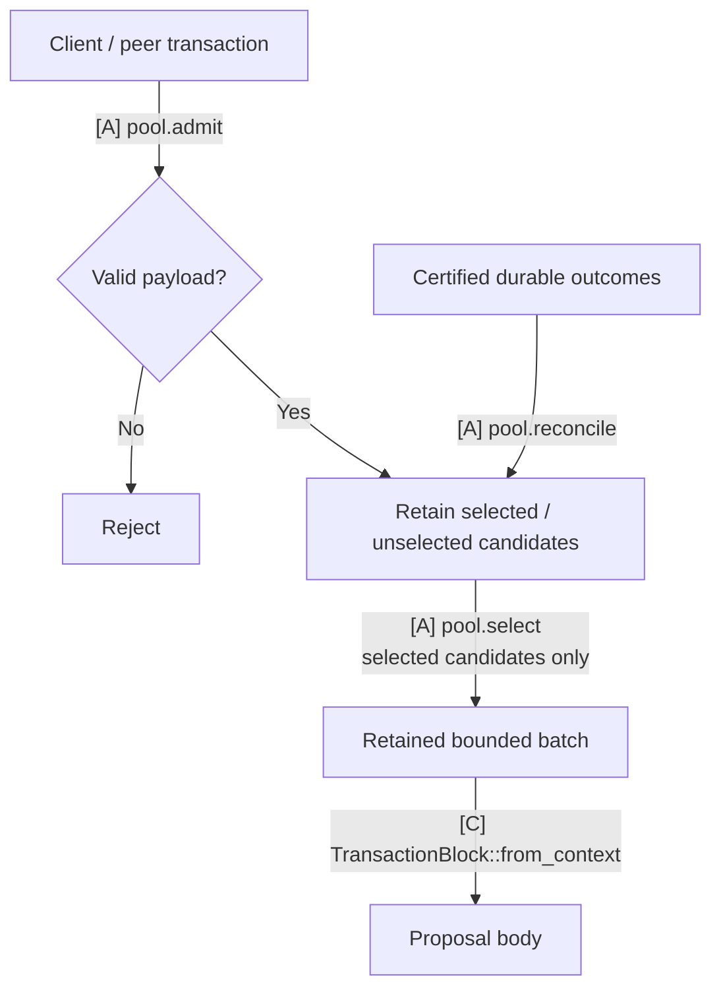

# TxPool: admission and selection

**TxPool retains transactions and supplies bounded batches for local proposals.** It owns admission, selected/unselected classification, duplicate handling and canonical maintenance. App callbacks call its concrete operations; these do not require a public TxPool trait.

## Transaction lifecycle

[Open full-size diagram](../assets/diagrams/diagram-27.svg) · [PNG](../assets/diagrams/diagram-27.png)

Selection preserves the chosen bytes. Canonical maintenance follows durable outcomes, so selecting or proposing a transaction does not retire it.

## Communication interfaces

| Direction | Call or value | Completion means |
|---|---|---|
| Client/peer ingress → TxPool | `pool.admit(tx, source)` → `Admission` | Bounded input validated and retained as selected/unselected, or rejected |
| App propose handler → TxPool | `pool.select(ctx, limits)` → `RetainedBatch` | Stable selected bytes fit dependency, count, work and full-body limits |
| App durable-outcome handling → TxPool | `pool.reconcile(applied_outcomes)` | Exact applied outcomes reconciled with the chosen backend |

These concrete calls are defined in the [communication reference](../04-reference/01-communication-contracts.md#private-pool-and-execution-calls). The [App callback](04-app-coordination.md#automatonpropose-pool-to-staged-block) packs selected bytes into a producer block. Pool selection never substitutes for canonical inclusion.

Admission verifies encoding, signature/domain and chosen stateless rules, then applies payload-based policy. Both RPC and peer paths use the same classification. Selected candidates may enter local batches. Valid unselected candidates remain only for the chosen retention/propagation policy. Invalid input is dropped. These classes need no second pool, actor or physical connection. Static classification uses immutable payload facts; live balances, canonical nonces and node load belong to separate readiness checks.

Selection uses the supplied Multimmit producer context. Its `parent` is a producer-header parent, not the application execution checkpoint or current canonical state. Dependency-aware packing cannot bypass an excluded required predecessor. Bound visited work and encoded body bytes as well as returned transaction count. Retain the selected bytes so proposal cancellation, pool replacement or concurrent admission cannot change a constructed body's commitment. Selection alone does not retire a transaction canonically.

Local pool membership, selection and readiness govern this node's proposals; peer or canonical blocks are validated under the agreed payload rules without requiring their transactions to have been locally admitted or selected.

The [proposal flow diagram](04-app-coordination.md#automatonpropose-pool-to-staged-block) shows selection → block construction → staging → body-digest reply.

This is App-internal proposal code. Follow the canonical [verify handler](04-app-coordination.md#automatonverify-validity-custody-and-scheduling) and [Update handler](04-app-coordination.md#marshal-reportupdate-canonical-input-and-ack) for scheduling, reconciliation and ACK. Pool maintenance consumes recoverable durable outcomes; it adds no required pool-processing ACK to canonical delivery or native consensus. Reconcile missed maintenance before relying on the backend's readiness state.

Transaction ID, body digest and native header digest identify different objects. Maintain selected bytes → body → exact header/context → applied output correspondence.

## Connect one existing backend

The chosen backend must preserve stable proposal bytes, dependency-aware selection and reconciliation from durable outcomes. Backend choice, transaction codec/identity, duplicate semantics, static policy, quotas and physical retention remain open.

The [pool backend survey](../04-reference/04-pool-backends.md#backend-operation-mapping) compares Nunchi, Reth and Constantinople operations and their integration limits. Read it when selecting an implementation; the communication contract above applies to each candidate.
