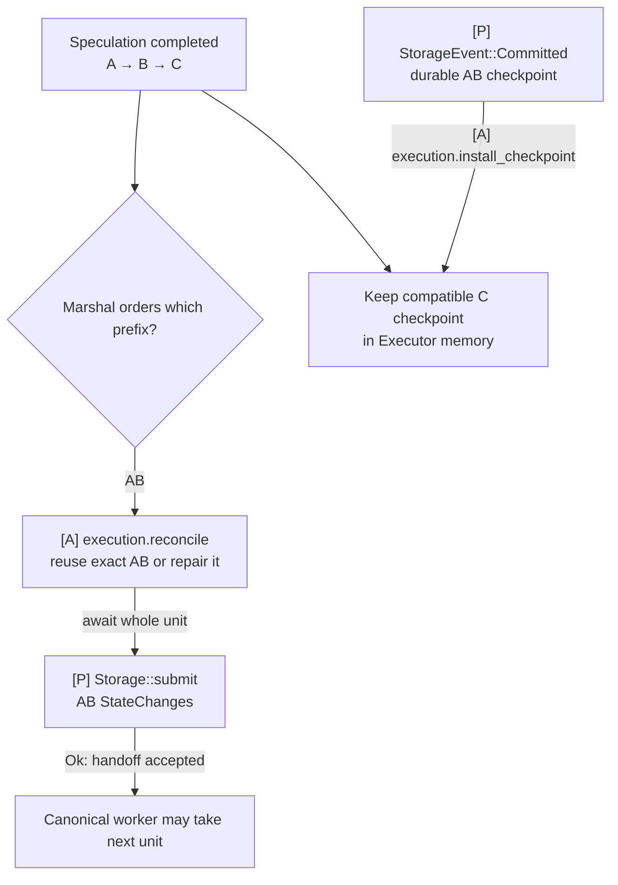
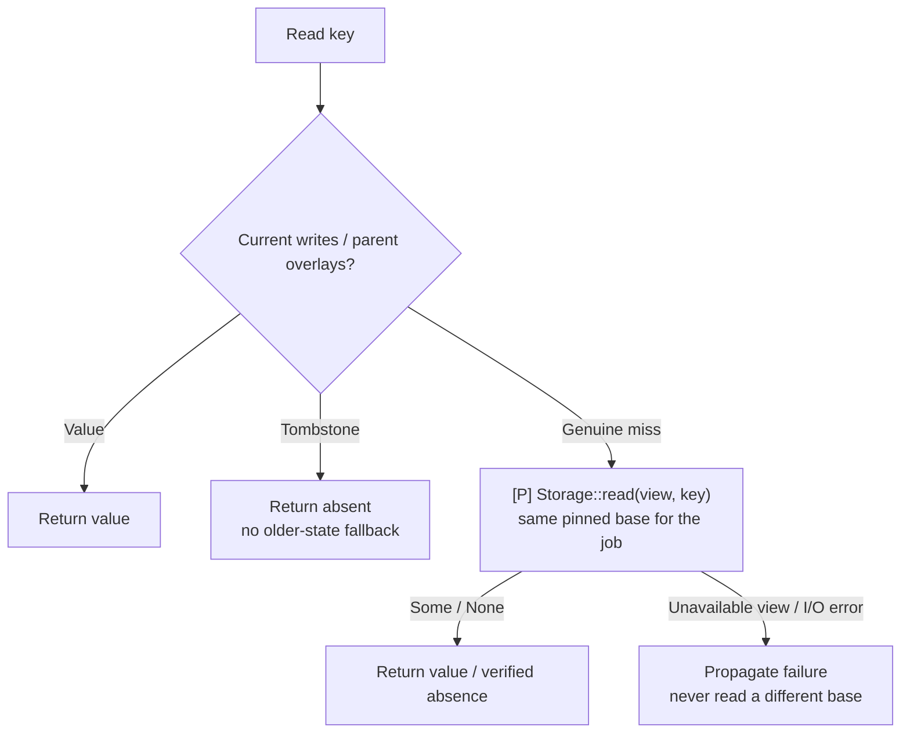

# Executor: execution and checkpoints

**Executor computes transactions, manages in-memory checkpoints and certifies execution results.** App coordination supplies jobs and canonical input; Storage supplies pinned cold state and certified durable checkpoints. PreCut and Baton use the same Executor behavior.

## Execution, submission and memory

[Open full-size diagram](../assets/diagrams/diagram-29.svg) · [PNG](../assets/diagrams/diagram-29.png)

The canonical worker waits through execution and Storage acceptance. Root preparation, f+1 certification and flush complete separately; compatible descendants remain usable.

Native Multimmit's private `AppExecutor` runs `Automaton::propose/verify` callbacks. The App Executor described here is the transaction-computation responsibility inside App.

## Roles and responsibilities

| Responsibility | Owned state or work |
|---|---|
| Execute an exact-parent job | Transaction computation and in-memory effects on the assigned valid checkpoint |
| Retain reusable work | Checkpoints and StateChanges bound to exact input, parent, runtime and local attempt |
| Reconcile finalized input | Reuse matching work, finish missing work or repair the differing suffix |
| Certify results | Bind Storage-prepared state roots to direct execution and exact ordering; sign, collect and verify matching `f+1` evidence before requesting Storage commit |
| Install durable progress | Adopt Storage's usable checkpoint, skip covered input and retire conflicting attempts |
| Release memory safely | Preserve compatible descendants and retain overlays/views while workers or references need them |

Alignment selects work; the App owner rechecks and claims the attempt before launch. Storage prepares roots and persists state. Result processing is part of Executor: it signs, collects and verifies evidence, then requests commit. The [App owner](04-app-coordination.md) retains Update ACK tokens and coordinates these independent completions.

## Communication interfaces

| Direction | Call or value | Completion means |
|---|---|---|
| App dispatch → Executor | `execution.execute(job)` → `ExecutionOutcome` | Exact-parent StateChanges, or failure/cancellation; no persistent write |
| App canonical owner → Executor | `execution.reconcile(input, canonical_base)` → `StateChanges` | Effects for the required ordered unit, reusing or repairing prior work |
| Executor → Storage | `Storage::read(view, key)` | Value or absence at the exact pinned base; unavailable views and I/O failures are errors |
| Executor → App owner → Storage | StateChanges + bound `ExecutedRange`, then `Storage::submit(...).await` | The canonical worker completes the unit's execution-to-storage handoff only after Storage accepts it; flush timing belongs to Storage |
| Storage → Executor, through App routing | `StorageEvent::Prepared(prepared)` | State root and result commitments for signing against retained direct-execution evidence |
| Executor → Storage | `Storage::commit(verified)` | Accept a commit request after Executor completes `f+1` verification; durability arrives later |
| Storage → App owner → Executor | `StorageEvent::Committed(applied)`, then `execution.install_checkpoint(applied.checkpoint)` | Install a certified durable base and skip its covered input |

`execute`, `reconcile` and `install_checkpoint` are concrete App operations described in the [communication contracts](../04-reference/01-communication-contracts.md#private-pool-and-execution-calls). The shared owner binds changes to accepted job metadata before submission. Storage receives StateChanges rather than an Executor memory checkpoint, root or database batch.

## Execution-to-Storage completion

For each direct canonical unit, the App canonical worker awaits all required execution or exact-result reuse, then awaits `Storage::submit(executed, changes)`. Only `Ok(())` completes this handoff and lets that worker advance to the next ordered unit. Computation finishing or placing changes in an intermediate App queue does not complete it. Pending or rejected submission keeps the unit and its retryable changes retained; storage-instance failure requires recovery.

For speculative ABC with only AB finalized, reconcile all of AB and await Storage's acceptance of AB's changes. Keep C in memory. After acceptance, the canonical worker can process the next ordered unit without waiting for root preparation, certification or disk flush. Existing compatible speculation is retained independently.

This is a sequential async operation in the canonical worker. The App event loop, native callbacks and Storage event intake remain serviceable while it waits. There is no new `Executor::flush` method or change to ordering-only `Alignment::commit`. Memory reclamation still follows durable checkpoint installation and safe reference release.

## Exact parents and reusable work

Execution jobs carry the exact input block plus the execution checkpoint selected by the scheduler. A producer's `Context.parent` identifies that lane's previous header. It cannot identify the predecessor in the merged execution sequence. The same body after different prefixes needs different execution identity. Bind completed work to canonical base, application/runtime/rule version and exact prior inputs; the concrete encoding remains open.

Candidate metadata identifies the exact block; an execution attempt also identifies its chosen path and parent. A duplicate candidate notification does not launch another copy of an active attempt. Repair on a different exact parent remains distinct work.

Preserve completed/current `F` and sort only pending eligible inputs. A state-dependent child starts when the valid predecessor checkpoint is ready. Missing/unfinished parents leave work pending. A new arrival does not cancel or relabel started work; a new canonical Update may require exact-parent repair. [Scheduling rule](07-alignment.md#global-rule-for-local-execution-and-reports).

## Cold reads and checkpoint installation

[Open full-size diagram](../assets/diagrams/diagram-55.svg) · [PNG](../assets/diagrams/diagram-55.png)

Read current and parent overlays first, including tombstones. Only a genuine miss calls `Storage::read` against the retained base view. A failed or unavailable read never means absent data and never switches the job to a newer base. Failure/cancellation cannot produce a reusable completed checkpoint.

Accept completion once for the current attempt/context/ancestry; stale results cannot attach to the execution tree. Dropping a waiter does not necessarily stop its worker. Reclaim resources only after termination or reference release makes that safe.

For a durable ABC checkpoint while local work is at A, installation skips B/C and makes ABC available as the parent for later work. Check identity and read access, reject conflicting checkpoints and never rewind to an older base. Retire covered/conflicting attempts, ignore late completions and preserve compatible descendants without applying covered changes twice. Installation adds no ACK round. The [checkpoint handoff contract](../04-reference/01-communication-contracts.md#checkpoint-handoff-and-execution-skipping) defines the full retention rules.

## Execution effects and storage roots

Executor produces exact StateChanges on memory overlays. [Storage](09-storage.md) materializes selected effects into concrete QMDB batches, prepares deterministic commitments and controls physical persistence. Retain effects still needed by branches before a root-preparation operation consumes its only draft. Existing sealed-parent forks are usable; root-deferred branching needs its own App integration. See the [QMDB reference](../04-reference/03-qmdb.md).

The full `commonware_glue::stateful::Application` lifecycle is optional reference material. Its [mailbox](https://github.com/0xEyrie/monorepo/blob/6233438985d8249d2b2bc1204191d5d405652288/glue/src/stateful/actor/core/mailbox.rs#L8) targets the block/ancestry `commonware_consensus::Application` and Simplex Marshal contracts. Multimmit uses different callbacks; concrete DB utilities can be reused independently.

## Result certification and state sync

[Executor result certification](10-result-processing.md) combines accepted direct-execution evidence with Storage-prepared commitments and peer signatures. Executor validates matching `f+1` evidence before requesting Storage commit for direct or imported results. While certification is pending, valid private execution may continue; canonical state and ACK do not advance.

[State sync](11-state-sync.md) supplies the same durable checkpoint handoff. Imported work retains its provenance and cannot produce the node's own direct-execution signature. Later work executed directly from that checkpoint may be signed.

## Open decisions

| Item | Decision |
|---|---|
| Application transaction semantics | |
| QMDB variant / state encoding / result root | |
| Deterministic canonical operation and batch boundaries | |
| Root-deferred effects/read representation and checkpoint policy | |
| Execution identity / parent binding / checkpoint granularity | |
| Worker placement / cancellation / access-fencing contract | |
| Recoverable linkage of state / outputs / applied position / provenance | |
| Branch retention / memory / disk budgets | |
| Query / result material / certified state-sync protocol | |

## Commonware primitives in the execution layer

| Reused mechanism | App responsibility still required |
|---|---|
| QMDB and concrete `glue::stateful::db` utilities | Transaction semantics, exact execution ancestry and deterministic selected commitment |
| Runtime `Spawner`, `Strategizer`, existing future pools | Placement/work bounds and context-checked completion; a future pool alone does not bound work |
| Crypto signatures/certificates and typed P2P | Full execution subject, eligible distinct signers, `f+1` and direct/imported provenance |
| QMDB sync plus resolver | Trusted execution target, compatible material and active-validator writer handoff |
| Existing journal/metadata/barriers | App state/output/applied-index/certificate crash consistency; Marshal separately owns its delivery cursor |

The [source catalog](../04-reference/07-development-order.md#primitive-reuse-catalog) and [QMDB page](../04-reference/03-qmdb.md) distinguish current source from older reuse investigations. No transaction backend, result protocol, runnable scheduler or benchmark is implemented by this documentation.
