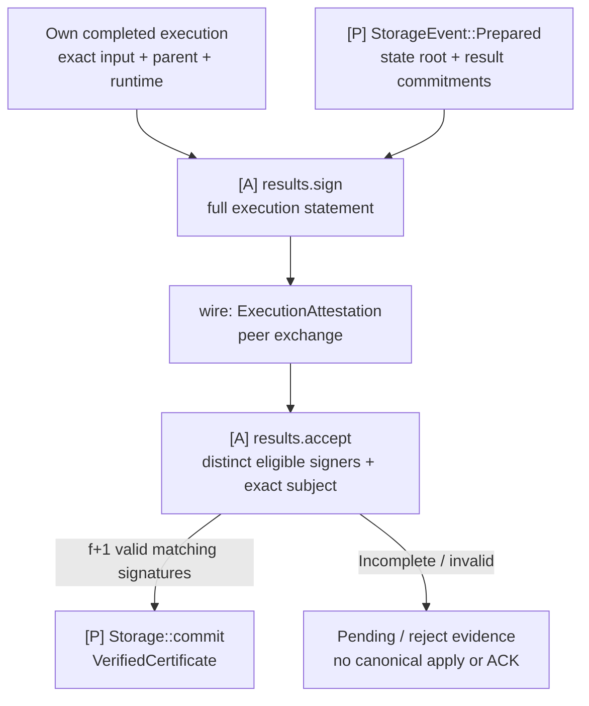
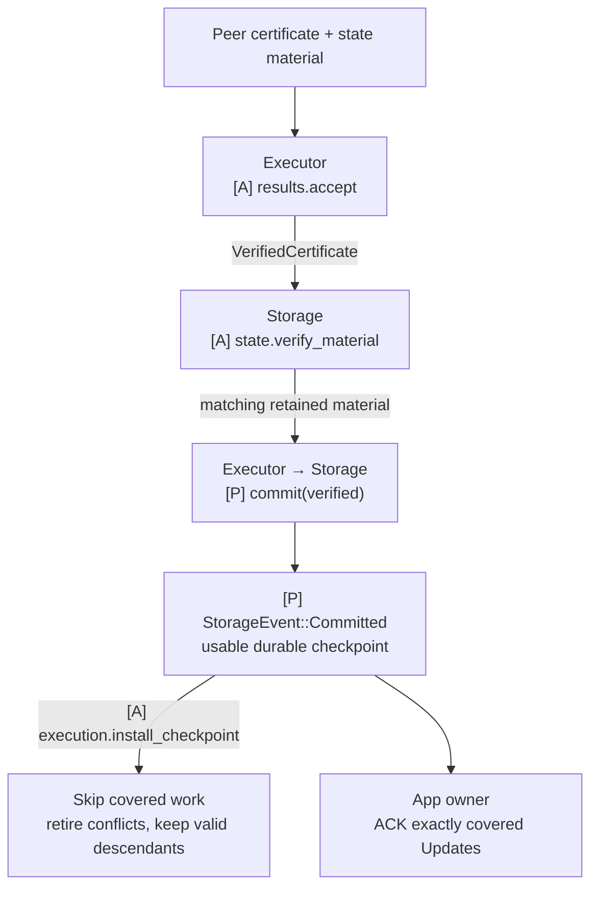

# Result certification and state sync

**Direct execution and certified state import share one Executor–Storage path.** Executor verifies `f+1` execution certificates and requests `Storage::commit(verified)`; Storage persists matching material and returns a usable checkpoint. Executor installs that checkpoint, and the App owner ACKs covered Updates.

Follow [result certification](#result-certification-inside-executor), then [state import and checkpoint installation](#state-sync-from-certified-execution-results). The latter can skip local execution while retaining the same verification and durability requirements.

## What Executor certifies

[Open full-size diagram](../assets/diagrams/diagram-31.svg) · [PNG](../assets/diagrams/diagram-31.png)

Certification belongs to Executor. A root alone is insufficient: signatures bind the same epoch, exact ordered range, canonical base, runtime and full result.

## Responsibilities

| Owner | Responsibility |
|---|---|
| Executor | Bind direct execution to the complete result, sign, collect and verify matching `f+1` evidence; install certified durable checkpoints |
| Storage | Prepare roots, verify and retain matching state material, and persist through the same canonical writer for direct work and imports |
| App owner | Retain Update tokens, route completions and checkpoints, coordinate import/recovery transitions, and ACK only certified durable input |

Result processing stays inside Executor. State import uses the existing Storage ownership and checkpoint handoff; neither needs a separate service or public trait. Retain original evidence and serving obligations, and preserve direct-versus-imported provenance.

## Communication interfaces

| Direction | Call, event or value | Completion means |
|---|---|---|
| Executor computation → its result processing | Accepted direct `ExecutionOutcome` and its exact job context | Local computation evidence; it still needs irrevocable input and prepared commitments before signing |
| Storage → Executor result processing, through the owner | `StorageEvent::Prepared(prepared)` | Commitments/material for the selected unit; no canonical durability yet |
| Executor result processing → peer Apps | `ExecutionAttestation(statement, signature)` | Own signature created locally for directly executed, fully bound work |
| Peer Apps → Executor result processing | `ExecutionAttestation` or `ExecutionCertificate` | Local validation yields `VerifiedCertificate`, pending or invalid after full-subject and signer checks |
| App import handling → Storage | `state.verify_material(verified, material, base)` | `PreparedImport`, pending or invalid; matching material retained for a later commit request |
| Executor → Storage | `Storage::commit(verified)` | Locally verified result accepted for persistence; durable completion arrives separately as `StorageEvent::Committed` |
| Storage → App owner | `StorageEvent::Committed(applied)` | State, outputs, applied identity and original certificate evidence are recoverable |
| App owner → Executor | `execution.install_checkpoint(applied.checkpoint)` | Adopt a usable durable base, skip covered work and retire conflicts |
| App owner → Marshal | `update.acknowledgement.acknowledge()` | Exactly covered delivery acknowledged after certified App durability |

`results.sign(statement, direct_evidence)` and `results.accept(evidence, canonical_context)` are local private helpers behind those exchanges. `state.verify_material` belongs to concrete Storage integration and `execution.install_checkpoint` to Executor; they are not new trait methods. Peer messages are logical content with open codecs. See the [detailed result contract](../04-reference/01-communication-contracts.md#private-result-import-and-lifecycle-calls) and [message catalog](10-networking.md#messages-used-in-diagrams).

Execution and persistence use the [Executor](07-executor.md) and [Storage](08-storage.md) contracts. The App owner retains each Update and records `Alignment::commit` immediately, then drives independent execution, certification and durability. Follow the [E2E canonical sequence](../03-e2e/06-ordered-application.md) for their timing, the [certification sequence](../03-e2e/07-result-certification.md) for peer exchange and [state import](../03-e2e/08-state-import.md) for checkpoint handoff. PreCut and Baton share this path; reports and directions never gate it.

## Result certification inside Executor

Executor result-message handlers use existing authenticated P2P and crypto directly. Baton report/direction handling does not relay or gate execution certificates, state sync or apply.

A direct signer requires its own completed execution/validation evidence, a prepared full result commitment, irrevocable exact input and the correct canonical input state. Bind epoch, range, exact ordered inputs, canonical base, runtime/rule and selected result/output/material commitments. Local worker generations and writer permits are not stable shared signature fields. Advisory speculative order alone does not satisfy the signing condition.

Collect signatures only after validating the full subject, eligible epoch identity and signature. Count each identity once. State finalization requires `f+1` distinct matching signatures plus verified irrevocable order and canonical input-state linkage. That verified certificate is also a prerequisite for canonical state application and the covered Marshal ACKs. Eligible result signers need not belong to the particular ordering QC. Fewer signatures keep application pending while native consensus and valid private execution continue. A root alone or transport response count is insufficient. A certificate for a different result cannot authorize local effects; retain the certified result's matching material or recover the mismatch.

An imported verified result retains imported provenance. The app may relay/serve the original certificate; it cannot issue its own direct-execution signature for work merely imported. Recovery without direct-execution evidence cannot recreate that authority. It can directly execute and sign a subsequent range from the imported canonical checkpoint. Certification, material availability and local durable/read readiness remain separate milestones.

Per-block/per-chunk boundaries, statement codec/domain, result-root scheme, keys, serving/retention and result-switch policy remain open. A longer-range certificate cannot be sliced into a shorter-range certificate.

### Certification units and delivery progress

A certification unit is a bounded continuous ordered range with an exact start base and certified terminal result; its concrete boundaries remain open. All inputs needed to certify the next unit must be obtainable within the active `max_pending_acks` capacity at the participating signers, including after restart or a floor transition. Validate that compatibility during assembly; otherwise waiting for more Updates while withholding every ACK creates a delivery deadlock. Short partial units are valid only if their boundary is part of the common signing policy. Do not solve a full window by ACKing uncertified input.

Within a multi-block unit, compute successive blocks on private exact-parent checkpoints without awaiting per-block canonical application. Prepare and sign the unit's terminal result before the writer applies it; requiring application before signing would create a circular wait. Apply the whole certified unit and then ACK its covered Updates. A terminal certificate cannot be sliced to authorize an intermediate checkpoint unless the authenticated statement explicitly certifies that boundary. This permits bounded range signing without requiring per-block signatures.

Persist the certificate, exact subject and required verification context with the recoverable applied record, or a durable reference whose evidence remains available. On restart, Executor revalidates the recovered certificate and exact context; Storage confirms matching material and durable records before publishing readiness or ACKing replay. Body custody and private work storage may persist earlier; they do not advance the certified canonical applied position. Result certification, canonical durability and Marshal's cursor durability remain distinct sequential conditions.

## Import to checkpoint handoff

Certified state import is available during normal validator execution as well as recovery. Executor verifies the peer certificate; Storage verifies and retains matching material before the shared commit and checkpoint handoff.

[Open full-size diagram](../assets/diagrams/diagram-32.svg) · [PNG](../assets/diagrams/diagram-32.png)

Continue direct work while a certificate or applicable material is missing. A certificate arriving before the matching irrevocable input remains pending or prompts ordering recovery; it cannot settle unresolved order. Stop or fence unfinished direct execution only after both the certificate and usable material have been verified and the canonical writer can safely adopt the target.

### Import checks and completion

| Stage | App checks | Result |
|---|---|---|
| Execution certificate | `f+1` distinct eligible epoch validators on the same exact input/range, canonical base, runtime/rule and complete result | Authenticated execution target |
| Imported material | State delta/checkpoint and outputs match the target and correct local predecessor | Applicable candidate material |
| Canonical handoff | Recheck the current predecessor and writer authority after async preparation; shared fences; no partial local branch used as another delta's base | Authorized app-state transition |
| Durability | State, outputs, applied identity, certificate evidence and imported provenance recover together | Certified durable canonical checkpoint; covered Updates may be ACKed |
| Checkpoint handoff | Storage emits `Committed` with exact prefix/runtime/state identity and a usable pinned view; App owner forwards it | Executor installs the base, skips covered input and retires incompatible memory work |
| Later execution | Direct execution from the installed checkpoint | Own result/signature for that later range |

Material format and switching policy remain open; imports preserve the [certification requirements](#result-certification-inside-executor) above.

For a certified durable ABC target while local Executor is at A, `execution.install_checkpoint(ABC)` skips B/C and makes ABC the parent for D. The checkpoint must contain usable state access, not just a digest or numeric position. Check exact prefix/context before removing work; reject stale/conflicting completions after installation. A missing certificate, missing material or failed apply cannot produce this handoff. The [checkpoint contract](../04-reference/01-communication-contracts.md#checkpoint-handoff-and-execution-skipping) also governs direct commits and recovery. Marshal ACK requires certified durability, not a second ACK from Executor.

## Coordinate the app checkpoint with Marshal

Marshal's floor/progress describes native ordered delivery, not the app's execution result. `floor_at` and `install_floor` reuse native proof and delivery recovery; they do not fetch/validate/apply QMDB state. Authenticate the exact floor-to-app-checkpoint relationship and make the app target durable before authorizing delivery to resume beyond it. Do not advance Marshal over application work merely because a certificate or storage progress notification arrived. [Marshal floor APIs](https://github.com/0xEyrie/monorepo/blob/6233438985d8249d2b2bc1204191d5d405652288/consensus/src/multimmit/marshal/mailbox.rs#L450).

For a fresh namespace, `Start::Floor { floor_generation, floor }` requires the caller to authenticate the floor's anchor with the existing epoch L-QC verifier and bind its emitted frontier and positive monotone `floor_generation` to the imported App snapshot before opening Marshal. This is an existing startup field, distinct from App worker generations; `Floor` and `Update` themselves carry no generation field. Opening checks structure; the verifier passed later to `Service::start` does not authenticate that startup choice retroactively. For a peer-served floor, use `Start::Genesis` followed by the verifying `install_floor` path. [Existing startup contract](https://github.com/0xEyrie/monorepo/blob/6233438985d8249d2b2bc1204191d5d405652288/consensus/src/multimmit/marshal/config.rs#L163).

An in-flight floor change replaces the delivery generation and clears Marshal's previous pending window. The App may still retain old Updates, so `max_pending_acks` alone does not bound queued work across repeated resets. Coordinate each floor transition with App intake, reconcile old exact indices/blocks and bound any overlap before accepting the new window. `Update` carries no generation field; use App-owned transition state rather than inventing an upstream flag. Concrete cross-store switching and recovery sequencing remains implementation work. [Delivery reset](https://github.com/0xEyrie/monorepo/blob/6233438985d8249d2b2bc1204191d5d405652288/consensus/src/multimmit/marshal/actors/delivery/actor.rs#L423).

State installation refreshes the shared execution view; it is not a second notification of already-known ordering. An authenticated native floor that advances known ordering must reconcile that prefix through the same idempotent Alignment ordering contract. See [canonical application](../04-reference/03-qmdb.md#commit-a-branch-to-canonical-state).

## Reuse certificate building blocks

| Existing mechanism | Reuse | App check still required |
|---|---|---|
| `p2p::utils::codec` typed wrappers | Encode/decode existing authenticated sender/receiver traffic | Bounded codec, full statement, original eligible signer identities |
| Crypto `Subject`, `Attestation`, `Scheme`, `Signers` | Domain/message definition, signing, signature verification and packaging | Exact input/base/runtime/result interpretation and distinct eligible `f+1` |
| Optional buffered broadcast | Share/cache an identified certificate or material object | Cache key identifies the object; different attestations cannot all overwrite one statement digest |
| Optional collector | Solicit request-bound peer responses | Its count is transport responses before app validation, not valid signer count |

Current source: [certificate APIs](https://github.com/0xEyrie/monorepo/blob/6233438985d8249d2b2bc1204191d5d405652288/cryptography/src/certificate.rs), [typed transport](https://github.com/0xEyrie/monorepo/blob/6233438985d8249d2b2bc1204191d5d405652288/p2p/src/utils/codec.rs), [collector response handling](https://github.com/0xEyrie/monorepo/blob/6233438985d8249d2b2bc1204191d5d405652288/collector/src/p2p/engine.rs#L190).

`Scheme::assemble` packages supplied attestations; it does not replace signature verification. Validate and deduplicate roster indices before constructing signer sets. Decode peer certificates with the selected epoch verifier's bounded `certificate_codec_config`, not its unbounded trusted-storage configuration. Keep a bounded execution-statement envelope because primitive attestation/certificate data does not supply our exact execution context. Scheme-specific proof-of-possession and original-signature provenance requirements still apply.

`N5f1::quorum(n)` computes `n-f`, or `4f+1` for `n=5f+1`; this is not the execution-result threshold. Multimmit also has distinct DA and nullification threshold sharings, not an existing `f+1` result-signing role. Select compatible certificate/key material and quorum handling, or use lower-level signature/bitmap primitives while enforcing `f+1` in app assembly and verification. A quorum adapter cannot lower an existing BLS sharing's polynomial threshold. No new native quorum or result-signing format is adopted. [Current fault model](https://github.com/0xEyrie/monorepo/blob/6233438985d8249d2b2bc1204191d5d405652288/utils/src/faults.rs), [native key roles](https://github.com/0xEyrie/monorepo/blob/6233438985d8249d2b2bc1204191d5d405652288/consensus/src/multimmit/scheme/bls12381_threshold/mod.rs#L3), [BLS threshold compatibility](https://github.com/0xEyrie/monorepo/blob/6233438985d8249d2b2bc1204191d5d405652288/cryptography/src/bls12381/certificate/threshold/mod.rs#L92).

## Reuse Commonware material transport and proof validation

Use existing QMDB sync and its authenticated operation proofs beneath the app target checks. No new general state-transfer service is needed. Current source explicitly treats the sync target as caller-trusted: peer data is verified against it, but sync neither selects nor authenticates the target. [Sync trust model and entry point](https://github.com/0xEyrie/monorepo/blob/6233438985d8249d2b2bc1204191d5d405652288/storage/src/qmdb/sync/mod.rs).

| Existing mechanism | Supplies | App connection |
|---|---|---|
| `qmdb::sync::Source` plus DB P2P/resolver | Operation/material requests, proofs and serving | Bind peer material to the authorized target/history and retained outputs |
| `qmdb::sync::sync(Config)` | Opens/reconstructs a DB for a target and verifies retrieved material | Own candidate storage and verify complete execution result before adoption |
| Target updates | Strictly advancing targets on one append-only history | Establish that shared authenticated history; numeric progress alone is insufficient |
| `glue::stateful::db` sync helpers | Existing selected-DB assembly and one-time bootstrap references | Add the app's active-validator handoff; no full Stateful actor dependency |
| Current `OpsRootWitness` | Verifies the relationship of an operations root to a Current canonical root | Bind the trusted result root to the exact execution certificate |

A standard QMDB `Target` contains an operations root and range. It is not an execution certificate. `Target::advances` assumes both targets belong to the same valid append-only history. Current's canonical root differs from its operations root; when Current fits the selected scheme, reuse `ops_root_witness()` and `OpsRootWitness::verify` for that relationship. The app still authenticates the execution target. [Target](https://github.com/0xEyrie/monorepo/blob/6233438985d8249d2b2bc1204191d5d405652288/storage/src/qmdb/sync/target.rs#L11), [Current witness](https://github.com/0xEyrie/monorepo/blob/6233438985d8249d2b2bc1204191d5d405652288/storage/src/qmdb/current/proof/mod.rs#L125).

Use a fresh sync session for a chosen target or compatible advancing targets within one session; the policy remains open. A reached-target notification is progress. Receive the completed reconstructed/persisted DB and verify its exact certificate-authorized result/outputs before publishing app readiness or ACKing Updates. With an advancing session, bind the final target rather than relying on an earlier notification. [Current engine completion](https://github.com/0xEyrie/monorepo/blob/6233438985d8249d2b2bc1204191d5d405652288/storage/src/qmdb/sync/engine.rs#L691).

Sync opens configured storage and may discard/ignore journal material outside its target range. Preparing a candidate concurrently with direct execution requires separate storage ownership. Two handles to the same live partitions are not isolated candidates. An exclusive same-store handoff requires a fence before mutation. For Current, the retained operation range must start at or below the target's `sync_boundary()`; the next execution range is not that storage boundary. [Journal initialization contract](https://github.com/0xEyrie/monorepo/blob/6233438985d8249d2b2bc1204191d5d405652288/storage/src/qmdb/sync/journal.rs#L21), [Current range requirement](https://github.com/0xEyrie/monorepo/blob/6233438985d8249d2b2bc1204191d5d405652288/storage/src/qmdb/current/sync/mod.rs#L152).

The DB P2P mailbox can serve as the existing Source. `attach_database` enqueues a serving replacement; it does not acknowledge writer handoff or completed serving readiness. Existing in-progress reads may retain the prior handle. Validate exact selected native DB/codec bounds when assembling it; app execution subjects and outputs remain separately bound. [DB P2P mailbox](https://github.com/0xEyrie/monorepo/blob/6233438985d8249d2b2bc1204191d5d405652288/glue/src/stateful/db/p2p/mailbox.rs#L161).
