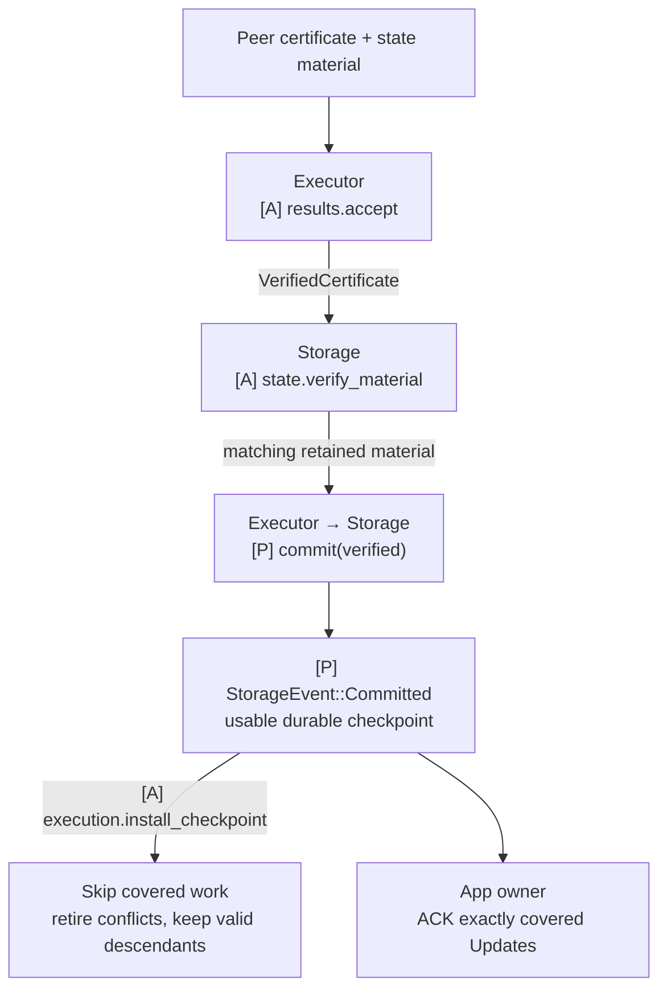

# State sync: certified checkpoint handoff

**Storage can finish canonical work by importing a verified peer result and handing its checkpoint to Executor.** This is an option during normal validator execution as well as recovery. It uses the same storage ownership, applied-state identity and canonical writer as direct work. The PreCut/Baton scheduler does not approve or relay the transfer.

## Import to checkpoint handoff

[Open full-size diagram](../assets/diagrams/diagram-32.svg) · [PNG](../assets/diagrams/diagram-32.png)

Invalid or incomplete evidence/material cannot advance state. Imported work retains its provenance and cannot become this node’s own direct-execution signature.

Continue direct work while a certificate or applicable material is missing. A certificate arriving before the matching irrevocable input remains pending or prompts ordering recovery; it cannot settle unresolved order. Stop or fence unfinished direct execution only after both the certificate and usable material have been verified and the canonical writer can safely adopt the target.

## Responsibilities and communication

Executor authenticates the target, Storage verifies/retains material and owns the writer, the App owner coordinates Update tokens, and Executor installs the checkpoint. `state.verify_material` is a concrete Storage integration helper; `Storage::commit` accepts Executor-verified authority and `StorageEvent::Committed(applied)` publishes durable completion. These are the same [Storage connections](09-storage.md#communication-interfaces) used by direct execution.

| Stage | App checks | Result |
|---|---|---|
| Execution certificate | `f+1` distinct eligible epoch validators on the same exact input/range, canonical base, runtime/rule and complete result | Authenticated execution target |
| Imported material | State delta/checkpoint and outputs match the target and correct local predecessor | Applicable candidate material |
| Canonical handoff | Recheck the current predecessor and writer authority after async preparation; shared fences; no partial local branch used as another delta's base | Authorized app-state transition |
| Durability | State, outputs, applied identity, certificate evidence and imported provenance recover together | Certified durable canonical checkpoint; covered Updates may be ACKed |
| Checkpoint handoff | Storage emits `Committed` with exact prefix/runtime/state identity and a usable pinned view; App owner forwards it | Executor installs the base, skips covered input and retires incompatible memory work |
| Later execution | Direct execution from the installed checkpoint | Own result/signature for that later range |

Imported material remains imported. The app can relay the original certificate; it cannot sign the imported range as its own direct execution. Recovery that lacks direct-execution evidence cannot recreate that signing authority. State finalization, material availability and local durable/read readiness remain separate milestones. Result statement boundaries, codec, roots, material format and switching policy remain open.

For a certified durable ABC target while local Executor is at A, `execution.install_checkpoint(ABC)` skips B/C and makes ABC the parent for D. The checkpoint must contain usable state access, not just a digest or numeric position. Check exact prefix/context before removing work; reject stale/conflicting completions after installation. A missing certificate, missing material or failed apply cannot produce this handoff. The [checkpoint contract](../04-reference/01-communication-contracts.md#checkpoint-handoff-and-execution-skipping) also governs direct commits and recovery. Marshal ACK requires certified durability, not a second ACK from Executor.

## Reuse Commonware material transport and proof validation

Use existing QMDB sync and its authenticated operation proofs beneath the app target checks. No new general state-transfer service is needed. Current source explicitly treats the sync target as caller-trusted: peer data is verified against it, but sync neither selects nor authenticates the target. [Sync trust model and entry point](https://github.com/0xEyrie/monorepo/blob/6233438985d8249d2b2bc1204191d5d405652288/storage/src/qmdb/sync/mod.rs).

| Existing mechanism | Supplies | App connection |
|---|---|---|
| `qmdb::sync::Source` plus DB P2P/resolver | Operation/material requests, proofs and serving | Bind peer material to the authorized target/history and retained outputs |
| `qmdb::sync::sync(Config)` | Opens/reconstructs a DB for a target and verifies retrieved material | Own candidate storage and verify complete execution result before adoption |
| Target updates | Strictly advancing targets on one append-only history | Establish that shared authenticated history; numeric progress alone is insufficient |
| `glue::stateful::db` sync helpers | Existing selected-DB assembly and one-time bootstrap references | Add the app's active-validator handoff; no full Stateful actor dependency |
| Current `OpsRootWitness` | Verifies the relationship of an operations root to a Current canonical root | Bind the trusted result root to the exact execution certificate |

A standard QMDB `Target` contains an operations root and range. It is not an execution certificate. `Target::advances` assumes both targets belong to the same valid append-only history. Current's canonical root differs from its operations root; when Current fits the selected scheme, reuse `ops_root_witness()` and `OpsRootWitness::verify` for that relationship. The app still authenticates the execution target. [Target](https://github.com/0xEyrie/monorepo/blob/6233438985d8249d2b2bc1204191d5d405652288/storage/src/qmdb/sync/target.rs#L11), [Current witness](https://github.com/0xEyrie/monorepo/blob/6233438985d8249d2b2bc1204191d5d405652288/storage/src/qmdb/current/proof/mod.rs#L125).

Use a fresh sync session for a chosen target or compatible advancing targets within one session; the policy remains open. A reached-target notification is progress. Receive the completed reconstructed/persisted DB and verify its exact certificate-authorized result/outputs before publishing app readiness or ACKing Updates. With an advancing session, bind the final target rather than relying on an earlier notification. [Current engine completion](https://github.com/0xEyrie/monorepo/blob/6233438985d8249d2b2bc1204191d5d405652288/storage/src/qmdb/sync/engine.rs#L691).

Sync opens configured storage and may discard/ignore journal material outside its target range. Preparing a candidate concurrently with direct execution requires separate storage ownership. Two handles to the same live partitions are not isolated candidates. An exclusive same-store handoff requires a fence before mutation. For Current, the retained operation range must start at or below the target's `sync_boundary()`; the next execution range is not that storage boundary. [Journal initialization contract](https://github.com/0xEyrie/monorepo/blob/6233438985d8249d2b2bc1204191d5d405652288/storage/src/qmdb/sync/journal.rs#L21), [Current range requirement](https://github.com/0xEyrie/monorepo/blob/6233438985d8249d2b2bc1204191d5d405652288/storage/src/qmdb/current/sync/mod.rs#L152).

The DB P2P mailbox can serve as the existing Source. `attach_database` enqueues a serving replacement; it does not acknowledge writer handoff or completed serving readiness. Existing in-progress reads may retain the prior handle. Validate exact selected native DB/codec bounds when assembling it; app execution subjects and outputs remain separately bound. [DB P2P mailbox](https://github.com/0xEyrie/monorepo/blob/6233438985d8249d2b2bc1204191d5d405652288/glue/src/stateful/db/p2p/mailbox.rs#L161).

## Coordinate the app checkpoint with Marshal

Marshal's floor/progress describes native ordered delivery, not the app's execution result. `floor_at` and `install_floor` reuse native proof and delivery recovery; they do not fetch/validate/apply QMDB state. Authenticate the exact floor-to-app-checkpoint relationship and make the app target durable before authorizing delivery to resume beyond it. Do not advance Marshal over application work merely because a certificate or storage progress notification arrived. [Marshal floor APIs](https://github.com/0xEyrie/monorepo/blob/6233438985d8249d2b2bc1204191d5d405652288/consensus/src/multimmit/marshal/mailbox.rs#L450).

For a fresh namespace, `Start::Floor { floor_generation, floor }` requires the caller to authenticate the floor's anchor with the existing epoch L-QC verifier and bind its emitted frontier and positive monotone `floor_generation` to the imported App snapshot before opening Marshal. This is an existing startup field, distinct from App worker generations; `Floor` and `Update` themselves carry no generation field. Opening checks structure; the verifier passed later to `Service::start` does not authenticate that startup choice retroactively. For a peer-served floor, use `Start::Genesis` followed by the verifying `install_floor` path. [Existing startup contract](https://github.com/0xEyrie/monorepo/blob/6233438985d8249d2b2bc1204191d5d405652288/consensus/src/multimmit/marshal/config.rs#L163).

An in-flight floor change replaces the delivery generation and clears Marshal's previous pending window. The App may still retain old Updates, so `max_pending_acks` alone does not bound queued work across repeated resets. Coordinate each floor transition with App intake, reconcile old exact indices/blocks and bound any overlap before accepting the new window. `Update` carries no generation field; use App-owned transition state rather than inventing an upstream flag. Concrete cross-store switching and recovery sequencing remains implementation work. [Delivery reset](https://github.com/0xEyrie/monorepo/blob/6233438985d8249d2b2bc1204191d5d405652288/consensus/src/multimmit/marshal/actors/delivery/actor.rs#L423).

The normal path is ordered Update → immediate `Alignment::commit(ordered)` and independent App Executor processing → exact-parent reuse/repair or verified import → Executor verifies matching `f+1` evidence and requests Storage commit → `Committed(checkpoint)` → ACK. Both scheduling modes share it. State installation refreshes the shared execution view; it is not a second notification of already-known ordering. An authenticated native floor that advances known ordering must reconcile that prefix through the same idempotent Alignment ordering contract. See [canonical application](../04-reference/03-qmdb.md#commit-a-branch-to-canonical-state) and [result certification](10-result-processing.md#result-certification-inside-executor).
