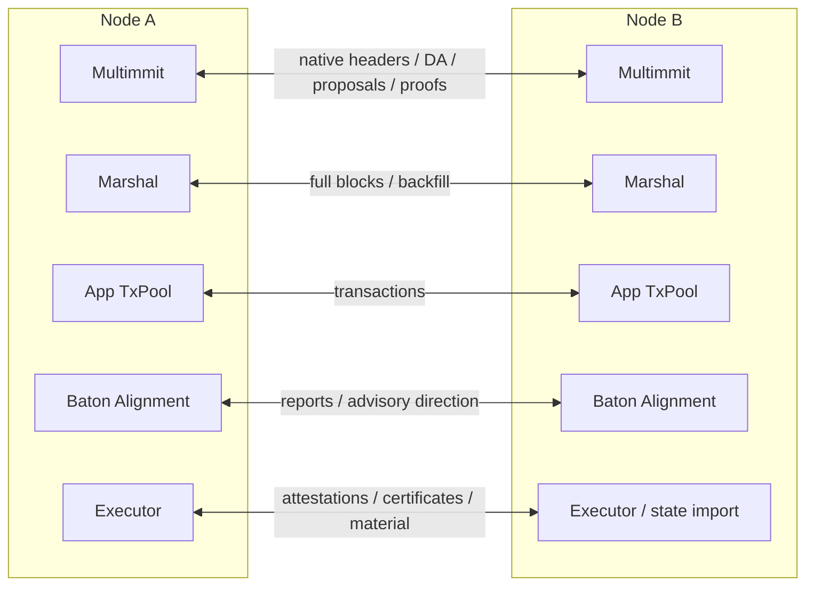

# P2P: channels and messages

**Reuse one Commonware network and the existing Multimmit/Marshal channels.** App transaction, report/direction and execution-result messages can use additional logical channels on that network. They need no second networking stack.

## Separate message planes

[Open full-size diagram](../assets/diagrams/diagram-33.svg) · [PNG](../assets/diagrams/diagram-33.png)

These are logical message owners; concrete App wire codecs and channel allocation remain open. Existing Commonware Sender/Receiver handles carry the traffic.

## Responsibility and communication

Commonware transport supplies authenticated peer connections and registered channels. Multimmit and Marshal own native message handling; App ingress, Baton policy and Executor result processing validate their own message content. Transport receipt establishes neither transaction admission, final ordering nor certified durability.

## P2P connections and message planes

| Plane | Payload | Current example channel |
|---|---|---|
| Native data | Signed producer headers, DA votes and DA certificates | `0` |
| Native consensus | Leader proposals, votes, no-votes and nullification messages | `1` |
| Native certificates | Nullification, V-QC and L-QC certificates | `2` |
| Native resolver | Native view proofs and recovery material | `3` |
| Marshal resolver | Exact block/history/certificate backfill | `4` |
| Marshal broadcast | Complete `TransactionBlock` values with header and body | `5` |
| App transactions | Bounded transaction messages / inventory according to selected pool policy | Undecided |
| App Baton reports / direction | Signed intended-order reports, window context and advisory direction | Undecided |
| App execution results / state sync | Exact statements, signatures, result certificates, material and queries | Undecided |

The first six IDs are an example node's assembly choices, not protocol-mandated IDs. Pre-cut has no Baton report/direction channel. Transport peer authentication does not establish application statement validity or epoch signer membership. Report, body and transaction floods still compete for processing and bandwidth; queues, quotas and runtime placement must keep native work serviceable.

## Reuse the existing network handles

The [current log-multimmit node](https://github.com/0xEyrie/monorepo/blob/6233438985d8249d2b2bc1204191d5d405652288/examples/log-multimmit/src/node.rs#L242) registers all channels with `network.register(channel, quota)`, starts the network, then starts Marshal and the App before opening Engine. The old example/signature mismatch recorded in historical reviews is not the current wiring.

| Connection | Existing mechanism | App responsibility |
|---|---|---|
| Complete block broadcast | `buffered::Engine` and Marshal's existing `Relay` | Define bounded body codec/digest and stage exact local blocks |
| Missing block/history retrieval | Generic resolver plus Marshal's `BackfillBridge` | Request exact references through Marshal; do not recreate a fetch/cache engine |
| Native activity → Marshal | Marshal `Mailbox` implements `Reporter<Activity>` | Compose with optional App observation using existing `Reporters` |
| Finalized blocks → App | App handle implements `Reporter<Update<TransactionBlock>>` | Retain every accepted Update, process in order, ACK after durable apply |
| Typed App P2P | Existing codec wrapping and registered channel handles | Bounded decode, schema, subject validation and per-message semantics |

Follow the [existing Marshal assembly](https://github.com/0xEyrie/monorepo/blob/6233438985d8249d2b2bc1204191d5d405652288/examples/log-multimmit/src/marshal.rs#L126) for buffer, resolver, service, verifier and Relay. These components already own their wire types. Raw channel pairs passed to them must use compatible public-key and runtime types; an extra typed wrapper is useful only for an actual App message loop.

`subscribe_block` establishes durable custody from local storage or buffered ingress and does not start an explicit peer fetch. `fetch_block` initiates retrieval through the existing resolver. Native headers and complete bodies travel independently, so header-first reception is expected. [Body exchange](../03-e2e/02-block-exchange.md)

`Relay::broadcast` returns local `Feedback`, not a remote receipt or custody ACK. Even `Ok` can mean that no matching staged block was found and nothing was sent. Reuse the existing Relay and its bounded staged lookup. [Relay implementation](https://github.com/0xEyrie/monorepo/blob/6233438985d8249d2b2bc1204191d5d405652288/consensus/src/multimmit/marshal/relay.rs#L107)

Provide usable App body access before `Engine::open` can issue recovered verify requests. Keep native and Marshal resolver channels distinct; application execution readiness must not create a cycle in native custody recovery. [Startup sequence](../03-e2e/09-startup-and-recovery.md#startup-prepare-custody-before-native-recovery)

Bound complete encoded messages and outstanding requests/subscriptions, not only mailbox item count. Application result signers are the authenticated epoch identities in the exact signed subject, not arbitrary connected peers. Concrete wire formats, numerical budgets, transaction propagation and result transport remain open.

## Messages used in diagrams

`wire:` labels describe peer-message content, not trait methods. Existing native artifacts retain their native codecs. The App names below are logical contracts; they do not declare new Rust structs or settle their wire encoding.

| Diagram label | Contract / definition |
|---|---|
| `Transaction(tx)` | Bounded transaction input admitted under the [pool contract](06-tx-pool.md); transport receipt is not admission or inclusion. |
| `WindowAnnouncement(context, deadline)` | Baton report-window context and fixed closure deadline under the [report rules](07-alignment.md); authentication and exact context checks are required. |
| `SignedReport(context, intended_order)` | Original authenticated intended-order report, counted once per eligible identity in the fixed window; not execution evidence. |
| `SignedDirection(context, order)` | Authenticated advisory direction under the same context; [pending-order rules](../03-e2e/05-direction-and-execution.md) constrain adoption. It does not establish native finality. |
| `ExecutionAttestation(statement, signature)` | Original eligible validator signature over the exact direct-execution subject under [result certification](10-result-processing.md#result-certification-inside-executor). |
| `ExecutionCertificate(statement, signatures)` | Matching full subject and distinct eligible `f+1` evidence; Executor verifies it before requesting Storage commit. |
| `MaterialRequest(verified_target)` / `StateMaterial(target, data, outputs)` | Request and applicable state/output material bound to the same certified target under [state sync](11-state-sync.md); a certificate alone is not material. |
| `TransactionBlock` / `SignedTransactionBlock` | Existing complete block / signed producer-header artifacts; [body exchange](02-marshal-custody.md) explains their independent paths. |
| DA vote/certificate, `LeaderBlock`, native votes and proof artifacts | Existing [native protocol messages](01-multimmit.md), not App execution-result certificates. Future policy encoding in diagram 12 remains an unresolved native extension. |

The generic internal dispatch wakeup and `StorageEvent` use local App communication. They are not peer wire formats. Execution/material traffic on the PreCut overview denotes the execution-result rows above; native broadcast/backfill traffic denotes the existing native/Marshal planes.

## Continue with E2E flows

The component pages establish ownership and communication contracts. Start [Transaction to durable state](../03-e2e/01-transaction-to-state.md) to follow those connections in time: pool selection, native custody, Alignment admission, Executor work, ordered Update, result certification, Storage durability and ACK. The later cases expand one part of that same flow, including failure and recovery.
