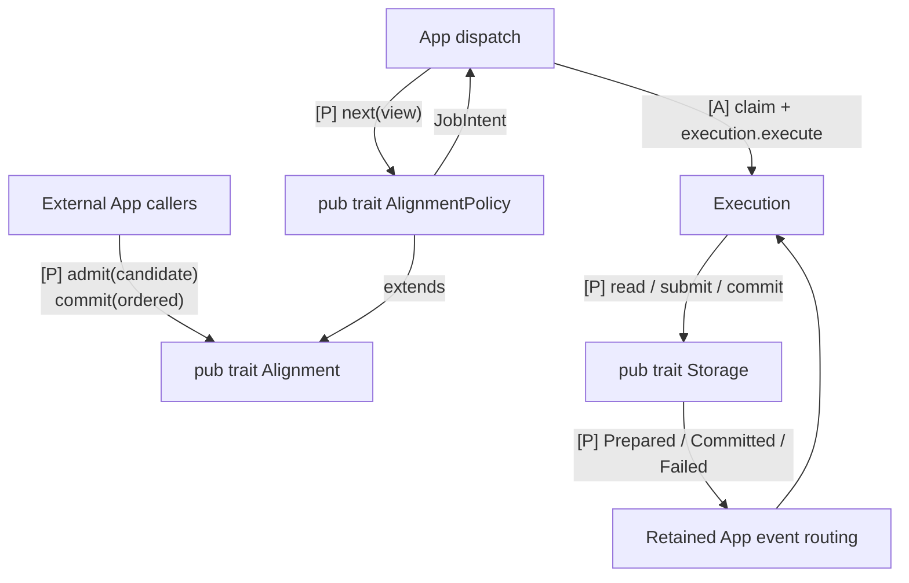

# Communication contracts and type details

<a id="interface-map-what-to-implement-and-connect"></a>

**Use this reference to check who calls whom, what crosses the connection and what completion establishes.** Start with the [component reading path](../01-overview/01-architecture.md#responsibilities-and-communication) for responsibility summaries, then use the contracts here beside the E2E diagrams. The [Rust reference](02-rust-signatures.md) contains existing Commonware declarations.

The five-crate scaffold declares the proposed App interfaces and placeholders with task/spec references. Their behavior remains unimplemented; use [developer assignments](07-development-order.md#developer-assignments) to complete them. Native excerpts remain references to the pinned Commonware graph.

<a id="public-calls-and-internal-selection"></a>

## Public calls and policy selection



[Open full-size diagram](../assets/diagrams/diagram-43.svg) · [PNG](../assets/diagrams/diagram-43.png)

The Rust declarations below are proposed App contracts. Existing Automaton, Reporter, Relay and Marshal interfaces are listed separately; concrete helper names remain App implementation choices.

Proposed App traits define shared communication contracts. Concrete helper names describe private App behavior; they do not require another public trait. PreCut and Baton share `Alignment` and public `AlignmentPolicy`; Storage has its separate request/event contract. These proposals are not an implemented or released SDK.

Using a supplied alignment implementation does not require reimplementing its traits. Execution calls the public policy contract across the crate boundary; custom policies implement both traits, while policy helper decomposition remains private. Each method below specifies values, state changes, completion and failure behavior while leaving private decomposition to its owner.

<a id="consensus-alignment-and-app-execution"></a>

## Consensus and application responsibilities

| Responsibility | Owns | Calls / completion |
|---|---|---|
| **Consensus** | Multimmit producer lanes, DA, proposals, votes and native finality | Calls the existing Automaton; publishes native activity to Marshal |
| **Node** | Native transport, service construction and supervised lifetimes | Constructs and connects Marshal, Execution, pool, policy and backend |
| **TxPool** | Transaction admission/selection, retained bytes and payload codec | Consumes SelectionContext/PoolUpdate projected by Execution |
| **Alignment** | PreCut/Baton candidate and report/direction policy | `admit`, ordering-only `commit`, and `next` over a read-only execution projection |
| **Execution** | Native callbacks, retained delivery tokens, lifecycle, dispatch, transaction execution, checkpoints and result certification | Implements Automaton/Reporter, projects pool/policy inputs, requests Storage work and ACKs exactly covered certified durability |
| **Storage** | Roots/material, canonical persistence, pinned views, import and recovery | Implements the Execution-owned read/submit/commit/verify_material/recover contract and emits retained events |
| **Existing Marshal** | Full-block custody, relay/backfill, native history interpretation and ordered delivery | Provides Mailbox/Relay interfaces and reports indexed Updates to Execution |

App in Commonware/E2E notation means the application role implemented by Execution. Its coordination, execution and results are internal responsibilities, not an extra App crate or callback-forwarding layer. Native `multimmit::AppExecutor` is Commonware's callback runner, distinct from Baton Execution. Node injects the pool, selected Alignment policy and Storage implementation through `Execution::open`.

## Proposed Alignment interface

**These are App-side design proposals, not existing Commonware traits.** External callers admit candidates and report finalized ordering through `Alignment`. Execution dispatch selects work through the public `AlignmentPolicy`. PreCut and Baton implement both contracts, allowing the same dispatch loop to use either policy. Execution owns result certification; Storage owns canonical persistence.

```rust
pub trait Alignment {
    fn admit(&mut self, candidate: Candidate) -> CandidateAdmission;
    fn commit(&mut self, ordered: &OrderedView);
}

pub trait AlignmentPolicy: Alignment + Send + 'static {
    fn next(&self, view: &SchedulingView<'_>) -> Option<JobIntent>;
}

pub struct PreCutAlignment { /* ... */ }
pub struct BatonAlignment { /* ... */ }
```

`AlignmentPolicy: Alignment` requires its implementations to implement `Alignment` as well. Implement both traits separately for each concrete type. Execution uses a generic bound `A: AlignmentPolicy`; candidate/order producers may only need `Alignment`. Neither trait creates a runtime actor. Existing `Automaton` and `Reporter<Update>` remain the native entry points.

| Rust declaration | Intended caller / use |
|---|---|
| `pub trait Alignment` | External calls into alignment: candidate admission and finalized-order notification |
| `pub trait AlignmentPolicy: Alignment` | Execution dispatch shared by PreCut and Baton: choose the next execution intent |
| `pub struct PreCutAlignment`, `BatonAlignment` | Concrete policies in baton-alignment, selected by Node assembly |

`Alignment`, `AlignmentPolicy`, concrete policy types and their input/output values are publicly reachable from `baton-alignment`. Execution constructs read-only views and calls them across crates; fields and policy helpers remain private. `SchedulingView` contains an `OrderedView` and an `ExecutionView` projection, never an Execution handle or a second mutable checkpoint tree. The placeholder fields still require MODEL-01 implementation.

### External calls through Alignment

| Operation | Input / result | Contract |
|---|---|---|
| `admit` | Qualified candidate → admitted, already known, deferred or ineligible | Retain candidate metadata once under bounded resources. No execution, body fetch or custody I/O. Execution checks the current role/lifecycle/authentication facts before admission. Deferred speculation does not invalidate a valid verify verdict. |
| `commit` | Exact continuous finalized-order view from retained Marshal Updates | Record immutable ordering and reconcile speculative priority with it. Idempotent on repeated exact input; never infer order across a gap or conflict. No execution, `f+1` wait, storage I/O or ACK. |

`OrderedView` identifies the exact continuous finalized input prefix: ordering context, output indices and block identities, with sufficient linkage to the preceding known prefix. It comes from the retained local Marshal stream or an authenticated native floor/recovery prefix, not an advisory direction or peer assertion. It says nothing about execution completion or state durability. The Execution owner forwards new ordered progress promptly to `Alignment::commit(ordered)` and independently to canonical execution. Remove a candidate from speculative selection only once canonical intake retains the work; keep required block/checkpoint references until execution and retention rules permit release.

The storage module implements [`Storage`](#proposed-storage-interface) for direct and imported results. Execution verifies `f+1` distinct eligible signatures on the exact ordered input/base/runtime/state-root/result subject and requests `Storage::commit(verified)`; Storage matches prepared material and applies through one canonical writer. Only certified durable application permits Marshal ACK. `Alignment::commit` has already handled ordering and is not called again to signal state application.

<a id="internal-selection-through-alignmentpolicy"></a>

### Selection through AlignmentPolicy

| Operation | Input / result | Contract |
|---|---|---|
| `next` | Current immutable execution/resource view → block plus exact parent/context, or no intent | Select only eligible unstarted work under the policy, preserving valid started order `F`. The parent must be completed and usable. This call does not claim the job, reserve resources or start execution. |

`SchedulingView` is a read-only projection of authoritative App state: known finalized-order frontier, certified durable state base/runtime, valid completed/current path `F`, exact ready checkpoints, claimed/running attempts, current lifecycle/generation and available resources. The ordering frontier may be ahead of the applied state base; recording it does not make a checkpoint usable. This is not a second execution tree. `JobIntent` identifies a block, its exact execution parent and selection context. These names specify required information, not final Rust fields or new wire types.

Execution handles candidate admission, execution completion and resource availability by asking `AlignmentPolicy::next` again. Between selection and launch it rechecks the intent against current state, atomically claims the attempt and reserves resources on the Execution owner, then records the updated execution view before launching. Another `next` call therefore excludes claimed work. If claim/recheck fails, refresh the view without launching; `next` changed no policy state. On failed launch or worker completion, settle the attempt through the shared lifecycle before offering capacity again. Dropping a waiter does not prove safe termination.

Follow these visual call paths for the lifecycle:

- [Verify and admission](../../execution/README.md#coordination-automatonverify-validity-custody-and-scheduling): valid payload/custody → optional candidate admission → verdict.
- [Internal dispatch](../../execution/README.md#coordination-dispatch-after-verification): `next` → owner claim → execution → current completion.
- [Ordered application](../02-e2e/06-ordered-application.md#ordering-to-ack-at-a-glance): retained Update → ordering commit → execution/submission → Execution certification → durable state/checkpoint → ACK.

On Storage failure, retain the input and withhold ACK until the cause is resolved or the failed instance is recovered.

`app.admit_candidate` and `app.dispatch_ready` in detailed diagrams are handlers around `Alignment::admit` and `AlignmentPolicy::next`. Retained ordering reaches `Alignment::commit`; later `app.publish_applied` updates execution state and wakes internal dispatch without another Alignment callback. Neither trait needs a duplicate execution-tree maintenance hook. Both concrete policies belong to the Alignment crate. Neither supplies native policy adoption or reorders Marshal Updates.

`BatonAlignment` owns report collection, deadlines and direction selection internally. Its private methods and task decomposition are left to its implementation. When that processing changes a scheduling choice, wake the shared dispatch loop so it asks `AlignmentPolicy::next` again. A generic coalesced notification through an existing channel is sufficient; its name and mechanism are not another SDK contract. PreCut uses both common traits without Baton protocol machinery.

## Proposed Storage interface

`Storage` owns checkpoint-bound reads, accepted execution changes, result-root preparation, persistence, imported material and recovery records. Execution owns transaction computation, in-memory checkpoints and execution-result certification. Both PreCut and Baton use this same interface. Storage hides when and how changes become database batches or durable writes.

**Execution submits `StateChanges` plus the exact executed range, receives Storage-prepared roots, creates/verifies the matching `f+1` result certificate and requests commit.** Storage constructs database batches and roots. The Execution owner validates the range against retained consensus ordering and the accepted execution attempt. It can forward the call without introducing another public trait. Submission is separate from certified durable completion.

```rust
use core::future::Future;

pub trait Storage: Send + Sync {
    /// Reads a key at the supplied pinned state view.
    fn read(
        &self,
        view: &StateView,
        key: StateKey,
    ) -> impl Future<Output = Result<Option<StateValue>, StorageError>> + Send;

    /// Retains changes for an exact executed range without promising durability.
    fn submit(
        &self,
        executed: ExecutedRange,
        changes: StateChanges,
    ) -> impl Future<Output = Result<(), StorageError>> + Send;

    /// Accepts Execution-verified authority to persist the exact prepared result.
    fn commit(
        &self,
        verified: VerifiedCertificate,
    ) -> impl Future<Output = Result<(), StorageError>> + Send;

    /// Retains applicable material without canonical mutation.
    fn verify_material(
        &self,
        verified: &VerifiedCertificate,
        material: StateMaterial,
        base: &AppliedCheckpoint,
    ) -> impl Future<Output = Result<Option<PreparedImport>, StorageError>> + Send;

    /// Returns stored candidates and original evidence for local re-verification.
    fn recover(&self) -> impl Future<Output = Result<RecoveredState, StorageError>> + Send;
}

pub enum StorageEvent {
    Prepared(PreparedState),
    Committed(DurableApplied),
    Failed(StorageFailure),
}
```

This is a proposed App SDK interface, not an existing Commonware trait or implemented Rust export. The argument, event and error types specify logical contracts below; concrete fields, codecs and backend types remain open and must be publicly reachable with the trait. Assembly wires a retained, bounded event receiver using existing runtime channels or reporter machinery. No new observer trait is required. Shared handles permit reads and submissions while the implementation serializes canonical mutation; `&self` does not grant concurrent database writers.

| Direction / operation | Meaning and completion |
|---|---|
| Execution → `read(view, key)` | On an in-memory miss, read the exact pinned base. `None` means verified absence at that view; unavailable/pruned views and I/O failure are errors, never absence or fallback to the newest state. |
| Execution → `submit(executed, changes)` | Transfer a complete, exact-parent executed range within known continuous finalized ordering. `Ok(())` means bounded retention accepted, not a root, certificate, durable state or permission to ACK/prune checkpoints. |
| Execution → `commit(verified)` | Request persistence after Execution verifies eligible distinct `f+1` signatures and the full result subject. `Ok(())` means accepted commit work, not durability. Storage matches the verified subject to retained material, ordering and the current predecessor before mutation. |
| Execution → `verify_material(verified, material, base)` | Retain bounded, fully applicable import material; no canonical advance or ACK. Pending material stays pending. |
| Execution → `recover()` | Return stored state/evidence candidates for local re-verification before publication; disk bytes do not recreate verifier authority. |
| Storage → `Prepared(prepared)` | Commitments for an exact accepted signing unit are ready. Execution may sign only with matching retained direct-execution evidence, then collect peer signatures. |
| Storage → `Committed(applied)` | The exact certified prefix and linked state/output/certificate/provenance are recoverably durable. `applied.checkpoint` is usable for Execution installation and covered Update ACKs. |
| Storage → `Failed(failure)` | Identify the affected unit or storage instance and the error. No durable completion is implied. A mutable-store/durability failure stops that instance until recovery; a rejected commit request leaves valid retained work pending. |

`commit` accepts a local verifier-produced value, never a peer `ExecutionCertificate` or caller-supplied verification flag. Storage checks the verified subject against its retained prepared root, material, exact order and current predecessor; a stale, missing or mismatched target cannot advance state. It retains an accepted request and original evidence through persistence. Exact retries are idempotent, including recovery of an already durable record; conflicting requests fail without authorizing a write. Execution remains the sole owner of quorum/signature verification, including on import and recovery.

### Cold state reads

A job reads its current in-memory writes first, then its completed in-memory parent overlays, then `Storage::read(view, key)` at the installed base. A tombstone is a known deletion and must not fall through to an older stored value. Every cold read in that job uses the same exact base/runtime view; advancing storage must not silently change it. The job's speculative ancestors remain Execution-owned overlays, not implicit Storage history.

`StateView` is a retained read-only capability supplied in `AppliedCheckpoint`. Storage pins the required material or provides equivalent versioning/access fencing until readers release it. Existing live QMDB readers are not automatically snapshots. Execution receives no mutable database handle and need not load the entire database into memory. A cold read can await I/O for that job; unrelated execution and consensus callbacks continue independently.

### Ordered progress submission and batched persistence

`ExecutedRange` binds exact continuous ordered inputs and output indices, predecessor state/prefix, runtime and accepted local execution provenance. A numeric high-water mark alone is insufficient. The Execution owner validates that this work matches its authoritative ordering and live attempt before submission. If Execution has speculated ABC but only AB is ordered, submit AB's retained changes and keep C in memory. Never include C merely because its computation finished.

The direct canonical path synchronizes execution with Storage acceptance: the canonical worker awaits reuse/completion/repair of every block in the selected unit, then awaits `Storage::submit(executed, changes)`. It completes that handoff and advances to the next ordered unit only on `Ok(())`. Finishing computation or enqueueing an App-local forwarding task is insufficient. Pending or rejected submission retains the unit and retryable changes; no later unit overtakes it. A storage-instance failure requires recovery. This await does not wait for `Prepared`, `commit`, `Committed` or disk flush. Native callbacks, independent speculative work and retained Storage event intake remain serviceable; do not hold the Execution owner or a lock needed by Storage across the await.

Assembly supplies Storage with read-only access to the App's authoritative retained ordering context; a peer certificate or caller-supplied frontier cannot replace it. Submission accepts one complete bounded signing unit; its agreed boundaries and changes representation must permit the chosen exact prefix. A later unit may depend on an earlier accepted, still-uncommitted unit. Storage retains that exact predecessor chain, prepares roots in order and defers canonical mutation until every required predecessor has an applicable Execution-verified commit request. Execution can continue on its in-memory checkpoints without awaiting each storage commit. A conflicting or stale chain is rejected; overlapping retries do not double-apply changes. Exact duplicate submissions are idempotent; a replay after durable commit re-emits the matching completion.

Accepted changes are owned/retained by Storage, but acceptance may be memory-only. Before acceptance, cancellation or backpressure leaves the caller responsible for retryable changes. After acceptance, dropping a caller does not cancel retained work. On crash, only the recovered certified durable prefix is authoritative; replay/reexecution can reconstruct later accepted work. Execution may release a transferred changes buffer under the ownership contract, but keeps memory/checkpoint data still needed for reads, descendants or replay until durable installation and reference release.

Storage prepares selected signing-unit commitments and emits `Prepared` before certification and application. Execution binds the prepared state root and required output/material commitments to its direct execution, gathers signatures, verifies the full certificate and calls `commit(verified)`. Certificate-only input cannot execute transactions or manufacture missing material. A verified peer import supplies matching material through Storage's existing import path and shares the same writer and `Committed` event. Imported work never generates an own direct-execution signature.

Storage chooses physical write/flush batching and may persist multiple successive certified units together. **Physical batching must not alter the deterministic operation history, signed roots, certification-unit boundaries or exact committed order.** Independently certified units retain their evidence and predecessor linkage. A longer-range certificate cannot be sliced to authorize an intermediate checkpoint. Batch thresholds need a bounded drain rule compatible with Marshal's delivery window, idle tails and shutdown; waiting for more Updates than the unacknowledged window allows would deadlock progress. Batch sizes and timing stay inside Storage.

Track the distinct milestones: ordered, executed, submitted, certified and durable. Only `Committed` advances the published durable frontier and permits covered ACKs or checkpoint cleanup. Receiving `Prepared`, accepting a certificate, or completing a write without the required durability barrier does not. A certificate may arrive before material: Execution bounds pending evidence or rejects it for retry while valid direct work continues; it requests commit only when Storage has retained the matching prepared material.

Execution validates the full certificate subject, eligible epoch identities, distinct signatures and authoritative order. Storage accepts only the resulting local `VerifiedCertificate`, matches its exact subject to retained material and ordering, and rechecks the predecessor under writer authority before canonical mutation. It does not collect signatures or repeat the quorum verifier. Once mutation starts, task cancellation does not prove rollback. The retained operation must complete/reconcile or require recovery before another mutation. Recoverable state, outputs, applied identity, certificate evidence and provenance must agree. Recovery loads the linked records and has Execution revalidate their original certificate and context before Storage publishes `Committed`; genesis uses the configured initial trust anchor.

### Event delivery and checkpoint installation

Events are a reliable retained handoff to the Execution owner, not lossy progress hints. The event path must be drained independently of submissions/signature work so a full queue cannot deadlock a waiting caller. Bound outstanding work and deliver backpressure; do not discard a `Prepared`, `Committed` or failure event. Duplicate/recovered events are idempotent by exact identity. A later `Committed` may cover earlier units only when the recoverable continuous prefix proves all of them; never drop a `Prepared` still needed for signing. Unexpected Storage task/channel closure stops new submissions and triggers recovery, not success.

On `Committed(applied)`, the Execution owner publishes the applied identity, reliably forwards `applied.checkpoint` to Execution and ACKs only covered retained Updates. Storage never ACKs Marshal or calls `Alignment::commit`; that method already records ordering promptly. Checkpoint handoff adds no execution wait or second installation ACK.

### Checkpoint handoff and execution skipping

`AppliedCheckpoint` contains the exact continuous certified ordered prefix, state/base/runtime identity, provenance and a usable pinned `StateView`. A height or root alone is insufficient. `DurableApplied` identifies the covered units and their recoverable evidence. Direct commit and certified import emit `StorageEvent::Committed`; startup recovery supplies the same established checkpoint after Execution verifies recovered evidence and Storage confirms the matching durable record, before dispatch. Assembly supplies the configured genesis checkpoint initially.

`execution.install_checkpoint(checkpoint)` is a concrete Execution operation, not another public trait. The Execution owner retains the newest compatible checkpoint until it is adopted; dispatch uses that latest retained base. Installation checks exact identity and read access, then replaces the memory base and execution generation. Skip covered queued work, retire covered/conflicting attempts, and ignore their late completions. Preserve compatible descendants and rebase their remaining overlays without applying covered changes twice. Repeated exact checkpoints are idempotent, older compatible ones never rewind execution, and conflicting ones are rejected.

Physical memory cleanup waits until live workers/readers/descendants no longer require an overlay or old view. Storage independently retains disk material needed by pinned views, queries, recovery and result serving. Logical retirement is not permission to free still-referenced data.

For example, if Execution is at A and Storage imports a certified durable ABC checkpoint, install it, skip local B/C and start D from ABC. If Execution already computed ABCD while Storage commits AB, adopt AB as the base, release covered A/B overlays when safe and preserve compatible C/D work. No reexecution is required just because persistence lagged behind execution. A certificate without usable material or a failed/pending apply produces no `Committed` checkpoint.


## Diagram notation

Read a method-call arrow as **caller → owner: operation(inputs)** and its return as the value or completion condition. An event arrow identifies publisher and consumer; it is independent of the earlier method return. Boxes separate responsibilities; they do not require separate actors, channels or public traits. Flowcharts show dependencies; sequence diagrams show ordering within the illustrated path. An arrow to a worker does not block unrelated App work.

| Label | Meaning | Implementation responsibility |
|---|---|---|
| **[C]** | Existing Commonware interface at the [native pin](../../execution/README.md#coordination) | Implement the existing App callbacks; reuse supplied Engine, Marshal, network and QMDB operations |
| **[A]** | App-owned processing | The operation or helper name explains the flow; it does not prescribe a private method, exported Rust API or actor count |
| **[P]** | Proposed App trait contract | External `Alignment` and `Storage`, plus cross-crate `AlignmentPolicy`; shared by PreCut and Baton, not existing native interfaces |
| **[X]** | Missing native extension obligation | Design and implement the native integration before claiming protected-prefix behavior; the shown names are not settled signatures |
| **wire** | Peer message | Existing native messages retain their native codecs; App transaction/report/direction/result message names denote logical content, with concrete codecs/channels still open |

Solid versus dashed sequence arrows distinguish calls from returns/notifications, not durability. Only the stated completion contract establishes durability. Overview flowcharts may group methods and omit arguments; their named methods map to the same contracts as the detailed sequence diagrams. Receiver-local names such as `stage_block`, `engine.start` and `barrier.durable` refer to the documented Mailbox, Engine and Barrier methods. Generic arguments and some configuration fields are omitted for readability; use the Rust reference and source for compilable signatures. `Receiver<T>` is returned by the async Automaton callback; `reply.send(value)` later resolves it. Returning the receiver and sending the verdict are different events.

A label describing internal behavior or a data dependency is not an additional Rust method. `[A]` calls are documented concrete App helpers, with implementation signatures left private. A coalesced dispatch wakeup is an internal notification with no required named event type. `[X]` hooks are explicitly unresolved native obligations, not implementable SDK signatures. `wire:` App message names describe logical content; their codecs remain open. The [message catalog](../../node/README.md#networking-messages-used-in-diagrams) records those distinctions. Do not interpret all arrows as public trait methods.

The practical implementation split is:

- **App entry points:** transaction ingress, existing `Automaton::propose/verify`, and existing `Reporter<Activity = marshal::Update<Block>>`.
- **App implementation:** pool, the selected PreCut or Baton scheduler, exact-parent execution, result handling and durable state integration. Ordinary scheduling and canonical execution share this implementation.
- **Reuse:** native Engine, Marshal custody/relay/backfill/ordered delivery/cursor, Commonware transport and concrete QMDB primitives.
- **Native extension still required for Baton:** authenticated proposal-policy adoption, validation, prefix preservation/continuation and matching Marshal recovery. App scheduling alone does not provide it.

## Values carried between App calls

These are logical contracts, **not new Rust struct definitions or wire schemas**. Keep existing native values, concrete batch handles and exact identities where possible.

| Diagram value | Meaning |
|---|---|
| `LaneContext`, `SelectionContext` | Trusted epoch/local optional lane/producer set/application type-assignment policy, and the matching native proposal context. TxPool selects eligible types for `(epoch, lane)`; bucket layout, mapping and context transitions belong to POOL-01/MODEL-01. |
| `Admission`, `AdmissionError` | Admission confirms valid retention by type with duplicate metadata, independently of proposal eligibility. Invalid rejects the payload; Backpressure preserves caller retry ownership. |
| `Payload` | A bounded batch from type pools eligible for the proposal epoch/lane. Selection preserves retention and does not imply canonical inclusion. |
| `PayloadVerdict` | `Valid`, permanent `Invalid`, or `Pending` for unavailable dependencies. It describes payload validity, separately from custody and speculative eligibility. |
| `Candidate` | Exact producer block/context plus the validity, custody and authentication facts available to App. The owner rechecks current lifecycle/ancestry/eligibility before scheduling. |
| `Job`, `job_id` | Exact block, completed valid execution parent, canonical base, runtime and input prefix, bound to a claimed local attempt and reserved resources. The producer's lane parent is not the execution parent. |
| `StateChanges` | Execution's sole state-data payload to Storage, accompanied by `ExecutedRange` metadata: deterministic application changes produced on the assigned parent. All data required as durable application effects by the chosen result contract must be represented here; concrete encoding remains open. No root, certificate, storage batch or Execution checkpoint. |
| `ExecutedRange` | Exact bounded ordered unit, predecessor state/prefix, runtime and accepted direct-job identity; separately bound by the owner, never an unverified numeric frontier. |
| `StateView` | Retained read-only capability for the exact installed base; Storage pins or fences its backing state for all reads. |
| `StorageError`, `StorageFailure` | Distinguish rejected/backpressured submissions, unavailable reads, inapplicable commit requests and fatal mutable-store/durability failure; include exact unit/instance scope for asynchronous failure. No error authorizes ACK. |
| `ExecutionOutcome` | Local job completion envelope containing `StateChanges` or failure/cancellation. App owns the job/context/provenance binding; the envelope is not another storage payload. |
| `CanonicalInput` / `OrderedInput` | App retains full Updates and ACK tokens in CanonicalInput; its exact execution projection is OrderedInput, which carries no native ACK authority. A bounded certification unit may span blocks; its whole authorized range is applied together. App retains every original ACK token. No prior candidate or verify call is required. |
| `PreparedState`, `PreparedImport` | Selected commitments/material with full input/base/runtime/output identity, actual batch ancestry and direct/imported provenance. Preparation alone grants no writer authority. |
| `DurableApplied`, `AppliedCheckpoint` | Durable completion carries a usable read-only canonical checkpoint with exact prefix/runtime/state identity, matching `f+1` evidence and provenance. Execution installs it to skip covered work. A root or QMDB flush alone is insufficient. |
| `LeaderContext`, `FrozenReports`, `PreparedDirection` | Exact epoch/view/history/canonical parent/rule/window/frontier, original signed report snapshot, and a completed valid direction choice. No execution-completion or ordering-finality proof is implied. |
| `VerifiedCertificate` | Local Execution-verifier output binding original `f+1` evidence to the exact epoch, ordered input/range, predecessor state, runtime, state root and required output/material commitments. Construction is restricted to successful Execution verification; it is not a wire type or deserializable trusted flag. Storage persists the underlying evidence, not the local verification capability. It does not establish durability. |
| `RecoveredState` | Storage-loaded state/checkpoint candidate plus exact applied identity, original certificate evidence and verification context. Execution must reverify it before usable checkpoint publication; loading disk bytes does not recreate `VerifiedCertificate`. |

## Existing interfaces to connect

| Existing operation | Who supplies it | App work / result |
|---|---|---|
| `Automaton::propose(ctx)` | App implements the Commonware trait | Return a receiver; select transactions, construct `TransactionBlock::from_context`, stage the full block, then send its body digest. |
| `Automaton::verify(ctx, body_digest)` | App implements the Commonware trait | Return a receiver; obtain the exact block, check payload and durable custody, admit eligible work, then send the validity verdict without waiting for speculation. |
| `digest_reply.send(body_digest)` / `verdict_reply.send(bool)` | Existing one-shot sender paired with the callback receiver | Resolve the pending proposal/verification result; closure is handled under the callback lifecycle, not as a durable event. |
| `Reporter::report(Update)` | App implements a typed Commonware reporter | Synchronously retain the full Update and ACK; return `Feedback` after handoff. The canonical worker handles it later. |
| `Context::header(body_digest)` then `header.block_ref::<H>()` | Native block types | Derive the full header then exact Marshal lookup reference; neither value is the body digest alone. |
| `stage_block(block)` / `Custody::wait()` | Marshal mailbox/token | Accepted storage work / durable custody respectively; `put_block(block)` combines both. |
| `subscribe_block(reference)` / `fetch_block(reference)` | Marshal mailbox | Subscription yields a block after custody; explicit fetch can yield buffered bytes before durability. Fetch alone is insufficient for `verify(true)`. |
| `Relay::broadcast(header_digest, ())` | Existing Marshal Relay | Local propagation submission with `Feedback`; it does not prove peer receipt. App needs no duplicate block service. |
| `Update.acknowledgement.acknowledge()` | Existing Exact token, called by Execution owner | Complete this retained delivery only after matching durable App application; Marshal separately persists its cursor. |
| `network.register/start`, `buffered::Engine::new/start`, `resolver::Engine::new/start`, `marshal::open`, `Service::relay/start`, `Engine::open/start`, `Running::ready` | Existing assembly interfaces | Wire App handles, buffer/resolver and native planes in [startup order](../02-e2e/09-startup-and-recovery.md). Custody must work before native recovery verifies blocks. |
| `DatabaseSet`, concrete batches and `Barrier` | Existing storage primitives | Implement the App's exact-parent access, selected roots, writer fencing and recovery linkage around the [QMDB call sequence](03-qmdb.md#current-qmdb-apis). |

Native `Reporter<Activity>` observations are optional App hints, distinct from required `Reporter<Update>` delivery. No App execution method is added to Automaton. Its async callback can hand work to a cloneable owner handle; `&mut self` does not serialize every worker or establish a database writer fence.

<a id="private-pool-and-execution-calls"></a>

## Concrete pool and execution calls

TxPool and Alignment expose the calls needed by Execution; execution helpers are internal to Execution and backend lifecycle calls use Storage. TxPool methods are public concrete calls; Execution coordination/execution helpers remain private. The Storage trait belongs to `baton-execution`; `baton-storage` implements it. These calls do not introduce additional traits.

These rows explain behavior and completion behind the diagrams. Helper names are illustrative, not methods an SDK consumer must implement. Choose private decomposition inside the implementation; do not add forwarding traits just to reproduce every row.

| Proposed call | Owner and return | Completion, waiting and failure contract |
|---|---|---|
| `TxPool::open(lanes)` | Node → TxPool | Inject trusted LaneContext; keep local assignment and shared routing independent of Execution/Storage internals. |
| `pool.admit(tx)` | TxPool → `Result<Admission, AdmissionError>` | Validate, deduplicate and retain by type for sharing regardless of local proposal eligibility. Success carries duplicate metadata; failures distinguish Invalid from retryable Backpressure. |
| `pool.select(ctx, limits)` | TxPool → `Payload` | Called from Automaton::propose handling. Resolve eligible type pools for the matching epoch/lane, pack ready transactions within limits and preserve retention. |
| `pool.reconcile(applied_outcomes)` | TxPool maintenance | Reconcile all type pools from durable outcomes across all lanes; schedule after publication without another ACK approval. |
| `app.check_payload(ctx, full_block)` | App payload code → `PayloadVerdict` | Check exact header/body/digest and application validity. Temporary absence stays pending; state-dependent transaction outcomes are handled by execution. |
| `app.admit_candidate(candidate)` | Execution owner → admitted, deferred, already known or ineligible | Recheck origin/role, live lifecycle, exact identity, ancestry/authentication and applied state. Preserve `F`; sort only eligible pending work. Saturated speculation does not make a valid custody verdict false. |
| `app.dispatch_ready()` | Execution owner → claimed `Job` or no work | Choose an eligible pending input with a completed valid exact parent and resources. Bind/claim the attempt before launching; missing parent/capacity stays pending. |
| `execution.execute(job, storage)` | Execution execution worker → `ExecutionOutcome` | Execute transaction semantics under valid parent access. It runs independently of the verify verdict. Failure/cancellation must not become a reusable checkpoint. |
| `app.finish_job(job_id, outcome)` | Execution owner → accepted completion or ignored stale result | Accept once for the current attempt/context/ancestry. Settle reserved resources only after no launch or safe termination; canceling a waiter alone does not stop worker/DB access. |
| `execution.install_checkpoint(checkpoint)` | Execution owner forwards Storage output → Execution | Install a usable certified durable base, skip covered input and retire conflicting attempts. Idempotent and monotone by exact context, not height alone. No persistent state write or extra ACK. |
| `execution.branch(job.parent)` | Execution → in-memory overlay/checkpoint | Resolve the exact parent from the installed read-only base plus completed in-memory effects. Storage reads remain guarded by Storage; no mutable DB handle is transferred. |

PreCut uses admission, pending sorting and dispatch directly. Baton uses the same shared contracts while managing its report/direction policy internally. Workers and a canonical consumer may run concurrently, subject to one owner accepting transitions and one canonical writer.

<a id="private-canonical-and-state-calls"></a>

## Concrete canonical and state calls

| Proposed call | Owner and return | Completion, waiting and failure contract |
|---|---|---|
| `app.retain_update(update)` | Execution Update inbox → `Feedback` | Synchronous, non-dropping indexed-block/token retention and worker wakeup. Size for the active delivery window and coordinate old retained Updates across floor resets. `Backoff` is not a retry request. |
| `app.apply_next()` | Execution canonical worker | Process the next bounded continuous certification unit. Matching certified durable replay can ACK without duplicate effects; gaps/conflicts stop advancement. Drive reconciliation, preparation, certification, commit, publication and ACK. |
| `execution.reconcile(ordered, storage)` | Execution execution code → `StateChanges` | Reuse exact validated changes, finish or repair execution on the required parent. App canonical intake separately chooses a ready Storage import. Never substitute pending scheduler order for Marshal order. |
| Storage preparation after `submit` | Storage internals → `StorageEvent::Prepared` | Materialize accepted StateChanges and prepare deterministic commitments for the exact unit; no larger speculative suffix or durability promise. |
| `app.publish_applied(applied)` | Execution owner | Advance exact applied identity once, retain/forward `applied.checkpoint` to Execution and schedule pool reconciliation. ACK covered Updates after certified durability; checkpoint handoff adds no approval round. |
| `Storage::recover()` | Storage assembly → `RecoveredState` or recovery failure | Load linked state/output/applied-position/certificate/provenance as a checkpoint candidate. Execution revalidates its certificate with `results.accept`; `Storage::commit(verified)` idempotently confirms the matching durable record and emits `Committed`. Only then install the checkpoint and dispatch. Configured genesis supplies its trusted initial checkpoint without an execution certificate. |

The owner awaits exact ordered changes and `Storage::submit` acceptance as one canonical-worker operation; Execution supplies verified commit authority through `Storage::commit`. It handles `Prepared` and `Committed` events independently, without awaiting a flush inside execution. The ACK tokens stay with the retained delivery owner throughout these calls. `Storage` does not acknowledge Marshal directly. After a crash between App persistence and Marshal cursor persistence, replay verifies exact identity and recoverable certification evidence, then acknowledges idempotently. No new signature round is needed for a recovered certified applied record. Missing certification keeps input pending. The bounded signing unit must permit progress inside the delivery window; see the [canonical sequence](../02-e2e/06-ordered-application.md) and [certification units](../../execution/README.md#certification-certification-units-and-delivery-progress).

## Baton behavior and native extension

Baton implements the same Alignment contracts as PreCut. Its report authentication, fixed-window collection, bounded direction selection and pending-order changes remain implementation behavior. The [policy rules](../../alignment/README.md#alignment) define the invariants; no private method catalog is part of the SDK contract. The following native extension obligations are separate from that internal decomposition.

| **[X]** obligation named in diagrams | Native implementation still required |
|---|---|
| `leader_context()` | Expose authenticated leader-window/proposal context; producer Automaton context is not this hook. |
| `offer_policy(prepared)` | Make an already prepared candidate available without making native cut await reports or planning. |
| `adopt_policy(actual_context, ready_candidate)` | Validate availability/adoption, bind to actual parent/frontier, freeze the authenticated policy and preserve its exact leading execution sequence. |
| `validate_policy(proposal, actual_context)` | Validators verify the same policy interpretation and preservation; native continuation and Marshal order/recovery must carry it consistently. |

These four names describe obligations, not an approved hook API. Proposal encoding, adoption point, continuation and recovery proofs remain [open native design](05-native-open-decisions.md). Before adoption, no prepared valid choice uses the actual-parent valid base path; after adoption, dropping the protected prefix as fallback is forbidden.

<a id="private-result-import-and-lifecycle-calls"></a>

## Concrete result, import and lifecycle calls

| Proposed call | Owner and return | Required contract |
|---|---|---|
| `results.sign(prepared, direct_evidence)` | Execution result code → attestation | Bind irrevocable exact input/base/runtime/result and verified direct execution. Imported work cannot become an own direct signature. |
| `results.accept(evidence, canonical_context)` | Execution result code → `VerifiedCertificate`, pending or invalid | Verify full subjects and `f+1` distinct eligible signers independently of native ordering QC membership. Incomplete/missing context stays pending. |
| `Storage::verify_material(verified, material, base)` | Storage → `PreparedImport`, pending or invalid | Verify exact applicability and retain candidate material inside Storage, keyed by its full certified target, before returning PreparedImport. Later `Storage::commit(verified)` resolves that same retained material and rechecks the base under the shared writer. Neither return grants writer authority nor justifies stopping direct work. This operation is part of the public Storage contract; it does not verify quorum evidence again. |
| `Execution::open(pool, alignment, storage)` | Node assembly → Execution callback handle | Create retained Update/event ingress and wire dependencies before starting Marshal output. Storage recovery supplies the base separately; speculative lifecycle remains recovering. |
| `Execution::start(mailbox.clone())` | Node assembly → running callback work | Make custody lookup and Update handling usable before `Engine::open`; recovery verify must be answerable. |
| `app.activate(native_ready, recovered_base)` | Execution owner → live speculative lifecycle | Activate only after successful native readiness and consistent App recovery; failed startup does not dispatch speculation. |

Follow [results](../02-e2e/07-result-certification.md), [state sync](../02-e2e/08-state-import.md) and [recovery](../02-e2e/09-startup-and-recovery.md) for the actual call ordering. These operations stay inside App; Baton planning does not gate them.

<a id="how-to-read-the-rust-traits"></a>

## Call flow and completion

| Entry | App work | Completion boundary |
|---|---|---|
| Client / transaction peer | Validate and retain pool candidates | Admission, not canonical inclusion |
| `Automaton::propose` | Select batch, construct producer block, stage in Marshal | Body digest through the returned receiver; local custody verification follows |
| `Automaton::verify` | Validate payload/custody and record usable scheduler input | Validity through the returned receiver; no speculative execution wait |
| Optional native `Reporter<Activity>` | Correlate native observations | Best-effort hint |
| Marshal `Reporter<Update>` | Retain canonical index, full block and ACK | Immediate local handoff |
| Marshal ordered-input handoff | Retain complete Update and reflect exact continuous ordering in `Alignment::commit` | Ordering recorded without awaiting execution, certification or durability |
| Execution canonical worker / Storage events | Submit ordered changes or verified import; Execution certifies the prepared result and requests Storage commit; Storage batches persistence | `Committed` supplies a checkpoint to Execution and permits covered ACKs; Marshal cursor persistence is separate |
| Peer execution messages | Validate exact results and applicable state material | Result certification or safe import, independent of Baton reports |

Existing cloneable handles and Commonware channels connect the Execution owner to asynchronous work. The completion contracts above explain each handoff without fixing private function names or adding a new public framework.

## Read the detailed contract once

| Question | Canonical page |
|---|---|
| What goes inside App, and what does Marshal already implement? | [Application connection guide](../../execution/README.md#coordination) |
| What does verify do; how are local, remote, recovery and repeated calls handled? | [App verification flow](../../execution/README.md#coordination-automatonverify-validity-custody-and-scheduling) |
| What exactly waits for ACK and how does crash redelivery work? | [Update, queue and durability contract](../../execution/README.md#coordination-marshal-reportupdate-canonical-input-and-ack) |
| Which digest, parent, index or context does a value identify? | [Terminology](../01-overview/02-terminology.md), [Rust types and callbacks](02-rust-signatures.md) |
| How do Pre-cut and Baton differ, and what native work remains? | [Alignment and policy gap](../../alignment/README.md#alignment) |
| How are execution effects, roots, writer access and imported results connected? | [Execution](../../execution/README.md#execution), [Storage](../../storage/README.md#persistence), [result certification and state sync](../../execution/README.md#certification), and [QMDB](03-qmdb.md) |

Use types from one resolved Commonware dependency graph; matching names or digest bytes across versions do not establish Rust type compatibility. Native Activity and Marshal Update need separate typed reporter handles when both enter one App, because Reporter has one associated Activity per implementation.

## Finding calls in E2E cases

| Case | Page |
|---|---|
| Transaction through durable application | [Normal flow](../02-e2e/01-transaction-to-state.md) |
| Propose, relay, verify and missing body | [Body exchange](../02-e2e/02-block-exchange.md) |
| Producer DA, leader proposal and native finality | [Native consensus](../02-e2e/03-native-consensus.md) |
| Report windows, direction and proposal freeze | [Leader](../02-e2e/04-leader-reports.md) |
| Pending sorting and exact-parent dispatch | [Scheduling](../02-e2e/05-direction-and-execution.md) |
| Update, reuse/repair, durable apply and ACK | [Canonical flow](../02-e2e/06-ordered-application.md) |
| Startup, restart and redelivery | [Recovery](../02-e2e/09-startup-and-recovery.md) |
| Result signatures and certified import | [Results](../02-e2e/07-result-certification.md), [State sync](../02-e2e/08-state-import.md) |
