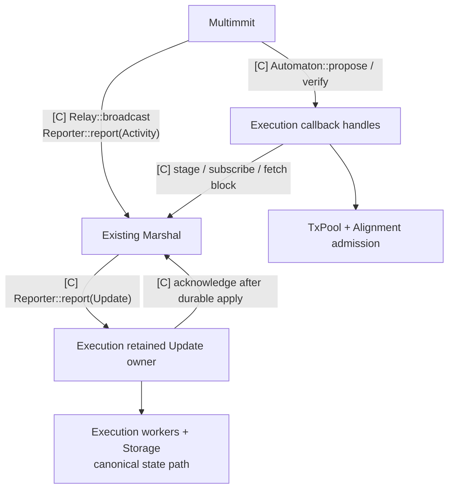

# Existing Rust signatures

<a id="rust-connection-points"></a>

**Implement existing Commonware callbacks on application handles.** This page contains native API excerpts. The separate [interface map](01-communication-contracts.md) defines the proposed App contracts: `Alignment`, public `AlignmentPolicy` and `Storage`.

These are existing API excerpts from [checkout 6233438](https://github.com/0xEyrie/monorepo/tree/6233438985d8249d2b2bc1204191d5d405652288), with surrounding generic bounds/imports omitted where stated. They are not standalone compilable declarations or a new application protocol. The [single Rust reference file](../assets/interfaces/baton.rs) is generated from this page; edit this source, then run `npm --prefix docs run docs:interfaces`.

## Modules and call flow



[Open full-size diagram](../assets/diagrams/diagram-52.svg) · [PNG](../assets/diagrams/diagram-52.png)

Both Pre-cut and Baton fit inside App. The shared canonical worker consumes Marshal's ordered-delivery contract in either mode. Baton report/direction logic has no authority to reorder the Update stream. The remaining native protected-prefix integration is described [separately](../../alignment/README.md#alignment-existing-callbacks-versus-the-native-policy-gap).

<a id="blockservice"></a>

## Automaton: existing payload callbacks

The existing [Automaton trait](https://github.com/0xEyrie/monorepo/blob/6233438985d8249d2b2bc1204191d5d405652288/consensus/src/lib.rs#L125) requires a cloneable, sendable `'static` handle. For Multimmit, choose `Context = multimmit::types::Context<D>` and `Digest = D`. The methods below appear inside that trait:

```rust,ignore
// Existing commonware_consensus::Automaton method excerpts.
fn propose(
    &mut self,
    context: Self::Context,
) -> impl Future<Output = oneshot::Receiver<Self::Digest>> + Send;

fn verify(
    &mut self,
    context: Self::Context,
    payload: Self::Digest,
) -> impl Future<Output = oneshot::Receiver<bool>> + Send;
```

`propose` selects App transactions, builds the exact producer-context block and returns its body digest after staged admission. It commits the proposer to successful verification of the same pair. `verify` confirms payload validity and Multimmit's durable custody obligations; it records usable scheduler input without awaiting speculative execution. Keep temporary missing data pending and reserve `false` for permanent invalidity. The shared trait documents terminal closure, but current remote Multimmit reschedules closed-receiver `Unavailable` results; local/recovery paths instead require success. Deduplicate live repeats and recovery. [Path-specific behavior](../../execution/README.md#coordination-automatonverify-validity-custody-and-scheduling).

The body implements existing `Codec` and `Digestible` with the same hasher digest; Multimmit's blanket `Body<H>` implementation supplies the marker. Use existing `TransactionBlock<H,B>` and header types rather than another generic block trait. The producer header `parent` identifies lane ancestry, not application execution state.

`CertifiableAutomaton` belongs to consensus paths with a separate certification callback, such as Simplex. Multimmit's attachment here requires Automaton; adding `commit` does not create an application execution hook for it.

## Reporter: two typed application connections

The existing [Reporter trait](https://github.com/0xEyrie/monorepo/blob/6233438985d8249d2b2bc1204191d5d405652288/consensus/src/lib.rs#L258) has one associated `Activity` and a synchronous method:

```rust,ignore
// Existing commonware_consensus::Reporter method excerpt.
fn report(&mut self, activity: Self::Activity) -> Feedback;
```

| Handle passed to | Associated Activity | Use |
|---|---|---|
| Native `multimmit::Config::reporter` | `multimmit::types::Activity<V,D>` | Route to Marshal; optionally fan out native observations to App |
| Marshal `Service::start(..., application)` | `multimmit::marshal::Update<TransactionBlock<H,B>>` | Transfer canonical block/index/ACK into App's retained delivery inbox |

Use Marshal's mailbox for native reporting. If App also consumes native Activity, give it a separate typed handle from its Update reporter and reuse the existing sibling composition shown in [log-multimmit node assembly](https://github.com/0xEyrie/monorepo/blob/6233438985d8249d2b2bc1204191d5d405652288/examples/log-multimmit/src/node.rs#L306). Native observations are best-effort hints; canonical Updates require retained, non-dropping handoff. Reporter callbacks return promptly without transaction execution or storage I/O inline.

## Marshal: existing full-block custody and delivery

The following [mailbox methods](https://github.com/0xEyrie/monorepo/blob/6233438985d8249d2b2bc1204191d5d405652288/consensus/src/multimmit/marshal/mailbox.rs#L326) are excerpts from the existing generic mailbox implementation:

```rust,ignore
// Existing multimmit::marshal::Mailbox method excerpts; enclosing bounds omitted.
pub async fn stage_block(
    &self,
    block: impl Into<Arc<TransactionBlock<H, B>>>,
) -> Result<Custody, Error>;

pub async fn put_block(
    &self,
    block: impl Into<Arc<TransactionBlock<H, B>>>,
) -> Result<(), Error>;
```

`stage_block` returns an accepted custody token. `token.wait().await` establishes durable recoverability. Dropping that token does not cancel already accepted storage work. `put_block` performs both steps. For lookup use existing `get_block`, `subscribe_block` and `fetch_block`: local lookup, custody subscription and explicit network fetch are different operations. Subscription alone does not promise to start a peer fetch. A get/fetch result can still be buffered ahead of storage sync; verify must establish durable custody through subscription or completed stage/put, rather than equating fetched bytes with persistence.

The [delivery value](https://github.com/0xEyrie/monorepo/blob/6233438985d8249d2b2bc1204191d5d405652288/consensus/src/multimmit/marshal/types.rs#L130) is already defined by Marshal:

```rust,ignore
// Existing multimmit::marshal::Update; imports/derives omitted.
pub struct Update<B: Block> {
    pub index: OutputIndex,
    pub block: Arc<B>,
    pub acknowledgement: Exact,
}
```

App retains the token while reconciling/applying that exact input, then consumes it through `Acknowledgement::acknowledge`. ACK follows application durability; Marshal's cursor sync is a subsequent boundary. Redelivery must be idempotent. The current delivery actor does not retry a dropped Update on `Feedback::Backoff`; account for its ordinary delivery window and floor-reset overlap while preserving accepted tokens. Update has no generation field; App coordinates the state-import/floor lifecycle itself. [Detailed failure and queue contract](../../execution/README.md#coordination-marshal-reportupdate-canonical-input-and-ack).

Open the public `multimmit::marshal::open`, connect its resolver bridge, obtain its reusable relay, then start the service with `SchemeVerifier` and the application Update reporter. The public service start returns the mailbox and service handle. [Assembly](07-development-order.md) follows the current example rather than copying historical Simplex wiring.

## Relay: reuse Marshal's implementation

```rust,ignore
// Existing commonware_consensus::Relay method excerpt.
fn broadcast(&mut self, digest: Self::Digest, plan: Self::Plan) -> Feedback;
```

For Multimmit `Plan = ()`; `digest` is the full header/block identity. Marshal's relay looks up the staged full block and submits it to buffered dissemination. The application need not add a new Relay service, body cache or retry protocol. Local Feedback does not mean remote receipt or durable peer custody.

<a id="txpolicy"></a>
<a id="txpool"></a>

## Pool stays inside App

Use concrete admission/selection functions. Admission validates and retains transactions by type independently of proposal eligibility. `Automaton::propose` calls into `TxPool::select` to resolve eligible type pools for the epoch/lane and pack a bounded Payload. Selection and proposal preserve retention and sharing. Canonical outcomes update the chosen pool backend internally. Backend, type-assignment policy and P2P retention remain developer-owned choices. [Pool behavior](../../tx-pool/README.md#pool).

<a id="orderer"></a>
<a id="planner"></a>
<a id="baton"></a>

## Alignment stays inside App

Select a concrete Pre-cut or Baton implementation at startup. Both operate on shared candidate/checkpoint state and preserve `F ++ sort_G(S_pending)`. Baton additionally handles reports, frozen-window evaluation and direction. Private handlers and existing runtime workers suffice; no public `on_block/on_finality/execute/commit` framework is introduced. Marshal already supplies ordinary ordered delivery. [Scheduling behavior](../../alignment/README.md#alignment).

<a id="runtime"></a>
<a id="resultservice"></a>
<a id="execution"></a>
<a id="storage"></a>

## Execution and state stay inside App

Transaction workers produce effects/checkpoints on exact parents. Storage prepares selected roots, applies canonical material through one writer and recovers durable checkpoints. Execution installs those checkpoints as read-only bases and skips covered input. Reuse concrete QMDB handles; keep root-deferred branching limits explicit. The proposed `Storage` contract specifies pinned cold reads, ordered StateChanges submission, verified commit requests and retained Prepared/Committed events. Storage owns roots and physical batching; Execution owns signing, collection and certificate verification. Submission acceptance does not mean durability.

## Interface boundary for state finalization and state sync

App's execution components exchange signatures, certificates and change sets directly over Commonware P2P. Retain full input/range, canonical base, runtime and result binding; collect `f+1` distinct eligible epoch signatures for the research result endpoint. A received certificate is not durable state, and imported material cannot become an own direct-execution signature.

`Alignment::commit(ordered)` records finalized ordering without waiting for execution or signatures. Execution requests Storage commit only after verifying a matching `f+1` certificate for both direct and imported results. Missing certification keeps prepared work pending. Imported apply also verifies material and applicability before stopping local work. The scheduler supplies no state-commit approval. Concrete VM, result wire format, safe switching and rootless branch representation remain implementation work. [Execution](../../execution/README.md#certification), [state backend](03-qmdb.md) and [state sync](../../execution/README.md#certification-state-sync-from-certified-execution-results) detail the implementation behind the proposed [Storage contract](01-communication-contracts.md#proposed-storage-interface).
