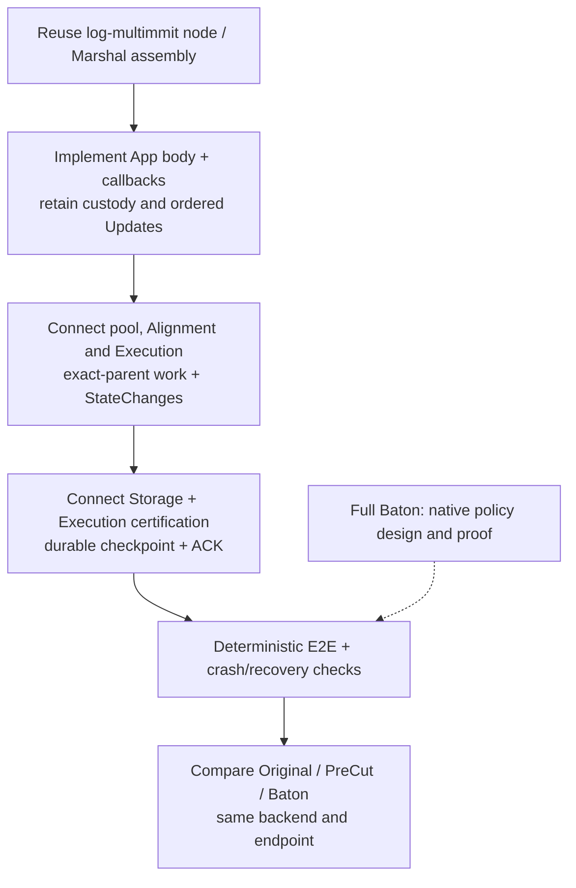
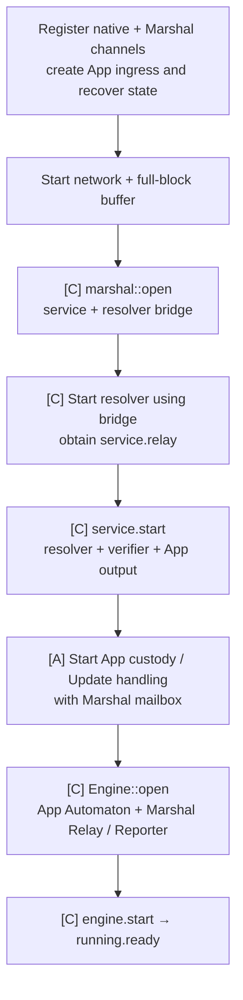

# Commonware integration and development order

**Start with current `log-multimmit` and replace its synthetic App behavior with transaction handling and scheduling.** The existing Engine/Marshal graph already provides producer consensus, body custody, backfill and canonical delivery. Keep one App containing its pool, selected scheduler, execution workers and state backend.

## Implementation dependency map

[Open full-size diagram](../assets/diagrams/diagram-46.svg) · [PNG](../assets/diagrams/diagram-46.png)

The native policy extension is required for full Baton ordering claims. A shared App execution path or a successful documentation build does not establish that extension.

## Developer assignments

**The repository contains compiling signatures and intentionally failing `todo!()` operations. Implement the assigned task below; compilation alone does not complete it.** Source comments carry the same task ID and a `Spec:` path. The [root instructions](../../AGENTS.md) define implementation and review requirements.

Start with MODEL-01 and PAYLOAD-01. POOL-01, PRECUT-01 and STORE-01 can then proceed on agreed types. EXEC-01 uses storage reads; CALLBACK-01 connects custody and speculative dispatch. CERT-01 and IMPORT-01 require exact execution/storage context. APPLY-01 joins the certified canonical path; NETWORK-01 validates the integrated lifecycle. BATON-01 follows a working Pre-cut path. Native protected-prefix work is separately unresolved.

| Task | Source | Deliverable |
|---|---|---|
| MODEL-01 | `alignment/src/types.rs`, `tx-pool/src/types.rs`, `execution/src/types.rs`, owned execution/storage capabilities | Exact in-memory values, retained capabilities and ownership |
| PAYLOAD-01 | `tx-pool/src/payload.rs` | Bounded body codec and body commitment |
| POOL-01 | `tx-pool/src/pool.rs` | Admission, retained selection and durable cleanup |
| CALLBACK-01 | `execution/src/coordination.rs` | Native payload callbacks and claimed speculative dispatch |
| PRECUT-01 | `alignment/src/policy.rs` | Pre-cut implementation of both Alignment contracts |
| BATON-01 | `alignment/src/policy.rs` | Baton implementation of the same contracts, with internal report/direction work |
| EXEC-01 | `execution/src/execution.rs` | Exact-parent execution, canonical repair and checkpoint installation |
| CERT-01 | `execution/src/execution.rs` | Direct signing, evidence collection and restricted verifier output |
| STORE-01 | `storage/src/backend.rs` | Pinned reads, accepted changes, root preparation and persistence |
| IMPORT-01 | `storage/src/backend.rs`, Execution verifier and transition coordination | Certified material import and verified recovery |
| APPLY-01 | `execution/src/coordination.rs` | Retained ordered work, execution-through-submit, events and durable ACK |
| NETWORK-01 | `network/src/main.rs`, Execution assembly | Supervised native services, recovery readiness and shutdown |

Crate READMEs own component details and link to these assignments. Execution implements the native callbacks, retains Update/ACK tokens and owns computation/certification. AlignmentPolicy is public across crates; PreCut/Baton helpers stay private. TxPool and Alignment consume projected inputs and never import Execution. The Storage trait and state/import values live in Execution; its generic callback handle receives the backend from Network assembly. Create Execution ingress with `open(pool, alignment, storage)` before `Service::start` takes its Reporter; attach the returned mailbox through `Execution::start` before native recovery. The SHA-256/MinPk native handle follows the pinned example and does not choose the execution-result signature scheme. Keep one pinned Commonware graph.

### MODEL-01: define exact values before behavior

- **Input and output:** Translate the [value contracts](01-communication-contracts.md#values-carried-between-app-calls) into owned/borrowed Rust values. Replace each `_private: ()` placeholder with required fields, validation and retention; the marker is not a usable representation.
- **Required identity:** OrderedView binds continuous indices, exact blocks and preceding prefix; execution binds canonical base, parent checkpoint, runtime and attempt; certificates bind epoch, exact range/order/base/runtime and complete result. StateView must retain usable pinned reads, not a digest alone. Preserve original Update/Exact ownership in Execution CanonicalInput; internal execution uses its exact OrderedInput projection. Define trusted LaneContext and project SelectionContext/PoolUpdate for TxPool, plus OrderedView/ExecutionView for Alignment without leaking Execution state handles. Define producer-validated construction for values crossing crates without opening verifier-capability constructors.
- **Scope:** Define in-memory contracts without adopting a wire format, VM or result-root scheme. Keep verified authority and direct-execution evidence restricted to their producing owner; raw peer values cannot construct either. Coordinate the representations with their consumers before implementing behavior.
- **Done when:** Exact replay can be distinguished from conflicting input, different-parent execution and stale attempts. Focused tests demonstrate these distinctions and the required capability lifetime; no default values can stand in for authenticated or durable state.

### PAYLOAD-01: body codec and commitment

- **Input and output:** Selected transaction bytes become Payload; bounded untrusted bytes decode to Payload or a codec error; `digest` returns the body commitment. Reuse native TransactionBlock for the header and full-block identity.
- **Required behavior:** Bound count, each transaction and cumulative bytes before allocating; define matching Read/Write/EncodeSize behavior. Use codec Buf. Hash the approved canonical encoding under a unique domain. [Block and custody contract](../../network/README.md#marshal-custody).
- **Decisions first:** Agree transaction framing, limits and hash-domain bytes. The body/header distinction is fixed; the transaction format is not supplied by the scaffold.
- **Done when:** Codec round trips and malformed/truncated/oversized inputs are tested; equal canonical bodies have equal commitments, and native header/body identities remain distinct. Add codec conformance cases when an encoded public format is adopted.

### POOL-01: transaction retention

- **Input and output:** Network supplies LaneContext to `TxPool::open`. `admit` validates and retains by type, returning Admission with duplicate metadata or AdmissionError::Invalid/Backpressure. During Automaton::propose, Execution calls `select` with the exact epoch/lane to get stable bounded Payload bytes; `reconcile` consumes durable outcomes from every lane. TxPool owns its input types; Execution projects matching proposal context and durable outcomes. [Pool contract](../../tx-pool/README.md#pool).
- **Required behavior:** Keep admission independent of proposal eligibility and share all retained types. Compute eligible type pools in `select`; do not store a per-transaction proposal-eligibility class. Preserve exact duplicate identity without relay loops and report capacity pressure separately with caller retry ownership. Selection and epoch reassignment preserve retention; durable outcomes reconcile type pools without an ACK approval.
- **Developer-owned design:** Retain valid transactions by type internally and select eligible types for `(epoch, lane)`. POOL-01 defines the type taxonomy, bucket/index layout, type-to-lane assignment, load distribution, overlapping/uncovered types and safe epoch transitions. Coordinate context values with MODEL-01 and trusted configuration with NETWORK-01; no per-type public pool trait or bucket handle is required.
- **Decisions first:** Choose transaction validity/identity, the shared type-assignment policy, backend, bounded sharing/retry and retention policy. One type per lane and one lane per type are not fixed requirements. Retention by type, context-based selection and sharing across lanes are required.
- **Done when:** Deterministic tests show a tx admitted on node A, whose lane does not serve its type, reaches node B and is selected under B's matching proposal context. Cover non-producer retention/sharing, Invalid rejection without relay, duplicate suppression and retryable capacity. Verify epoch/lane-specific type selection, reassignment without transaction loss, stale selection requests, stable outstanding proposal bytes, canceled proposals and cleanup across type pools from durable outcomes of any lane.

### CALLBACK-01: native payload intake and dispatch

- **Input and output:** Implement Automaton::propose/verify on Execution<S, A>. Return receivers promptly; bounded jobs later return a staged body's digest or payload/custody verdict. Keep TxPool, Alignment and Storage injected; add recovering/live/stopping owner state and retained completions. [Callback flows](../../execution/README.md#coordination).
- **Required behavior:** Propose selects/builds/stages through Marshal. Verify derives the exact BlockRef, starts needed fetch before waiting, checks payload and durable custody, then rechecks current eligibility/deduplication before Alignment admission. Temporary data gaps remain pending; cancellation releases only abandoned local waits. No execution/root/f+1 wait precedes a true verdict.
- **Dispatch:** Recheck `next` against the current parent/runtime/attempt, claim resources once, then launch a Commonware runtime worker. Keep all App lock scopes short; callbacks, completions and Storage events must remain serviceable. Recovery verification must work before speculative activation.
- **Done when:** Deterministic tests cover peer/local/recovery calls, header-before-body arrival, temporary gaps, duplicates, canceled requests, delayed custody after applied progress, exhausted speculative capacity, double-dispatch prevention and safely terminated failed attempts.

### PRECUT-01: common scheduling contract

- **Input and output:** Implement `admit`, ordering-only `commit`, and public `next` for PreCutAlignment. Return admission status or a JobIntent selected from the authoritative SchedulingView. [Alignment contract](01-communication-contracts.md#proposed-alignment-interface).
- **Required behavior:** Preserve completed/current F and sort only eligible unstarted pending work; require an exact usable parent and resources. `next` does not mutate claims or launch work. `commit` reflects exact continuous ordering idempotently without executing, storing or waiting for certification.
- **Decisions first:** Agree the global comparator/tie-break and bounded admission policy. No Baton traffic, reports, directions or native policy changes belong to this task.
- **Done when:** Tests show late B before C starts yields ABC, while B after C starts preserves ACB; missing parents/capacity remain pending; duplicate ordering and candidates do not duplicate work; canonical repair is still possible when native order differs.

### BATON-01: Baton speculative policy

- **Input and output:** Implement the same Alignment/AlignmentPolicy contracts with internally retained authenticated reports and advisory directions. Private method decomposition is up to the implementer. [Baton policy](../../alignment/README.md#alignment).
- **Required behavior:** Preserve F, context binding and raw distinct-identity support. Close one report snapshot at the first 4f+1 valid admissions or fixed deadline. Evaluate bounded candidates and preserve the specified 2f+1 full-prefix/sum-LCP/base fallback behavior. Native cut and canonical execution never wait for this work.
- **Scope:** This task controls speculation. Do not reorder Marshal Updates or manufacture native policy hooks. Authenticated adoption, protected-prefix preservation/continuation and recovery require the [separate native design](05-native-open-decisions.md).
- **Done when:** Tests cover deadline/admission races, duplicate/foreign-context reports, unfinished evaluation, missing reports, late completion and direction conflicts under the agreed policy; optional work cannot starve custody/canonical progress.

### EXEC-01: exact-parent execution and memory

- **Input and output:** Claimed Job becomes StateChanges plus retained direct evidence. OrderedInput projected from App-retained CanonicalInput becomes exact ExecutedRange and changes after complete reuse/repair. AppliedCheckpoint installs a usable durable base. [Execution contract](../../execution/README.md#execution).
- **Required behavior:** Read current writes, then parent overlays, then pinned Storage state; honor tombstones and propagate cold-read errors. Match exact input/parent/runtime/attempt for reuse and accept each current completion once. Store no database/root-building logic in Execution.
- **Checkpoint handling:** Skip covered input, fence incompatible/stale work, preserve compatible descendants and retain views/overlays until workers and references release them. Imported work produces no own direct-execution evidence. Installation adds no ACK round.
- **Done when:** Tests cover ordered AB with speculative ABC, changed-parent repair, stale/duplicate completion, read error versus absence, tombstones, checkpoint advancement, covered-work skipping and safe memory release. The selected VM/runtime is a prerequisite, not a stubbed success path.

### CERT-01: full result certification

- **Input and output:** Matching direct evidence plus PreparedState yields an attestation. Peer attestations/certificates plus authoritative order yield pending, an error or VerifiedCertificate. The verifier is the only constructor of that capability. [Certification contract](../../execution/README.md#certification-result-certification-inside-execution).
- **Required behavior:** Bind epoch, exact input/range/base/runtime and complete state/output/material commitments. Authenticate distinct eligible original signers and enforce f+1 independently of native QC membership. Retain missing-context evidence within bounds; do not turn a root or transport response count into a certificate.
- **Decisions first:** Agree statement/codec/domain, signer keys, threshold-compatible signature scheme and bounded signing-unit policy. A native 4f+1 BLS sharing cannot be lowered to f+1 by changing a counter. Imported results may relay original evidence but cannot be directly signed as local work.
- **Done when:** Tests reject wrong contexts/roots/runtime/base, duplicate/ineligible/invalid signatures and imported signing; verify f versus f+1, pending context, recovery re-verification and delivery-window compatibility. The capability exposes read-only subject/evidence, with no public constructor, Decode, Default or trusted verification flag.

### STORE-01: state material and one durable writer

- **Input and output:** Implement the Execution-owned Storage::read/submit/commit/verify_material/recover contract in `storage/src/backend.rs`, with retained Prepared/Committed/Failed events. Read returns exact-view value/absence/error; submit accepts one complete unit; commit accepts verified authority. Events report later root preparation or certified durability. [Storage contract](01-communication-contracts.md#proposed-storage-interface).
- **Required behavior:** Wire authoritative ordering access and retained bounded event delivery during assembly. Match exact material/order/predecessor, prepare deterministic roots, and serialize canonical mutation. Return acceptance separately from durability. Physical batching cannot change signed history and must drain within delivery capacity, idle tails and shutdown.
- **Failure and ownership:** Keep pre-acceptance work retryable and post-acceptance work retained. Resolve exact retries idempotently. Persist state, outputs, applied identity, original evidence and provenance recoverably; mutable-store failure stops that instance. Implement with chosen QMDB primitives, not a second storage protocol.
- **Done when:** Tests cover pinned reads during advancement, unavailable versus absent state, rejected/retried submission, wrong/stale commit subjects, predecessor chains, partial write/crash, failed instances, bounded tail flush and replay. Only actual recoverable completion emits Committed.

### IMPORT-01: authenticated import and recovery

- **Input and output:** Execution-verified target, peer StateMaterial and current base yield pending, invalid or retained PreparedImport. Recovery yields a RecoveredState candidate for Execution re-verification before publication. [Import and handoff](../../execution/README.md#certification-import-to-checkpoint-handoff).
- **Required behavior:** Reuse QMDB material/proof transport while authenticating the complete execution target in App. Continue valid direct work until both certificate and applicable material are verified. Isolate candidate storage or fence exclusive mutation; recheck the predecessor at adoption. Use the same writer, Committed event and checkpoint handoff as direct work.
- **Execution coordination:** Bind Marshal floor/frontier to the durable App snapshot, authenticate startup floor authority and reconcile old retained Updates before opening another delivery window. A sync progress notice or `attach_database` submission is not completed adoption.
- **Done when:** Tests cover certificate-before-order, missing/wrong material, base changes during import, direct/import races, stale completions, preserved descendants, floor resets, overlap bounds and restart re-verification. Imported provenance survives every transition.

### APPLY-01: canonical delivery through durable ACK

- **Input and output:** Reporter::report(Update) synchronously retains exact block/index/token and updates Alignment ordering. Independent canonical work produces submitted changes; retained Storage events eventually publish checkpoint and ACK exactly covered input. [Canonical flow](../02-e2e/06-ordered-application.md).
- **Required behavior:** Allow a block first seen through Update; no earlier verify or scheduler entry is required. Await the whole selected unit's execution/reuse/repair and Storage::submit acceptance before the next unit. Process Prepared, f+1 and disk flush independently, keeping native callbacks and event intake serviceable.
- **ACK ownership:** Keep all Exact clones until matching certified durability or explicit lifecycle cancellation. Neither Feedback, submit acceptance, a certificate alone nor an Execution install ACK advances delivery. Recover replay between App durability and Marshal cursor persistence without duplicate effects.
- **Done when:** Deterministic tests cover no-prior-verify input, held/rejected submission, full delivery windows, dropped-token prevention, certification pending, storage failure, duplicate replay, conflicting/gapped order and floor-transition overlap. Shared-owner mutexes are never held across execution or storage awaits.

### NETWORK-01: native assembly and service lifetime

- **Input and output:** Define Network configuration and runtime-owned startup, construct the pool/policy/backend and inject them into Execution. Reuse log-multimmit's Engine/Marshal/buffer/resolver/network assembly, with this App's callbacks and state backend. [Assembly sequence](#body-assembly-to-implement).
- **Required behavior:** Supply retained Update and Storage-event ingress; serve custody before Engine::open recovery calls. Start native planes and activate speculation only after both native ready and a consistent recovered App base. Native activities go directly to Marshal; optional App observations use a separate typed handle.
- **Scope:** Reuse Commonware runtime supervision and channel capacities. Do not implement a new Relay/BlockService/Orderer, reuse synthetic example transaction behavior, or silently launch an unfinished node. Implement shutdown/failure ownership across every started service.
- **Done when:** Deterministic integration tests cover startup from genesis, restarted custody verification, replayed Updates before App readiness, partial startup failure, unexpected sibling exit and shutdown durability. Claim E2E completion only after these tests exercise implemented behavior, not the placeholders.

### Completion report for an assignment

State the task ID, changed responsibility, settled policy choices, focused tests and their results, and remaining TODOs. Review must confirm the task's listed input/output and failure contract. A global TODO count is an inventory, not a completion percentage; do not remove a task just to make the count smaller.

## Commonware integration anchors

Current native source is [6233438985d8249d2b2bc1204191d5d405652288](https://github.com/0xEyrie/monorepo/tree/6233438985d8249d2b2bc1204191d5d405652288). These anchors describe that checkout, not the older research baseline.

| Read in this order | Existing code | App connection |
|---|---|---|
| 1. Node assembly | [node.rs](https://github.com/0xEyrie/monorepo/blob/6233438985d8249d2b2bc1204191d5d405652288/examples/log-multimmit/src/node.rs#L242) | Register four Engine planes, Marshal resolver and body-broadcast channels; construct typed App handles |
| 2. Marshal assembly | [marshal.rs](https://github.com/0xEyrie/monorepo/blob/6233438985d8249d2b2bc1204191d5d405652288/examples/log-multimmit/src/marshal.rs#L126) | Reuse buffered Engine, `marshal::open`, resolver bridge, supplied Relay and SchemeVerifier |
| 3. Application callbacks | [application/actor.rs](https://github.com/0xEyrie/monorepo/blob/6233438985d8249d2b2bc1204191d5d405652288/examples/log-multimmit/src/application/actor.rs#L70) | Replace synthetic body construction/checks with TxPool and validity; register scheduling independently of execution completion |
| 4. Engine startup | [engine/mod.rs](https://github.com/0xEyrie/monorepo/blob/6233438985d8249d2b2bc1204191d5d405652288/consensus/src/multimmit/engine/mod.rs#L446) | Service recovery `verify` callbacks during open; then start planes and await readiness |
| 5. Ordered input | [Update](https://github.com/0xEyrie/monorepo/blob/6233438985d8249d2b2bc1204191d5d405652288/consensus/src/multimmit/marshal/types.rs#L128) | Retain input/ACK, notify Alignment of ordering, execute/reuse/repair, verify f+1, durably apply, acknowledge |
| 6. Native policy boundary | [LeaderBlock](https://github.com/0xEyrie/monorepo/blob/6233438985d8249d2b2bc1204191d5d405652288/consensus/src/multimmit/types/block.rs#L802), [Marshal order](https://github.com/0xEyrie/monorepo/blob/6233438985d8249d2b2bc1204191d5d405652288/consensus/src/multimmit/marshal/protocol/order.rs) | Full Baton needs authenticated policy construction/validation/continuation/recovery; callbacks alone do not provide it |

### Body assembly to implement

Body lookup/fetch and custody completion are separate: `get_block` and `fetch_block` may expose buffered material before durability. For a true verification verdict use Marshal's successful `subscribe_block` or stage/put durability completion.

Follow this Mermaid connection sequence. Labels identify existing APIs and application responsibilities; the [detailed startup flow](../02-e2e/09-startup-and-recovery.md) shows the method calls and readiness gates.

[Open full-size diagram](../assets/diagrams/diagram-54.svg) · [PNG](../assets/diagrams/diagram-54.png)

App custody processing must answer recovery verification during `Engine::open`. Activate speculative dispatch only after both native readiness and the matching recovered App base are established.

`Engine::open` spawns no native actors. `marshal::open` already starts its catalog and optional promoter; `Service::start` starts the remaining Marshal actors. Own that entire startup attempt through the existing node/runtime lifetime so a later open failure does not leave earlier services unmanaged. [Marshal lifecycle](https://github.com/0xEyrie/monorepo/blob/6233438985d8249d2b2bc1204191d5d405652288/consensus/src/multimmit/marshal/service/mod.rs#L1).

App processing must answer recovered-body requests while `Engine::open` is pending. Marshal can also begin redelivering old Updates when its service starts, so output ingress must retain them until App recovery is ready. Start in an explicit recovery lifecycle, deduplicate replay and enable fresh speculative admission after the relevant App/native startup fences. A new public callback is unnecessary for this local lifecycle state.

If App also consumes native Activity, use a separate typed handle from its `Reporter<Update<Block>>` and compose `Reporters::from((marshal, app_activity))`. Both App handles may reach the same owner, but Rust's associated Activity type prevents implementing both specializations on the same concrete type. The required output ingress retains Updates without dropping their ACKs. Its ordinary queue bound follows the active delivery window. Floor/import handoff must separately fence and reconcile old App-held Updates before allowing unaccounted overlap with a new window; Update carries no generation field and Marshal reset does not clear App queues. `Feedback::Backoff` does not make Marshal retry a rejected Update. See [delivery semantics](../../network/README.md#marshal-delivery-delivery-backpressure-and-recovery).

Pass native Activity directly to the supplied Marshal mailbox; an optional App observer is a sibling, not a forwarding dependency. Use its existing [pressure policy](../../network/README.md#multimmit-native-activities). Configure `catalog_mailbox_size`, `resolver_mailbox_size` and `backfill_concurrency` through Marshal's existing capacities; these derive router jobs/subscription slots and backfill bounds. They do not make every hint reliable or convert service errors into invalid-payload verdicts. [Derived actor bounds](https://github.com/0xEyrie/monorepo/blob/6233438985d8249d2b2bc1204191d5d405652288/consensus/src/multimmit/marshal/config.rs#L550).

Own service handles through existing runtime supervision. Engine and Marshal each supervise their own actors; the node owner coordinates failures and shutdown across Engine, App and transport lifetimes. Unexpected handle completion is a stop signal even when its result is Ok. Stop native callback producers and fence App work before tearing down body/state services. Abort/join is task termination, not an App flush barrier. Reopen matching native custody and application state on restart; native readiness is not durable application readiness. [Startup/recovery](../02-e2e/09-startup-and-recovery.md), [Marshal supervisor](https://github.com/0xEyrie/monorepo/blob/6233438985d8249d2b2bc1204191d5d405652288/consensus/src/multimmit/marshal/service/supervisor.rs#L64).

Use the callback response's existing cancellation signal to stop obsolete App waits, as the example does. Canceling a request does not undo accepted staging or a subscription's begun durable settlement. Stopping the service also does not guarantee those writes completed: only the successful custody/durable-apply boundary supports the corresponding promise. [Callback cancellation](https://github.com/0xEyrie/monorepo/blob/6233438985d8249d2b2bc1204191d5d405652288/examples/log-multimmit/src/application/actor.rs#L60), [subscription lifecycle](https://github.com/0xEyrie/monorepo/blob/6233438985d8249d2b2bc1204191d5d405652288/consensus/src/multimmit/marshal/service/subscriptions.rs#L1).

For checkpoint bootstrap, `Start::Floor` only seeds a fresh namespace and requires caller authentication of its anchor and snapshot binding; recovered storage wins over Start. Open/config validation does not verify that anchor signature, and the later `Service::start` verifier does not retroactively authenticate it. Prefer the documented `Start::Genesis` plus `install_floor` path for peer-served floors, coordinated with App state import. [Existing startup contract](https://github.com/0xEyrie/monorepo/blob/6233438985d8249d2b2bc1204191d5d405652288/consensus/src/multimmit/marshal/config.rs#L164), [floor and App authority](../../network/README.md#marshal-delivery-reuse-proof-verification-and-storage).

### Baton confirmed-order assembly

Use Marshal's existing canonical `Update` stream for both PreCut and Baton. Marshal already implements the body/proof backfill, native order reconstruction, catalog and ACK cursor previously assigned to a proposed Baton Orderer. App's retained-input handler notifies Alignment of ordering; Execution computes in memory; Execution result handling collects and verifies evidence, then requests Storage commit; Storage matches material and applies durably and supplies a usable checkpoint back to Execution. [Ordered input](../../network/README.md#marshal-delivery).

The native extension for full Baton is narrower and still unresolved: prepared policy must be bound to the actual leader proposal and interpreted identically by native validation/recovery and Marshal. Sorting output Updates locally is invalid. [Policy TODO](05-native-open-decisions.md#todo-bind-baton-prefix-and-policy-to-cut-proposals).

### Pool and storage assembly to evaluate

Keep admission/selection and cleanup inside App's chosen pool implementation. Reuse a compatible whole pool where appropriate; a queue or peer provider alone is not a complete transaction pool. Selection and proposal do not establish canonical retirement. [Pool choices](04-pool-backends.md).

Use QMDB primitives beneath App's state backend. Transaction execution produces changes; selected root preparation and canonical apply/durability remain separate work. Existing sealed-parent forks do not automatically provide root-deferred execution branching. Full `glue::stateful::Application` is optional and must not force hashing on every speculative attempt. [Storage details](03-qmdb.md).

## Development stages and validation flows

| Stage | Concrete work | Evidence required |
|---|---|---|
| 1 | Assemble existing Multimmit/Marshal with the App's body type and callback handles | Actual body custody, relay, native startup/recovery and ordered delivery |
| 2 | Add App-owned pool and deterministic transaction execution/backend | Bounded admission/selection, state effects and linked durable applied identity |
| 3 | Add App `Reporter<Update>` handling | Exact order, replay idempotence, ACK only after certified durable apply, signing units compatible with delivery capacity |
| 4 | Implement independent PreCut scheduler inside App | Pending-only sorting, exact-parent speculative reuse/repair, no Baton instance or traffic |
| 5 | Implement Baton scheduler report/direction work inside App | Authenticated report contexts, snapshot closure and completed bounded selection without blocking cut or confirmed processing |
| 6 | Implement native authenticated Baton policy extension | Proposal binding, pre-vote validation, inclusion/leading-order preservation, continuation and Marshal recovery |
| 7 | Compare Original / PreCut / Baton | Same pool/body/backend/resources/certification endpoint; actual E2E and performance evidence |

App execution certification and direct peer state sync belong with the shared execution/backend path, independent of report collection or direction selection. Retain `f+1` distinct valid signatures over the same irrevocable input, base state, runtime and result; imported state cannot be signed as locally executed. The native consensus quorum is not that execution certificate threshold. These contracts need implementation and tests; this documentation rewrite claims none.

## Primitive reuse catalog

| Responsibility | Existing building blocks | Application-specific work |
|---|---|---|
| Producer callbacks | `Automaton` | Pool selection, body validity and scheduler admission |
| Complete body custody/exchange | Multimmit Marshal, supplied Relay, buffered broadcast and resolver bridge | Body codec/digest, config and limits |
| Canonical input/replay | Marshal synchronizer/catalog/delivery, Update/Exact | Exact application-state apply and idempotent acknowledgement |
| Scheduling | Runtime clocks/tasks, actor mailboxes and future pools | Explicit work budgets, PreCut queue and Baton report/direction rules |
| Transaction state | QMDB batches/database and recovery primitives | Execution semantics, branch identity, selected root preparation and canonical writer |
| Result exchange | Commonware P2P, codecs and cryptography | Exact statements, provenance, distinct signer validation and result/state-sync coordination |

## Copy the assembly from real chains

The current native example is the primary connection reference. Earlier source-pinned ecosystem research remains useful for particular App internals, without importing a second consensus/body layer:

| Historical source | Useful comparison | Limitation |
|---|---|---|
| [Tempo engine](https://github.com/tempoxyz/tempo/blob/61c979a524f9af5de9c540a0088c429a44741e4c/crates/consensus/src/consensus/engine.rs) | Buffer/Marshal/execution handle composition | Simplex and Ethereum execution choices |
| [Alto engine](https://github.com/commonwarexyz/alto/blob/1d87569348b5560699465a72d691d90f18affb9c/chain/src/engine.rs) | Archive and actor ownership/startup | Simplex adapter and older dependency graph |
| [Constantinople pool](https://github.com/commonwarexyz/constantinople/blob/3b6c92e76bf582855615844a4175b8304808f6a9/crates/mempool/src/webserver/actor.rs) | Whole-pool admission/packing/tracking | Fixed transaction types and destructive-selection lifecycle |
| [Nunchi pool](https://github.com/nunchi-labs/sdk/blob/eea35ced709f68c15d6fbc8bcc754696a7e44374/mempool/src/actor.rs) | Generic nonce-lane actor and P2P | Payload/byte bounds, canonical cleanup and restart must fit App |
| [Constantinople execution](https://github.com/commonwarexyz/constantinople/blob/3b6c92e76bf582855615844a4175b8304808f6a9/crates/application/src/consensus/execution.rs) | Computation followed by selected root work | Historical source pattern, not an adopted runtime |

### Reference versions are not one compatible dependency graph

The earlier research inspected native `534af0...`, Commonware MCP `v2026.9.0`, and several ecosystem pins above. Current native integration follows `6233438...`. Those are different source/package graphs; matching Rust type names do not establish interoperability. Check concrete imports, codecs, runtime bounds and storage formats against the chosen current checkout before adapting an ecosystem component. No package upgrade or compiled actor port is made by this rewrite.

### Check native constructor inputs

Copy the current [Marshal constructor](https://github.com/0xEyrie/monorepo/blob/6233438985d8249d2b2bc1204191d5d405652288/examples/log-multimmit/src/marshal.rs#L126) and [node constructor](https://github.com/0xEyrie/monorepo/blob/6233438985d8249d2b2bc1204191d5d405652288/examples/log-multimmit/src/node.rs#L242). Their configs include body decode limits, peer provider/blocker, resolver timing, archive/cache sizes, committee verification and native strategy separation. Numeric example tuning and mock committee/key generation are not selected application production settings.

#### Source reading order

Read node → Marshal assembly → App callbacks → Engine open/start → Update/delivery → native proposal/order code. Read QMDB only after distinguishing transaction execution, root preparation and durable state apply. This order makes the existing owners visible before deciding whether an additional abstraction is needed.

### Source evidence from the indexed release

The [2026-10-04 reuse investigation](../research/assets/review/commonware-reuse-20261004/README.md) preserves historical MCP queries, ecosystem inspections and cross-reviews. Its then-current finding that Multimmit lacked Marshal is superseded by the current source. Historical toy checks/publication receipts do not validate this App integration.
