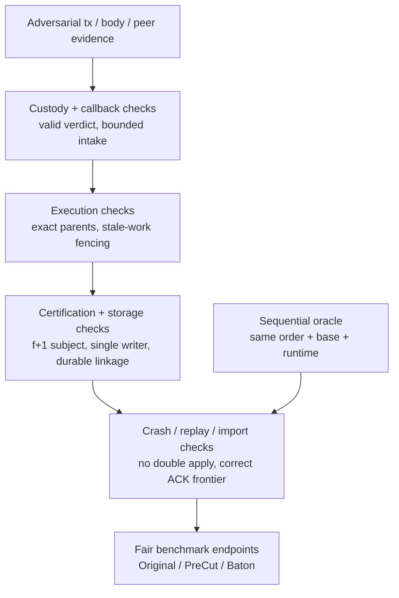

# Cases to verify

**Verify the App at its actual Multimmit/Marshal boundaries.** The cases below are acceptance criteria for future implementation, not executed Baton tests. Documentation source review, link checks and renders verify this design's presentation only.

## What each verification stage must prove

[Open full-size diagram](../assets/diagrams/diagram-47.svg) · [PNG](../assets/diagrams/diagram-47.png)

All proposed App runtime cases below remain **Not run**. Documentation rendering checks validate presentation and links, not these protocol properties.

Use the deterministic Commonware runtime and simulated network with the same public Sender/Receiver interfaces as deployment. Construct real App callbacks and current Multimmit Marshal; native mock callbacks alone do not establish transaction/body/scheduler behavior. Reuse the current [Marshal integration fixtures](https://github.com/0xEyrie/monorepo/blob/6233438985d8249d2b2bc1204191d5d405652288/consensus/src/multimmit/marshal/tests.rs) for assembly patterns.

| Existing support | What it controls | App assertion still needed |
|---|---|---|
| `deterministic::Runner`, simulated Network/Oracle | Seeded scheduling, peer/channel links, delay/loss/bandwidth | Exact application outputs, custody, ordered indices and state |
| Native Engine and Marshal test fixtures | Native producer/DA/order, custody/backfill and delivery lifecycle | App-owned pool and scheduler integration through real callbacks |
| Runtime `DelayedSyncContext` / `PendingSyncs` | Started, entered, parked, completed or failed sync operations | Correct certified App state/output/applied-position/evidence linkage before ACK |
| `Runner::start_and_recover` | Recoverable runtime checkpoint for a subsequent runner | Reopen all matching stores/services; no surviving old writer authority |

Inspect the current sync controls rather than copying an older API name. Observe actual operation gates/completion counts; starting a sync does not prove durability. A lost application ACK is a separate boundary after application state is durable. Runtime mocks model their storage abstraction, not every possible physical device failure. [Current sync controls](https://github.com/0xEyrie/monorepo/blob/6233438985d8249d2b2bc1204191d5d405652288/runtime/src/mocks.rs#L1240), [runtime recovery](https://github.com/0xEyrie/monorepo/blob/6233438985d8249d2b2bc1204191d5d405652288/runtime/src/deterministic.rs#L578).

## Scaffold checks already available

The Rust skeleton implements the actual native trait signatures with intentional TODO bodies. `cargo check --workspace --all-targets --locked`, Clippy, rustfmt and rustdoc validate compilation, lint and declarations; they do not execute the unfinished operations. `just check-stability` verifies the public ALPHA scope. `just` is an optional command runner; README lists the equivalent direct commands for environments without it.

`python3 scripts/check_scaffold.py` validates every TODO task ID and source `Spec:` reference against the [developer assignments](07-development-order.md#developer-assignments). Documentation checks/build and browser inspection cover current navigation, diagram loading, source downloads and mobile layout. The historical archive/review/diagram files were checked byte-for-byte during the repository-layout move.

Keep the runtime cases below as **Not run** until task implementations and their deterministic tests exist. A successful scaffold check is not an execution, certification, recovery or performance result.

## Verification cases by component

| Component | Required scenarios and assertions | App execution status |
|---|---|---|
| Pool / propose | Selected/Unselected/Invalid classification; Unselected on A shared to assigned B as Selected; both valid classes retained/served; Invalid not relayed; exact duplicates do not loop; retryable backpressure; context reclassification without lane-based loss; bounded local-lane batch; canceled proposal; selection does not imply canonical retirement; body digest and supplied producer context match | Not run |
| Custody / verify | Header-before-body and body-before-header; permanent invalidity vs temporary absence; wrong digest/context; accepted stage before durable completion; recovery reads matching retained body | Not run |
| Verify admission | Remote eligible block, local pre-sign check and startup recovery serviced before Engine::open returns; duplicate/canceled/stale completion, including remote rescheduling after closure; parent still pending its verdict; exact contextual deduplication; no false new-peer event; speculative queue pressure never becomes invalid verdict | Not run |
| Scheduling independence | Verify true after valid durable custody while execution is blocked; healthy native progress while App speculative worker is stalled; body I/O remains the promised custody fence; ready canonical work reaches durable ACK under sustained optional backlog | Not run |
| Retention / late verify | Native release uses per-chain released height, not certified height or App applied index; retained recovery requests still validate after speculative retirement; settled/canceled late requests do not recreate work; Marshal prune retains unreleased bodies and App retains independently needed state/results | Not run |
| Canonical Update | Exact next index and block identity; no App reordering; replay below applied cursor checks identity; gap/conflict stops apply; canonical-first input works without prior verify or speculative admission, including Observer | Not run |
| Delivery capacity | Non-dropping Update ingress under `max_pending_acks`; retains token; `Backoff` is not treated as retry; accidental Exact clone/drop detected; out-of-order ACK cannot skip earlier unacknowledged output; batching/signing ranges cannot require an extra Update beyond a full window before any ACK for durable application | Not run |
| Floor/import handoff | App checkpoint durable before authorized floor jump; old App-held Updates survive native waiter reset; new window overlap is bounded; no assumed Update generation field; stale worker/input fenced; crash between App adoption and Marshal reset recovers matching prefix | Not run |
| ACK / recovery | App apply durable before ACK; crash before ACK; ACK observed before Marshal cursor sync; already-applied redelivery is idempotent; ACK after valid speculation needs no repeated transaction execution | Not run |
| PreCut | No Baton instance/reports/direction/policy changes; shared pool/body/backend/resources; `F ++ sort_G(pending)`; exact-parent reuse/repair on new continuous confirmed input | Not run |
| Pending-only rule | A running, C then B admitted before C dispatch gives ABC; B after C starts preserves AC and gives ACB; arrival alone does not reexecute; differing native ABC still repairs from the correct parent | Not run |
| Baton reports | Exact context/identity verification; one report per signer; first `4f+1` or fixed deadline closes once; later arrivals do not extend deadline or mutate frozen originals | Not run |
| Baton selection | Completed bounded full-candidate evaluation; longest valid entire prefix with `2f+1` distinct original support; otherwise sum-LCP for a nonempty report snapshot; zero reports or no prepared policy uses the actual-parent valid base path before protected adoption | Not run |
| Native Baton policy | Authenticated actual-parent/rule/frontier binding; exact leading-order preservation; omission/substitution/reordering rejected; cut never waits for report/timer/optimizer/ACK; view recovery and Marshal interpretation agree | Not run |
| Worker termination | With one worker, an attempt ending without reusable output settles ownership once and allows required work to resume after safe resource release; dropped waiters alone do not release live work; an ordinary valid transaction revert remains a completed execution outcome | Not run |
| Execution / backend | Exact input-state/runtime ancestry; reuse only matching work; stale worker completion fenced; root preparation separate from effects; single canonical writer and crash-linked applied identity | Not run |
| Cold reads | Current writes and parent overlays win; tombstone prevents fallback; pinned base remains stable during concurrent commit/import; missing/pruned view and I/O failure differ from absent key; old views retained until readers finish | Not run |
| StateChanges handoff | Exact ordered range plus changes only; ABC speculation submits AB when only AB is ordered; duplicate/overlapping submissions never double-apply; accepted predecessor chains pipeline before durability; rejection/cancellation/backpressure retain retryable work | Not run |
| Synchronous execution-to-Storage handoff | Delay the last block's execution or `submit` acceptance: the canonical worker neither completes the handoff nor starts the next ordered unit; rejection retains retryable changes; after `Ok(())`, later units proceed while Prepared/certification/flush are delayed; callback and Storage event intake remain live | Not run |
| Execution certification / Storage commit | Execution rejects duplicate/ineligible signers, fewer than f+1, mixed ranges/bases/runtimes/roots and imported own-signing; only verifier-produced values reach commit; Storage rejects stale or mismatched prepared material; recovery and imports reverify original evidence before checkpoint publication | Not run |
| Storage batching and events | Submission/commit acceptance never ACKs or prunes memory; roots/signatures precede application; batched flush preserves each signed root/history; window saturation, idle tails and shutdown drain; retained Prepared/Committed/failure events avoid queue cycles; replay restores only recoverable durable prefix | Not run |
| Checkpoint installation | Direct commit/import/recovery supply usable views; certified ABC skips local B/C; duplicates are idempotent; older checkpoints cannot rewind; conflicting contexts and stale completions rejected; compatible C/D descendants survive an AB commit while Execution is at ABCD; covered overlays freed only after reference/worker release; digest-only/unavailable material cannot skip; no Execution ACK gate | Not run |
| Storage contract | Invalid/insufficient evidence and material mismatch cause no canonical mutation; duplicate signers never increase the threshold; stale base/conflicting order rejected; exact durable replay idempotent; future cancellation cannot bypass writer fencing; storage failure requires recovery; no ACK owned by trait | Not run |
| Certification / state sync | `f+1` valid distinct same-statement signatures; direct/imported provenance; imported state never signed as local execution; state-sync floor/worker/Update coordination; scheduler cannot gate result/apply path | Not run |

Existing native tests include custody subscriptions, staged Relay, exact body/history backfill, restart redelivery and bounded ACK pipelining. Their presence is source evidence of native mechanisms, not proof that the proposed App has been tested. Useful starting points are `buffered_ingress_subscription_establishes_durable_custody`, `production_engine_reporter_survives_engine_and_marshal_restart`, `crash_redelivers_only_until_acknowledgement_is_durable`, and `delivery_pipelines_exact_acknowledgements_up_to_the_configured_bound` in the [current Marshal tests](https://github.com/0xEyrie/monorepo/blob/6233438985d8249d2b2bc1204191d5d405652288/consensus/src/multimmit/marshal/tests.rs).

For each eventual test, compare canonical state/output with a sequential oracle over the same exact order, base state and runtime. Compare Original / PreCut / Baton under matching input, backend, resources and certification/readiness endpoint. Trace repeatability and historical toy tests do not establish these properties or performance gains.
