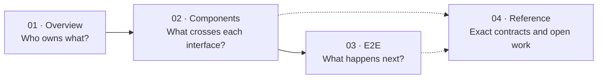

# Baton docs: start here

**Read [01. Architecture](01-overview/01-architecture.md) first.** It shows how one App connects to the existing Multimmit Engine and Marshal, and where TxPool, Alignment, Executor and Storage fit inside App.

## Choose a reading path

[Open full-size diagram](assets/diagrams/diagram-22.svg) · [PNG](assets/diagrams/diagram-22.png)

Start with the picture on each page. E2E pages show a short path first; expand their detailed sequences when you need exact calls and failure handling. **[C]** is existing Commonware, **[P]** a proposed App contract, **[A]** App processing, and **[X]** unfinished native work. Value/ownership maps describe data relationships rather than new interfaces.

## Reading order

The folders and filenames are numbered in reading order. Follow `01-overview`, then `02-components`, then `03-e2e`. Keep `04-reference` nearby for details when needed.

1. **`01-overview/` — understand the whole composition.** Read [Architecture](01-overview/01-architecture.md), then [terminology](01-overview/02-terminology.md) for the values passed between components.
2. **`02-components/` — understand each responsibility and exchange.** Start with [Multimmit](02-components/01-multimmit.md) and follow the [component contents](SUMMARY.md): communication partners, inputs, outputs and completion conditions.
3. **`03-e2e/` — follow the complete flow.** Start with [Transaction to durable state](03-e2e/01-transaction-to-state.md). Files `02`–`09` expand individual paths and recovery.
4. **`04-reference/` — look up details as needed.** Consult [communication contracts](04-reference/01-communication-contracts.md), Rust signatures, backend research and development checks from the component and E2E links.

Within the component section, the order is **Multimmit → Marshal → App integration → TxPool → Alignment → Executor → Storage → Result certification and state sync → P2P**. Once these responsibilities and exchanges are clear, continue to the first E2E page. Detailed type declarations can wait until you need them.

The [full contents](SUMMARY.md), filenames and site's previous/next links use this same order. `assets/` contains diagram renders and the generated Rust export; it is not a reading chapter.

## Before following E2E

Keep three completion boundaries in mind:

- `verify(true)` establishes payload validity and custody; eligible execution is dispatched independently.
- `Alignment::commit(ordered)` records finalized ordering immediately. `Storage::submit` accepts executed changes; `Storage::commit` accepts an Executor-verified request for persistence.
- `StorageEvent::Committed(applied)` establishes certified local durability, supplies Executor's next usable checkpoint and permits ACK of the covered Updates. Executor installation adds no ACK round.

## Document status

These pages describe a proposed App connected to native source at `6233438985d8249d2b2bc1204191d5d405652288`. App implementation, protected-prefix Baton native integration, E2E execution and performance results remain incomplete. Pre-cut and Baton share the App execution/storage contracts; full Baton additionally needs authenticated native policy adoption, preservation and recovery. Backend, comparator, wire and resource policies remain open. The Bank application model remains outside scope.

Markdown is canonical; the site and Rust export are generated from it. See [sources and document status](04-reference/09-sources.md) for evidence and historical material.
