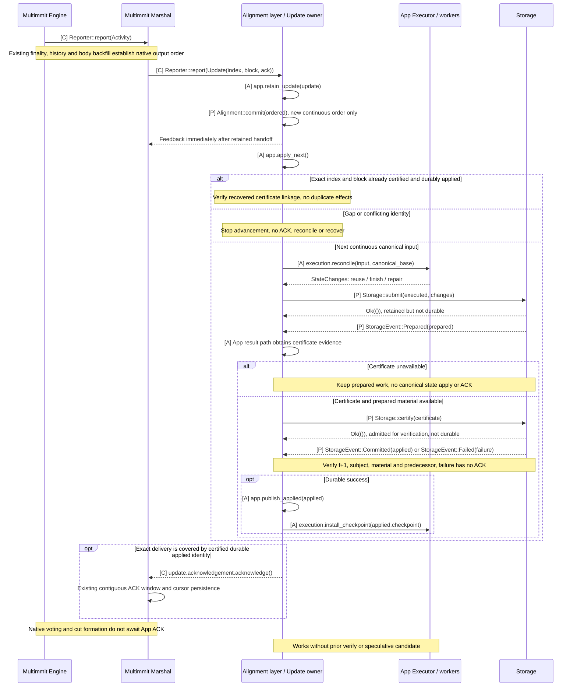
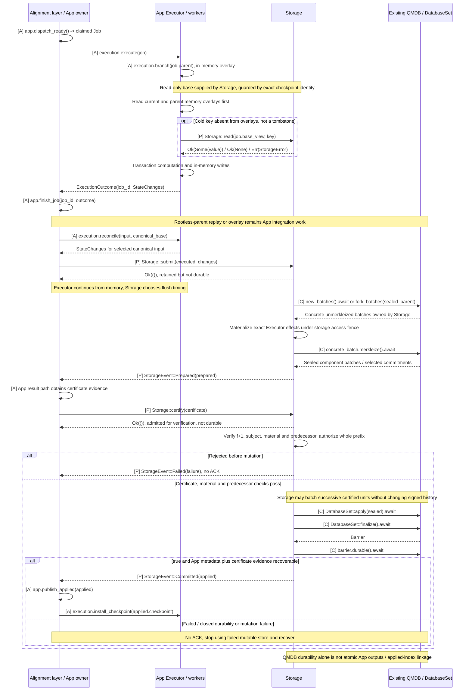

# Ordered input to durable application

**Marshal delivers ordering; Alignment records it; Executor computes and Storage stores.** `Reporter<Update>::report` retains the Update, reflects new continuous order through `Alignment::commit(ordered)` and returns promptly. The separate [`Storage`](../overview/interfaces.md#proposed-storage-interface) accepts ordered changes, validates matching `f+1` evidence and batches persistence. The Update owner sends ACK after `StorageEvent::Committed`, independently of earlier submission acceptance.

Read after [Marshal delivery](../consensus/ordered-input.md), [Executor](../execution/README.md) and [Storage](../execution/storage.md). This case follows ordering-only `Alignment::commit`, StateChanges, Storage events and the retained ACK through timing, completion and failure paths.

Diagram labels: **[C]** existing Commonware interface; **[A]** App-owned processing; **[P]** proposed App trait; **[X]** required native extension; **wire** peer message. See the [interface map](../overview/interfaces.md#diagram-notation) for contracts and implementation ownership.

## Native finality → ordered delivery → durable App application

[Open full-size diagram](../assets/diagrams/diagram-08.svg)

`Update` contains `index`, the complete `Arc<TransactionBlock>`, and `Exact` acknowledgement. The App must preserve the indexed sequence; pending speculative priority must not reorder it. Marshal already owns ordinary native history interpretation, missing-block backfill, finalized output retention and delivery. Baton does not duplicate those mechanisms. [Update contract](https://github.com/0xEyrie/monorepo/blob/6233438985d8249d2b2bc1204191d5d405652288/consensus/src/multimmit/marshal/types.rs#L128)

An Update may be App's first encounter with a block, as for an Observer or skipped speculation. Canonical reconciliation needs no earlier verify or candidate entry: execute with the required application checks, reuse exact validated work, or use verified applicable imported material. State-dependent transaction outcomes do not change native order.

The App owns the effect-to-state contract. `Alignment::commit` reflects ordering even while execution, signatures or storage are pending. Ordering and applied-state frontiers remain separate. Storage owns certificate validation and the writer; Alignment has no `f+1` collection or state-commit approval role. A repeated index is safe to ACK only after checking exact block identity, certified durable state and retained certificate linkage. A gap, conflict or mismatched predecessor stops advancement. Recovery may redeliver after application persistence but before Marshal's cursor persistence.

The execution path may collect several continuous Updates into one bounded certification unit. Keep every original token; compute its internal blocks on private checkpoints, verify its terminal certificate, apply the whole authorized unit, then ACK covered Updates. The unit must fit the active delivery window and cannot rely on its own ACK to receive inputs needed for certification. A terminal certificate alone does not authorize intermediate checkpoint publication. The diagram shows the unit's processing once sufficient input is retained.

## What the ACK waits for

The ACK is an in-memory completion signal issued **after matching `f+1` certification and durable application**. It is not a network consensus vote and does not perform I/O itself. Even a completed local speculative result must pass the certificate gate. With a valid certificate already available, only remaining preparation/persistence may be needed; otherwise required execution, certification or verified import remains pending. `Alignment::commit` does not authorize an early ACK.

The example node supplies assembly wiring, not this durable transaction consumer. Its `OutputReporter` acknowledges immediately in headless mode; with a terminal sink, it forwards the Update there. A transaction App replaces that consumer with the retained canonical-worker path above; copying the example's immediate ACK would skip application durability. [Example output reporter](https://github.com/0xEyrie/monorepo/blob/6233438985d8249d2b2bc1204191d5d405652288/examples/log-multimmit/src/application/reporter.rs#L33)

Within one active delivery window, Marshal can report multiple Updates while earlier ACKs are pending, up to `max_pending_acks`. Once the window is full, further application delivery waits; native Multimmit continues independently. Completed ACKs free the contiguous window prefix, and Marshal separately syncs its durable cursor. The window slot does not wait for that cursor's own I/O. [Delivery actor](https://github.com/0xEyrie/monorepo/blob/6233438985d8249d2b2bc1204191d5d405652288/consensus/src/multimmit/marshal/actors/delivery/actor.rs#L303), [ACK window](https://github.com/0xEyrie/monorepo/blob/6233438985d8249d2b2bc1204191d5d405652288/consensus/src/multimmit/marshal/actors/delivery/acks.rs#L107)

`report` is a synchronous retained handoff: preserve every accepted Update and its Exact token in App state, using coalesced wakeups if needed. `Backoff` does not request redelivery, and an unacknowledged dropped Exact clone cancels completion. The [canonical callback contract](../baton/interfaces.md#marshal-reportupdate-canonical-input-and-ack) defines active-window sizing, clone obligations, crash replay and App-owned floor/import coordination; floor resets do not clear App's retained Updates.

## Execution lifecycle: QMDB branches and canonical promotion

[Open full-size diagram](../assets/diagrams/diagram-09.svg)

Alignment, execution workers and storage are internal App responsibilities. Separate execution effects from root preparation, preserve exact parent/context reuse, and use one canonical writer for direct execution and peer import. The proposed Storage trait defines reads, submissions, certificate intake and events; concrete execution calls need no additional public Executor trait or delivery actor. QMDB APIs and the remaining root-deferred branching work are described in [QMDB](../execution/qmdb.md). No unconditional atomicity across independently stored state, outputs and applied metadata is implied.
