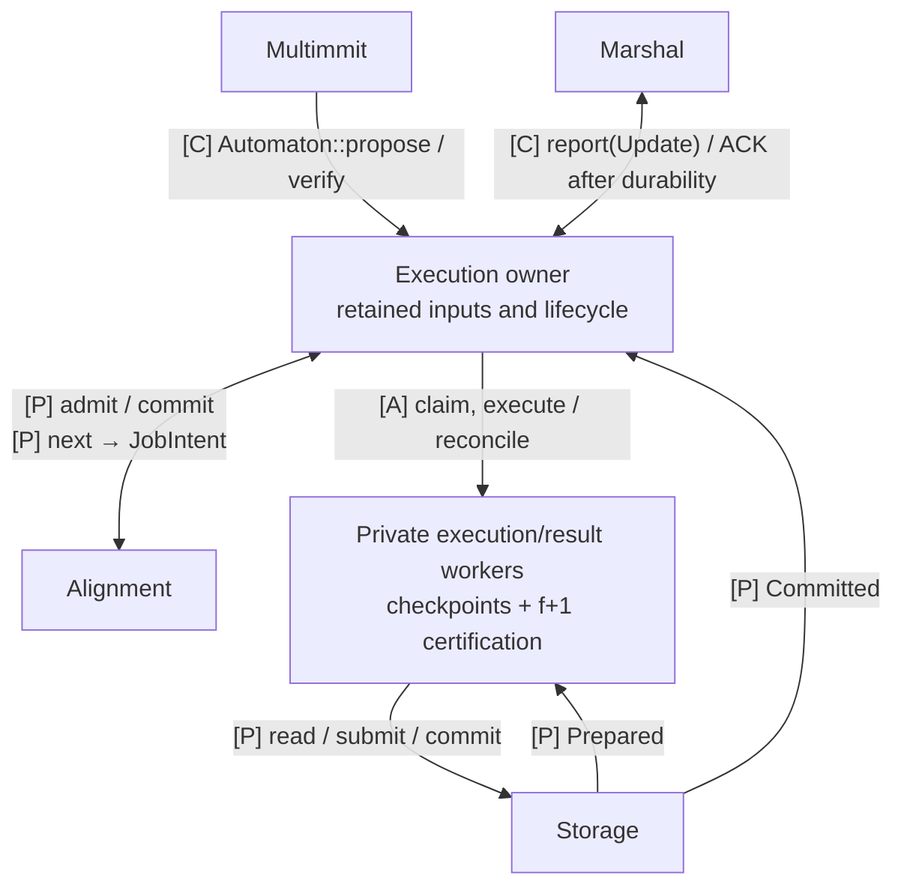
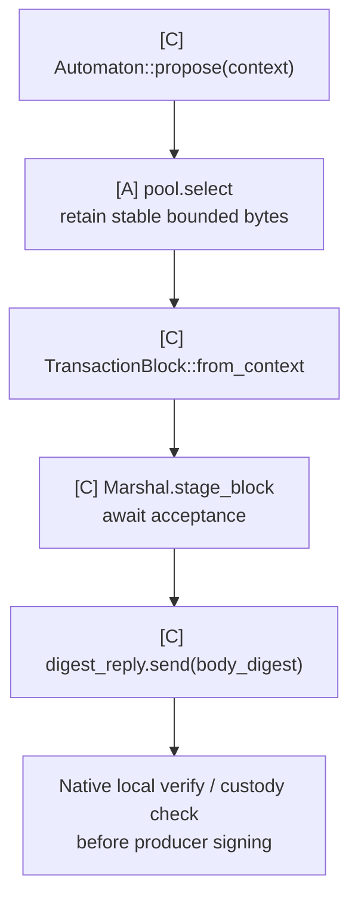
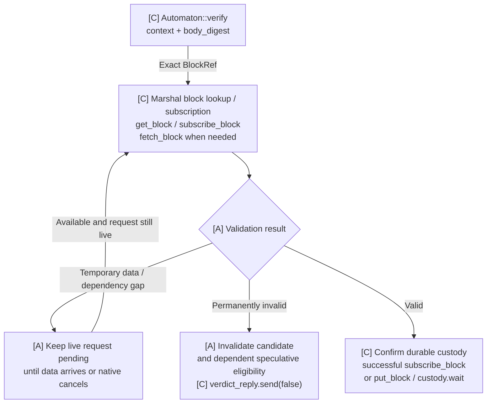
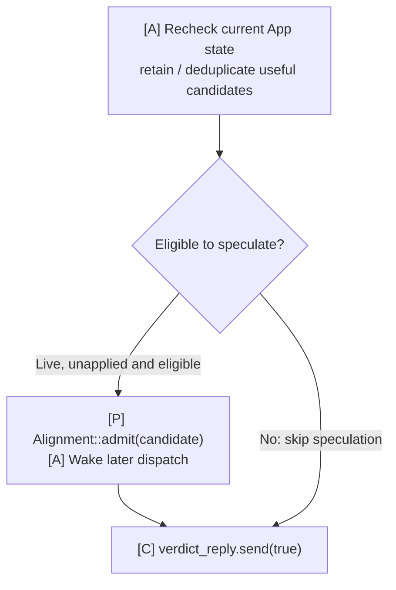
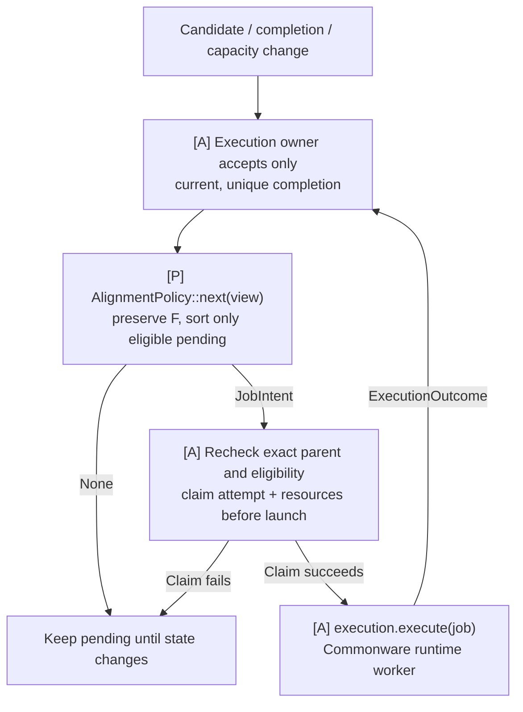
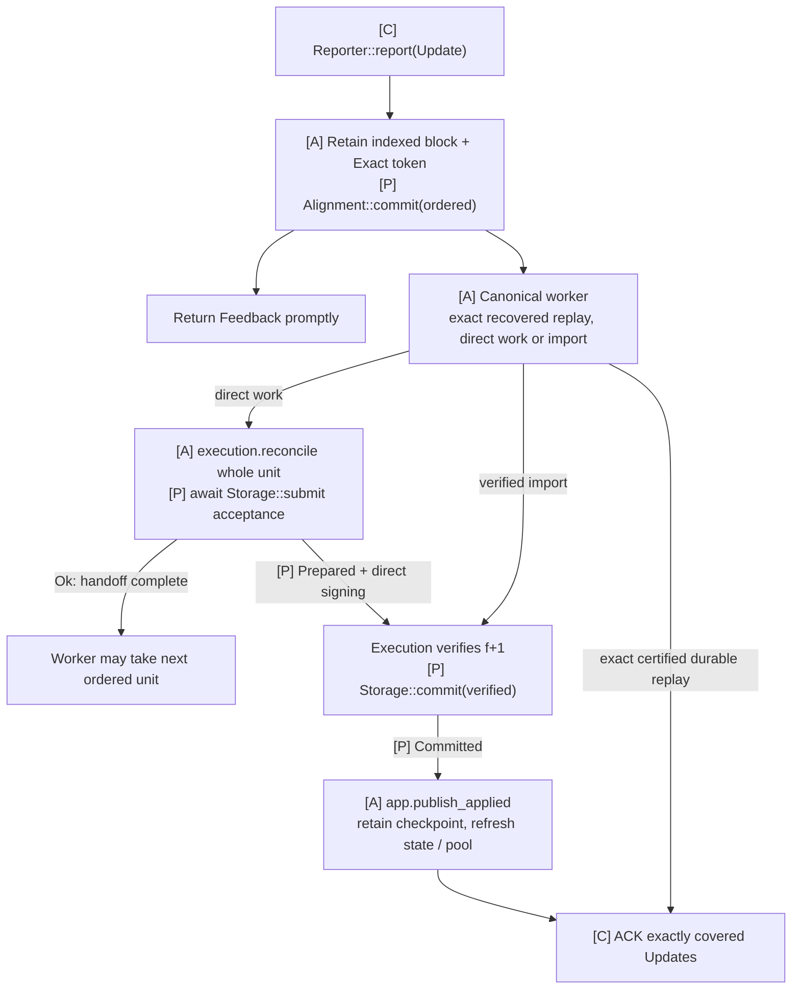
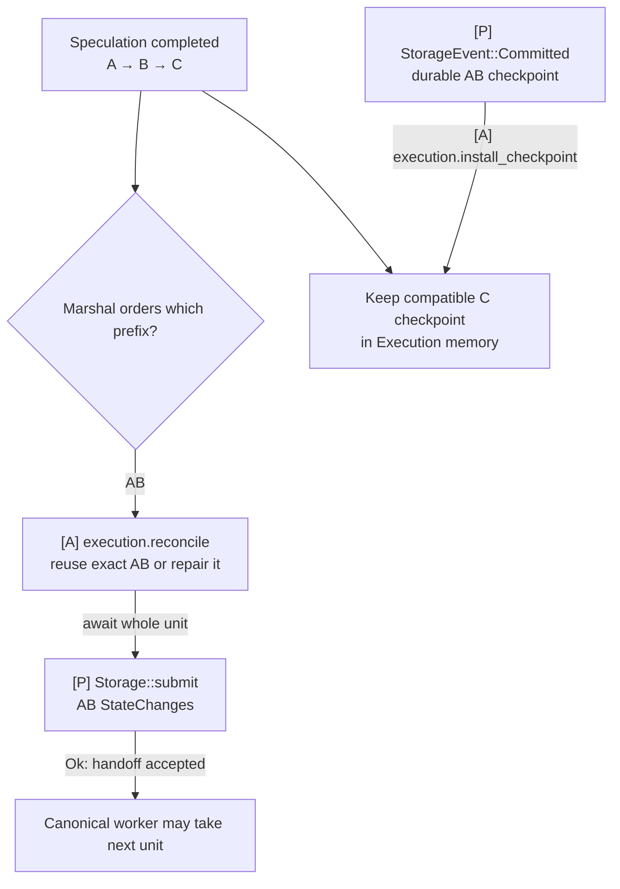
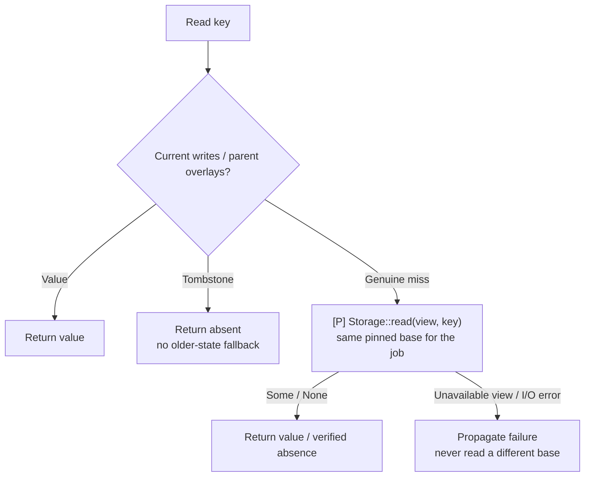
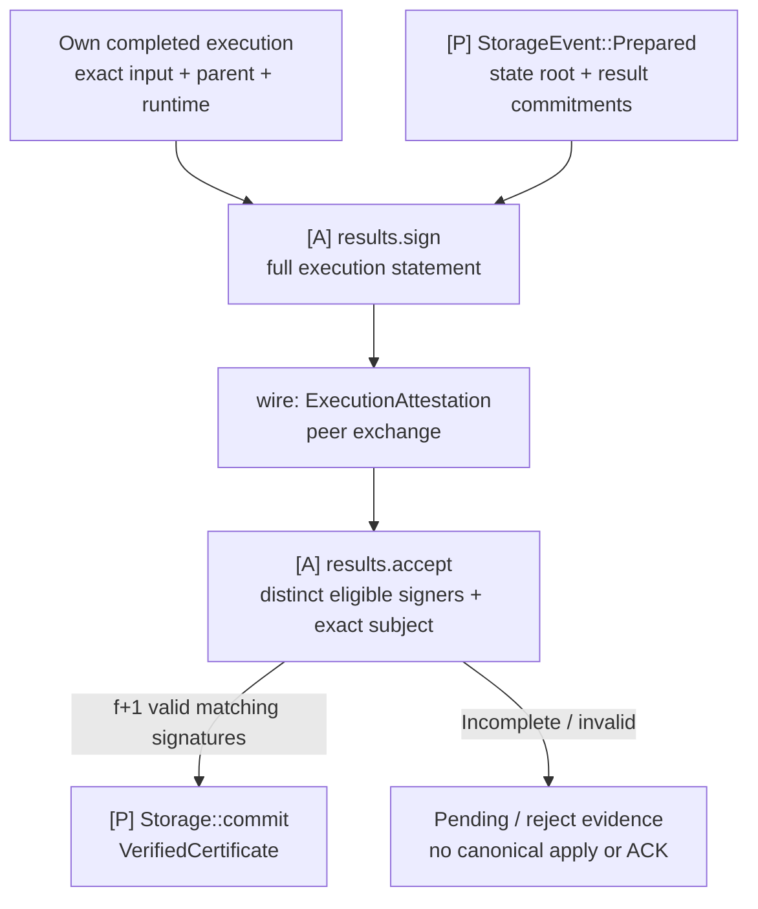
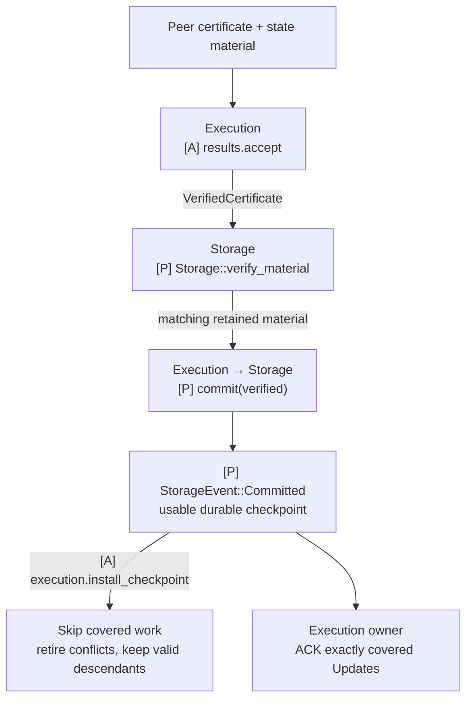

# Execution

`baton-execution` implements the native application callbacks and owns coordination, transaction execution, in-memory checkpoints and `f+1` result verification. The `Execution<S, A>` handle reaches one shared owner, with injected `Storage` and `AlignmentPolicy` implementations and a TxPool handle.

## Responsibilities and state

Keep payload/custody verification, retained Marshal Updates/ACK tokens, canonical work, dispatch claims and result routing here. Execution workers and result verification are private modules of this crate. TxPool owns transaction retention; Alignment owns scheduling policy; Storage owns roots and durable state.

The term **App** in native contracts and E2E diagrams denotes this Execution's Commonware application role. `app.*`/owner labels describe its coordination handlers; `execution.*` and `results.*` describe its internal computation and verification. They are not separate crates or additional public traits.

## Communication interfaces

| Partner | Interface | Completion means |
|---|---|---|
| Network assembly | `Execution::open(pool, alignment, storage); Execution::start(mailbox)` | Create retained callback/Update ownership in recovering state |
| Multimmit | `Automaton::propose`, `Automaton::verify` | Staged payload digest or valid payload/durable-custody verdict; no execution wait |
| Marshal | `Reporter::report(Update)` and existing Mailbox methods | Retain exact ordering/tokens, use native block custody and ACK only covered certified state |
| TxPool | `admit`, `select`, `reconcile` | Bounded transaction intake/selection or durable-outcome maintenance |
| Alignment | `Alignment::admit/commit`, `AlignmentPolicy::next` | Admit/reflect order/select an intent; Execution rechecks and claims work |
| Storage | `read`, `submit`, `commit`, `verify_material`, `recover`; `StorageEvent` | Pinned reads, retained changes, certified persistence and verified import/recovery handoff |

Project `SelectionContext` and `PoolUpdate` for TxPool, and `OrderedView`/`ExecutionView` for Alignment. These crates never import Execution state. `CanonicalInput` retains native ACK tokens; internal `OrderedInput` carries execution data only.

## Storage contract

`baton_execution::storage::Storage` and the execution/state values define what Execution requires from a backend. `baton-storage` implements this contract; Execution never imports that concrete crate. Existing material-verification and recovery operations are included in the same trait so the injected backend services the entire direct/import/recovery lifecycle.

`VerifiedCertificate` is constructed only by the private execution verifier. `DirectEvidence` stays internal and is never recreated from imported state. Store original evidence, not a trusted flag. See the [shared Storage contract](../docs/03-reference/01-communication-contracts.md#proposed-storage-interface) and [backend responsibilities](../storage/README.md).

## Implementation tasks and completion

**TODO operations remain unimplemented.** Read the linked assignment for inputs, prerequisites, failure handling and acceptance tests. A source `Spec:` path resolves from its crate directory.

| Task | Required work and acceptance criteria |
|---|---|
| MODEL-01 | [Exact state, execution and retained-delivery values](../docs/03-reference/07-development-order.md#model-01) |
| CALLBACK-01 | [Native callbacks, custody and dispatch](../docs/03-reference/07-development-order.md#callback-01) |
| APPLY-01 | [Canonical execution-through-submit and durable ACK](../docs/03-reference/07-development-order.md#apply-01) |
| EXEC-01 | [Execution, memory and checkpoint installation](../docs/03-reference/07-development-order.md#exec-01) |
| CERT-01 | [Direct signing and full f+1 verification](../docs/03-reference/07-development-order.md#cert-01) |

Use focused deterministic tests after implementation and the [workspace checks](../README.md#validate-a-change). Compilation and documentation checks do not establish protocol behavior.

## Detailed behavior

- [Native callbacks and coordination](#coordination)
- [Execution and checkpoints](#execution)
- [Certification and state sync](#certification)

## Execution: native callbacks and coordination

**Execution connects Multimmit callbacks and Marshal deliveries to the pool, scheduling policy and Storage.** The shared Execution owner coordinates lifecycle, dispatch and retained Update tokens; callback handles are its entry points. Existing Multimmit Marshal supplies block custody, body exchange and ordered delivery.

Read the composition and communication table first, then follow [`propose`](#coordination-automatonpropose-pool-to-staged-block), [`verify`](#coordination-automatonverify-validity-custody-and-scheduling) and [`report(Update)`](#coordination-marshal-reportupdate-canonical-input-and-ack). [Startup](#coordination-assemble-before-opening-the-engine) explains when those entry points become available.

### One owner, independent work

[Open full-size diagram](../docs/assets/diagrams/diagram-26.svg) · [PNG](../docs/assets/diagrams/diagram-26.png)

The owner retains Update tokens and coordinates completions. Its short intake handlers stay available while body retrieval, transaction work and storage I/O run.

The name `App` in native/E2E notation is the application role implemented by Execution. This crate owns callback/delivery coordination, transaction computation, in-memory checkpoints and result certification. Alignment selects work; TxPool retains transactions and builds payloads; Storage prepares roots and persists state. These responsibilities do not require one actor per crate. Native `multimmit::AppExecutor` runs Automaton callback jobs and does not execute application transactions.

This design uses the current local Commonware checkout, [6233438](https://github.com/0xEyrie/monorepo/tree/6233438985d8249d2b2bc1204191d5d405652288). Earlier research against `534af0e` predates its Multimmit Marshal. Application scheduling, the transaction runtime and Baton policy integration described here remain to be implemented.

### Responsibilities

| Owned responsibility | What the Execution owner coordinates |
|---|---|
| Native callback intake | Route payload construction/validation to the pool and custody path |
| Speculative dispatch | Admit eligible candidates, request a policy intent, recheck context and claim resources before launch |
| Ordered input | Retain complete indexed Updates and tokens; immediately reflect continuous ordering in Alignment |
| Independent completions | Accept current execution results and route Storage events without blocking other intake |
| Durable publication | Retain/forward usable checkpoints, ACK covered Updates and schedule pool maintenance |
| Lifecycle | Recovery readiness, stale-worker fencing, retained queues and shutdown |

The callback handles and shared owner belong to Execution. Public `Alignment`/`AlignmentPolicy`, concrete TxPool operations and the injected `Storage` contract connect the other crates. Execution/result helpers remain private. [Architecture](../docs/01-overview/01-architecture.md) shows the composition.

Pre-cut and Baton share the same execution, certification and storage path. Pre-cut has no Baton instance, reports, directions or native policy change. Baton adds intended-order collection and advisory direction; authenticated native policy adoption remains separate unfinished work.

### Communication interfaces

| Direction | Interface or value | Completion means |
|---|---|---|
| Multimmit → App | `Automaton::propose(ctx)` | Returned receiver later yields the staged body digest |
| Multimmit → App | `Automaton::verify(ctx, body_digest)` | Returned receiver later yields the validity/custody verdict, independently of execution |
| Marshal → App | `Reporter::report(Update)` | Full indexed block and ACK token retained; `Feedback` completes the handoff |
| App → TxPool | `pool.select` / `pool.reconcile` | Stable proposal bytes / maintenance from durable outcomes |
| App → Alignment | `admit(candidate)`, `commit(ordered)` | Eligible candidate retained or finalized ordering reflected |
| App dispatch → Alignment policy | Public `AlignmentPolicy::next(view)` | `JobIntent` or `None`; the owner still claims the job |
| App → Execution | `execution.execute/reconcile` | Exact-parent `ExecutionOutcome` / ordered StateChanges |
| App → Storage | `Storage::submit/commit` | Work or evidence retained; events complete later stages |
| Storage → App → Execution | `StorageEvent::Committed(applied)`, then `execution.install_checkpoint` | Certified durable identity published and a usable execution base handed over |
| App → Marshal | `update.acknowledgement.acknowledge()` | Matching delivery covered by certified durable App state |

The flows below expand each callback’s ownership, waits and failure paths. The [Rust reference](../docs/03-reference/02-rust-signatures.md) contains existing signatures. The [communication reference](../docs/03-reference/01-communication-contracts.md) defines exact values and completion/failure contracts. **[C]** is existing Commonware, **[P]** a proposed contract, **[A]** private App behavior and **[X]** unfinished native work. These names identify responsibilities rather than requiring one public trait per connection.

Use Marshal's existing `Relay` implementation. Its broadcast key is the **full header/block digest**, which locates the staged full block; this differs from the body digest returned by `propose` and passed to `verify`. The native wire carries signed headers separately from the Marshal body broadcast. A receiver may therefore have the header before the body. [Body flow](../network/README.md#marshal-custody) explains these identities and custody stages.

`Reporter` has an associated `Activity` type. One concrete Rust type cannot implement it twice with two different associated types. Give the same Execution owner two small typed handles if it needs both native observations and Marshal deliveries. This is ordinary mailbox wiring, not another service layer.

Cloned callback handles route to the same App state. For `propose` and `verify`, return the receiver promptly and run the pending request work shown below as bounded async jobs. Body/custody waits leave the Execution owner free to handle intake and completions; completed jobs re-enter that owner before updating shared state. The [existing example mailbox](https://github.com/0xEyrie/monorepo/blob/6233438985d8249d2b2bc1204191d5d405652288/examples/log-multimmit/src/application/mailbox.rs#L148) uses this handoff.

### Automaton::propose: pool to staged block

[Open full-size diagram](../docs/assets/diagrams/diagram-49.svg) · [PNG](../docs/assets/diagrams/diagram-49.png)

Selection and proposal do not retire transactions; cleanup follows canonical durable outcomes.

`stage_block(...).await` accepts custody work; the returned custody handle is the later durable-completion boundary. `put_block(...).await` combines staging and waiting. The native local `verify` must confirm validity and durable custody before local signing. If App promises durability earlier in its own propose implementation it may wait there, but selecting a batch or accepting staging alone is not a disk flush.

Transient absence of transactions or backpressure follows the callback's request lifetime and configured producer behavior. Do not invent an empty-block policy or treat local storage failure as successful custody. A failed mutable-storage operation is a fatal/recovery condition for that storage instance.

### Automaton::verify: validity, custody and scheduling

The callback starts a bounded verification job and returns its receiver promptly. The job follows this flow; its waits leave the App event loop available.

#### Verification entry points

`verify` is not a network-receive notification. Current Multimmit invokes it in three places:

- **Remote producer path:** native authentication/eligibility admits a header before the voter asks App to verify its payload. Duplicates, malformed packets and not-yet-eligible headers do not map one-to-one to calls.
- **Local producer path:** after `propose`, native code calls `verify` as a custody check **before signing the local header**.
- **Recovery:** `Engine::open` rechecks retained payload obligations before actors start.

Interpret successful **live** verification according to the node's role:

| Role | Candidate interpretation |
|---|---|
| Validator with a local producer lane | `context.chain() != local producer chain` can identify other-lane work |
| Nonproducing validator | Live validation still exists; there is no local lane to exclude |
| `Role::Observer` | No live per-chain validation; normally enter through Marshal Update unless an explicit authenticated early-candidate intake is added |

The callback has no origin or recovery flag. Track native role/lane and App lifecycle explicitly; those checks filter speculation, not the native custody verdict.

A local pre-sign body can be prepared locally. If report eligibility requires an authenticated native header, promote it only when that evidence is available. `TransactionProposed` and `ProtocolAccepted` are useful best-effort observations; missed hints may reduce speculation but cannot block canonical processing.

#### Payload and custody

[Open full-size diagram](../docs/assets/diagrams/diagram-20.svg) · [PNG](../docs/assets/diagrams/diagram-20.png)

Derive the exact `BlockRef` from `context.header(body_digest)` using App's configured hasher. Check the body's digest, context and payload rules. Start an explicit fetch when needed **before waiting for the subscription to complete**. A successful subscription already establishes custody; lookup/fetch alone does not.

#### Candidate admission and verdict

After validity and durable custody are confirmed, re-enter the Execution owner. Applied position or lifecycle may have changed while the job waited.

[Open full-size diagram](../docs/assets/diagrams/diagram-21.svg) · [PNG](../docs/assets/diagrams/diagram-21.png)

**`true` means valid payload and durable custody.** Admission only updates pending candidate state. [Later dispatch](#coordination-dispatch-after-verification) waits for the exact execution parent and resources; the verdict does not wait for transaction execution, result roots, reports or directions.

The actual `verify` future returns `oneshot::Receiver<bool>`; App later sends the verdict through the paired sender. `false` means permanent invalidity, not “body has not arrived,” “worker busy” or “speculation failed.” A canceled request stops its pending job; custody failure cannot become `true`, and mutable-store failure requires recovery of that instance. See [the body API guide](../network/README.md#marshal-custody-use-marshals-existing-body-apis) for the fetch-first custody path and superseded subscription handling.

The shared Automaton documentation describes single-shot verification and terminal closure. Current Multimmit's remote chain plane has a narrower implementation exception: a closed receiver becomes `Unavailable`, eligibility returns to `Ready`, and verification can be dispatched again within the same run. Local uncanceled custody failure is fatal; recovery also requires `true`. Do not rely on closure as a portable retry mechanism, and deduplicate repeated live calls as well as recovery. [Remote dispatch](https://github.com/0xEyrie/monorepo/blob/6233438985d8249d2b2bc1204191d5d405652288/consensus/src/multimmit/actors/voter/chain_plane.rs#L522), [eligibility transition](https://github.com/0xEyrie/monorepo/blob/6233438985d8249d2b2bc1204191d5d405652288/consensus/src/multimmit/machine/eligibility.rs#L352).

Use payload validity rules that can legitimately be checked at this boundary. Producer context does not specify the final cross-lane state. State-dependent transaction outcomes belong to execution against the chosen exact parent; a speculative revert or conflict does not retroactively make an otherwise valid payload malformed.

The scheduler's pending entry is not a finished execution result. Native remote dispatch can occur while the producer parent's own validation is pending; it does not prove all predecessor bodies are ready. App checks candidate ancestry/body readiness and the execution checkpoint separately. Admission is an inexpensive local state update. Keep speculative capacity separate from custody and canonical delivery: when a speculative budget is exhausted, retain/coalesce a deferred candidate where the chosen bounded policy permits, or forgo that speculative opportunity. Do not send `false` or wait for execution just to obtain a speculation slot. Marshal's later canonical Update remains authoritative even if a block was never speculated.

Deduplicate candidates across concurrent verification, local proposal, activity hints and recovery. Repeated verification refreshes candidate facts; it does not reset an existing execution attempt to pending. Match exact epoch/context/block identity and exclude already applied speculative work using current owner state after asynchronous custody completes. Canonical application may have advanced while verification waited. Already-applied or unscheduled does not mean invalid payload: complete a still-required custody verdict honestly while skipping speculative admission. If a required producer parent is permanently invalid, dependent candidates remain ineligible even if their own payload bytes passed validation. Apply the [role and lifecycle checks](#coordination-when-speculative-execution-begins) to admission, independently of the custody verdict.

#### Dispatch after verification

[Open full-size diagram](../docs/assets/diagrams/diagram-50.svg) · [PNG](../docs/assets/diagrams/diagram-50.png)

An unfinished parent or exhausted worker capacity keeps dependent work pending. Claims bind exact input state, runtime, ordered prefix and local attempt; scheduling selection alone starts no work.

Computation runs through Commonware runtime workers, outside the native callback and App's short admission handlers. App retains the execution tree, completed effects and worker fences; the scheduler chooses pending work using that state. Claiming the job prevents another wakeup from starting the same attempt; distinct exact-parent repair work remains distinguishable. A failed launch or a current attempt ending without reusable output must settle its ownership once and re-evaluate work from the last valid checkpoint. Release claims/resources only after work never started or has safely terminated; dropping a waiter alone does not prove submitted CPU work stopped. Retain required canonical input for the chosen repair/recovery path. Correlate the current local attempt as well as exact input/parent/runtime: a matching generation alone does not make duplicate completion safe. The scheduler does not interpret the native producer header's `parent` as an application state root.

### Marshal report(Update): canonical input and ACK

Marshal calls `Reporter::report` synchronously with an `Update` containing `index`, `Arc<TransactionBlock>` and `acknowledgement: Exact`. Acknowledge that exact delivery only after App has verified a matching `f+1` execution-result certificate and durably applied the covered input.

`Alignment::commit(ordered)` reflects finalized ordering as soon as continuous indexed input is retained, without waiting for execution or certification. The canonical worker reuses an exact matching result or completes/repairs the required work.

The trusted local Marshal stream supplies the ordering authority; App checks its exact range against the recovered application checkpoint. Update is not a portable finality proof and does not carry execution state, runtime, result certificate or Baton policy. A peer-sent object with the same fields cannot substitute for this local callback. External evidence export remains a separate open contract, not a second verifier required for ordinary App delivery.

[Open full-size diagram](../docs/assets/diagrams/diagram-51.svg) · [PNG](../docs/assets/diagrams/diagram-51.png)

Submission pending/rejection retains the unit and retryable changes. The worker advances only after Storage accepts; certification and flush proceed separately. The owner retains every ACK token, forwards the durable checkpoint to Execution and recovers on storage-instance failure.

An Update may be App's first encounter with the block, including for an observer or skipped speculation. Canonical processing cannot require an earlier `verify` call or scheduler entry: it performs the application checks needed for execution, or reuses exact validated work. This does not add another Automaton callback.

The public [`Storage`](../docs/03-reference/01-communication-contracts.md#proposed-storage-interface) contract owns root preparation and durable application authorized by Execution. Execution supplies StateChanges with exact executed-range metadata; Storage prepares storage commitments; Execution collects and verifies evidence before requesting commit. The retained Update owner forwards the `Committed` event's checkpoint to Execution and handles ACK. Storage submission can precede certification and durability; neither acceptance alone authorizes ACK. A call into this trait never waits for Alignment approval.

Do not put application execution inside `report` or return an async future from it. App can pipeline receipt and computation while preserving canonical application order. Reports/direction planning cannot approve or gate this worker. App's capacity policy must also let required custody and canonical execution, root preparation and durability make progress under sustained optional load. Speculation, report verification and planning cannot indefinitely monopolize the resources that work needs.

| Event | What it proves | What can continue |
|---|---|---|
| `report(Update)` returns | App accepted the delivery into its retained path | Native consensus and other delivery slots |
| App finishes matching transaction work | A result exists for the exact execution context | Root preparation and result signing; canonical apply awaits certification |
| Execution verifies matching `f+1` certificate | Exact ordered input/base/result is certified | Writer may apply matching material after its authority checks |
| App completes certified durable apply and ACKs | App can recover this applied input and certification evidence | Marshal releases acknowledged window capacity in contiguous order |
| Marshal syncs its delivery cursor | Marshal can recover its acknowledged delivery position | Recovery from the persisted cursor and permitted pruning |

Within one active delivery window, Marshal can report up to `max_pending_acks` outstanding Updates. A full window pauses further App delivery; native voting, leader finality and producer progress do not wait for these ACKs. Retain every accepted Update and its Exact token in a queue sized for that window. `Closed` terminates delivery; `Backoff` does not retry a dropped Update. Every Exact clone must acknowledge, and dropping an unacknowledged clone cancels its live waiter.

ACK is an in-memory signal after App durability. Marshal subsequently persists its own cursor, so a crash between those boundaries can redeliver already-applied input. Compare recovered position and exact identity before ACKing replay; do not duplicate effects. A gap or conflicting identity stops application for recovery/error handling. An included block with a missing body is never an empty slot.

For floor/import transitions, the active-window bound does not cover old Updates still retained by App after Marshal resets its window. Update has no generation field. Serialize the transition through Execution ownership: fence/reconcile old inputs and tokens against matching durable App state, or explicitly budget bounded overlap before accepting a fresh window. The [detailed handoff](#certification-coordinate-the-app-checkpoint-with-marshal) remains implementation work.

Result certification precedes canonical application for both direct and imported work: irrevocable exact input/base/runtime plus `f+1` distinct matching execution signatures. While signatures are missing, retain prepared work without canonical state apply or ACK. Signing must precede application, and the next certification unit must fit the active delivery capacity. Within a unit, private execution checkpoints allow progress before application. [Execution result contract](#certification-result-certification-inside-execution).

### Assemble before opening the engine

Network first calls `Execution::open(pool, alignment, storage)` to create retained Update ingress. Pass its clone as the Reporter to `Service::start`, then give the returned Mailbox to `Execution::start`. Early Updates remain retained while the mailbox is unattached; body work starts after attachment. This two-step construction follows the native service dependency and does not add a forwarding layer. Keep speculation gated until recovery and native readiness finish.

Restore App's canonical state/applied binding, or initialize the agreed App genesis; Marshal's index 0 is genesis and is never delivered as an Update. Use the [existing assembly](../docs/03-reference/07-development-order.md#body-assembly-to-implement), with App custody and retained Update intake available before `Engine::open` invokes recovery verification. Gate speculative dispatch during recovery, not the custody answers needed to finish open.

Pass App's Automaton, Marshal's relay and the native activity reporter into Engine. Start its planes, await native readiness and App's recovered base, then activate scheduling and re-evaluate retained candidates; another successful verify callback is not guaranteed. Native `ready` is only a startup milestone. The example supplies wiring, not the transaction execution or durable Update consumer.

Keep failed startup, sibling-service lifetimes and shutdown under the [existing node owner](../docs/03-reference/07-development-order.md#service-lifetimes). Checkpoint imports must also follow the [floor-to-App-state authority contract](#certification-coordinate-the-app-checkpoint-with-marshal), including authentication before using `Start::Floor`.

### Native activities and optional local notifications

Route native `Activity` directly to Marshal through its [existing mailbox reporter](../network/README.md#multimmit-native-activities). App may additionally consume `TransactionProposed`, `ProtocolAccepted`, finality or history observations for candidate correlation and advisory scheduling. These are best-effort, idempotent hints; App must not build a second finality/delivery engine from them.

Shared execution progress is ordinary App state: after canonical apply, remove applied pending entries and rebase/fence conflicting speculative work without calling `Alignment::commit` again. Applied-progress coordination adds no extra ACK protocol or scheduler approval. Result signatures, certificates and state-sync material travel directly between peer application execution components; Baton report collection is outside that path.

### Baton-specific work stays inside the application

Baton scheduling owns the report window, intended-order snapshot, bounded candidate evaluation and advisory direction. Reports bind epoch, view, history, canonical parent, rule, window and frontier. They express intention, not execution completion. Reuse the existing Clock, runtime tasks, crypto, codec and authenticated P2P for this work. Bound both retained messages and submitted CPU work; an unordered future pool alone is not a capacity limit.

The ordinary local rule is `F ++ sort_G(S_pending)`: preserve completed/current execution order and sort only eligible work not yet started. Cut readiness never waits for reports, a timer, planning, speculative execution or a direction reply. Details and the remaining protected-prefix integration obligation are in [Alignment behavior and direction](../alignment/README.md#alignment).

**An app-only Baton scheduler can guide speculation today; it cannot make its preferred order canonical by rearranging Marshal Updates.** The full research objective still needs an authenticated native policy/adoption mechanism and consistent history interpretation. Keep this explicit rather than adding a facade that makes the missing protocol work appear implemented.

## Execution and checkpoints

**Execution computes transactions, manages in-memory checkpoints and certifies execution results.** Execution coordination supplies jobs and canonical input; Storage supplies pinned cold state and certified durable checkpoints. PreCut and Baton use the same Execution behavior.

### Execution, submission and memory

[Open full-size diagram](../docs/assets/diagrams/diagram-29.svg) · [PNG](../docs/assets/diagrams/diagram-29.png)

The canonical worker waits through execution and Storage acceptance. Root preparation, f+1 certification and flush complete separately; compatible descendants remain usable.

Native Multimmit's private `AppExecutor` runs `Automaton::propose/verify` callbacks. Baton Execution implements those callbacks and owns the transaction-computation workers described here.

### Roles and responsibilities

| Responsibility | Owned state or work |
|---|---|
| Execute an exact-parent job | Transaction computation and in-memory effects on the assigned valid checkpoint |
| Retain reusable work | Checkpoints and StateChanges bound to exact input, parent, runtime and local attempt |
| Reconcile finalized input | Reuse matching work, finish missing work or repair the differing suffix |
| Certify results | Bind Storage-prepared state roots to direct execution and exact ordering; sign, collect and verify matching `f+1` evidence before requesting Storage commit |
| Install durable progress | Adopt Storage's usable checkpoint, skip covered input and retire conflicting attempts |
| Release memory safely | Preserve compatible descendants and retain overlays/views while workers or references need them |

Alignment selects work; the Execution owner rechecks and claims the attempt before launch. Storage prepares roots and persists state. Result processing is part of Execution: it signs, collects and verifies evidence, then requests commit. The [Execution owner](#coordination) retains Update ACK tokens and coordinates these independent completions.

### Communication interfaces

| Direction | Call or value | Completion means |
|---|---|---|
| App dispatch → Execution | `execution.execute(job, storage)` → `ExecutionOutcome` | Exact-parent StateChanges, or failure/cancellation; no persistent write |
| App canonical owner → Execution | `execution.reconcile(ordered, storage)` → `StateChanges` | Effects for the required ordered unit, reusing or repairing prior work |
| Execution → Storage | `Storage::read(view, key)` | Value or absence at the exact pinned base; unavailable views and I/O failures are errors |
| Execution → Execution owner → Storage | StateChanges + bound `ExecutedRange`, then `Storage::submit(...).await` | The canonical worker completes the unit's execution-to-storage handoff only after Storage accepts it; flush timing belongs to Storage |
| Storage → Execution, through App routing | `StorageEvent::Prepared(prepared)` | State root and result commitments for signing against retained direct-execution evidence |
| Execution → Storage | `Storage::commit(verified)` | Accept a commit request after Execution completes `f+1` verification; durability arrives later |
| Storage → Execution owner → Execution | `StorageEvent::Committed(applied)`, then `execution.install_checkpoint(applied.checkpoint)` | Install a certified durable base and skip its covered input |

`execute`, `reconcile` and `install_checkpoint` are private Execution operations described in the [communication contracts](../docs/03-reference/01-communication-contracts.md#private-pool-and-execution-calls). The shared owner binds changes to accepted job metadata before submission. Storage receives StateChanges rather than an Execution memory checkpoint, root or database batch.

### Execution-to-Storage completion

For each direct canonical unit, the Execution canonical worker awaits all required execution or exact-result reuse, then awaits `Storage::submit(executed, changes)`. Only `Ok(())` completes this handoff and lets that worker advance to the next ordered unit. Computation finishing or placing changes in an intermediate App queue does not complete it. Pending or rejected submission keeps the unit and its retryable changes retained; storage-instance failure requires recovery.

For speculative ABC with only AB finalized, reconcile all of AB and await Storage's acceptance of AB's changes. Keep C in memory. After acceptance, the canonical worker can process the next ordered unit without waiting for root preparation, certification or disk flush. Existing compatible speculation is retained independently.

This is a sequential async operation in the canonical worker. The App event loop, native callbacks and Storage event intake remain serviceable while it waits. There is no new `Execution::flush` method or change to ordering-only `Alignment::commit`. Memory reclamation still follows durable checkpoint installation and safe reference release.

### Exact parents and reusable work

Execution jobs carry the exact input block plus the execution checkpoint selected by the scheduler. A producer's `Context.parent` identifies that lane's previous header. It cannot identify the predecessor in the merged execution sequence. The same body after different prefixes needs different execution identity. Bind completed work to canonical base, application/runtime/rule version and exact prior inputs; the concrete encoding remains open.

Candidate metadata identifies the exact block; an execution attempt also identifies its chosen path and parent. A duplicate candidate notification does not launch another copy of an active attempt. Repair on a different exact parent remains distinct work.

Preserve completed/current `F` and sort only pending eligible inputs. A state-dependent child starts when the valid predecessor checkpoint is ready. Missing/unfinished parents leave work pending. A new arrival does not cancel or relabel started work; a new canonical Update may require exact-parent repair. [Scheduling rule](../alignment/README.md#alignment-global-rule-for-local-execution-and-reports).

### Cold reads and checkpoint installation

[Open full-size diagram](../docs/assets/diagrams/diagram-55.svg) · [PNG](../docs/assets/diagrams/diagram-55.png)

Read current and parent overlays first, including tombstones. Only a genuine miss calls `Storage::read` against the retained base view. A failed or unavailable read never means absent data and never switches the job to a newer base. Failure/cancellation cannot produce a reusable completed checkpoint.

Accept completion once for the current attempt/context/ancestry; stale results cannot attach to the execution tree. Dropping a waiter does not necessarily stop its worker. Reclaim resources only after termination or reference release makes that safe.

For a durable ABC checkpoint while local work is at A, installation skips B/C and makes ABC available as the parent for later work. Check identity and read access, reject conflicting checkpoints and never rewind to an older base. Retire covered/conflicting attempts, ignore late completions and preserve compatible descendants without applying covered changes twice. Installation adds no ACK round. The [checkpoint handoff contract](../docs/03-reference/01-communication-contracts.md#checkpoint-handoff-and-execution-skipping) defines the full retention rules.

### Execution effects and storage roots

Execution produces exact StateChanges on memory overlays. [Storage](../storage/README.md#persistence) materializes selected effects into concrete QMDB batches, prepares deterministic commitments and controls physical persistence. Retain effects still needed by branches before a root-preparation operation consumes its only draft. Existing sealed-parent forks are usable; root-deferred branching needs its own App integration. See the [QMDB reference](../docs/03-reference/03-qmdb.md).

The full `commonware_glue::stateful::Application` lifecycle is optional reference material. Its [mailbox](https://github.com/0xEyrie/monorepo/blob/6233438985d8249d2b2bc1204191d5d405652288/glue/src/stateful/actor/core/mailbox.rs#L8) targets the block/ancestry `commonware_consensus::Application` and Simplex Marshal contracts. Multimmit uses different callbacks; concrete DB utilities can be reused independently.

### Result certification and state sync

[Execution result certification](#certification) combines accepted direct-execution evidence with Storage-prepared commitments and peer signatures. Execution validates matching `f+1` evidence before requesting Storage commit for direct or imported results. While certification is pending, valid private execution may continue; canonical state and ACK do not advance.

[State sync](#certification-state-sync-from-certified-execution-results) supplies the same durable checkpoint handoff. Imported work retains its provenance and cannot produce the node's own direct-execution signature. Later work executed directly from that checkpoint may be signed.

### Open decisions

| Item | Decision |
|---|---|
| Application transaction semantics | |
| QMDB variant / state encoding / result root | |
| Deterministic canonical operation and batch boundaries | |
| Root-deferred effects/read representation and checkpoint policy | |
| Execution identity / parent binding / checkpoint granularity | |
| Worker placement / cancellation / access-fencing contract | |
| Recoverable linkage of state / outputs / applied position / provenance | |
| Branch retention / memory / disk budgets | |
| Query / result material / certified state-sync protocol | |

### Commonware primitives in the execution layer

| Reused mechanism | App responsibility still required |
|---|---|
| QMDB and concrete `glue::stateful::db` utilities | Transaction semantics, exact execution ancestry and deterministic selected commitment |
| Runtime `Spawner`, `Strategizer`, existing future pools | Placement/work bounds and context-checked completion; a future pool alone does not bound work |
| Crypto signatures/certificates and typed P2P | Full execution subject, eligible distinct signers, `f+1` and direct/imported provenance |
| QMDB sync plus resolver | Trusted execution target, compatible material and active-validator writer handoff |
| Existing journal/metadata/barriers | App state/output/applied-index/certificate crash consistency; Marshal separately owns its delivery cursor |

The [source catalog](../docs/03-reference/07-development-order.md#primitive-reuse-catalog) and [QMDB page](../docs/03-reference/03-qmdb.md) distinguish current source from older reuse investigations. No transaction backend, result protocol, runnable scheduler or benchmark is implemented by this documentation.

## Result certification and state sync

**Direct execution and certified state import share one Execution–Storage path.** Execution verifies `f+1` execution certificates and requests `Storage::commit(verified)`; Storage persists matching material and returns a usable checkpoint. Execution installs that checkpoint, and the Execution owner ACKs covered Updates.

Follow [result certification](#certification-result-certification-inside-execution), then [state import and checkpoint installation](#certification-state-sync-from-certified-execution-results). The latter can skip local execution while retaining the same verification and durability requirements.

### What Execution certifies

[Open full-size diagram](../docs/assets/diagrams/diagram-31.svg) · [PNG](../docs/assets/diagrams/diagram-31.png)

Certification belongs to Execution. A root alone is insufficient: signatures bind the same epoch, exact ordered range, canonical base, runtime and full result.

### Responsibilities

| Owner | Responsibility |
|---|---|
| Execution | Bind direct execution to the complete result, sign, collect and verify matching `f+1` evidence; install certified durable checkpoints |
| Storage | Prepare roots, verify and retain matching state material, and persist through the same canonical writer for direct work and imports |
| Execution owner | Retain Update tokens, route completions and checkpoints, coordinate import/recovery transitions, and ACK only certified durable input |

Result processing stays inside Execution. State import uses the existing Storage ownership and checkpoint handoff; neither needs a separate service or public trait. Retain original evidence and serving obligations, and preserve direct-versus-imported provenance.

### Communication interfaces

| Direction | Call, event or value | Completion means |
|---|---|---|
| Execution computation → its result processing | Accepted direct `ExecutionOutcome` and its exact job context | Local computation evidence; it still needs irrevocable input and prepared commitments before signing |
| Storage → Execution result processing, through the owner | `StorageEvent::Prepared(prepared)` | Commitments/material for the selected unit; no canonical durability yet |
| Execution result processing → peer Apps | `ExecutionAttestation(statement, signature)` | Own signature created locally for directly executed, fully bound work |
| Peer Apps → Execution result processing | `ExecutionAttestation` or `ExecutionCertificate` | Local validation yields `VerifiedCertificate`, pending or invalid after full-subject and signer checks |
| App import handling → Storage | `Storage::verify_material(verified, material, base)` | `PreparedImport`, pending or invalid; matching material retained for a later commit request |
| Execution → Storage | `Storage::commit(verified)` | Locally verified result accepted for persistence; durable completion arrives separately as `StorageEvent::Committed` |
| Storage → Execution owner | `StorageEvent::Committed(applied)` | State, outputs, applied identity and original certificate evidence are recoverable |
| Execution owner → Execution | `execution.install_checkpoint(applied.checkpoint)` | Adopt a usable durable base, skip covered work and retire conflicts |
| Execution owner → Marshal | `update.acknowledgement.acknowledge()` | Exactly covered delivery acknowledged after certified App durability |

`results.sign(statement, direct_evidence)` and `results.accept(evidence, canonical_context)` are local private helpers behind those exchanges. `Storage::verify_material` belongs to the injected Storage contract and `execution.install_checkpoint` to Execution; execution and result helpers remain private; import/recovery use the Storage trait. Peer messages are logical content with open codecs. See the [detailed result contract](../docs/03-reference/01-communication-contracts.md#private-result-import-and-lifecycle-calls) and [message catalog](../network/README.md#networking-messages-used-in-diagrams).

Execution and persistence use the [Execution](#execution) and [Storage](../storage/README.md#persistence) contracts. The Execution owner retains each Update and records `Alignment::commit` immediately, then drives independent execution, certification and durability. Follow the [E2E canonical sequence](../docs/02-e2e/06-ordered-application.md) for their timing, the [certification sequence](../docs/02-e2e/07-result-certification.md) for peer exchange and [state import](../docs/02-e2e/08-state-import.md) for checkpoint handoff. PreCut and Baton share this path; reports and directions never gate it.

### Result certification inside Execution

Execution result-message handlers use existing authenticated P2P and crypto directly. Baton report/direction handling does not relay or gate execution certificates, state sync or apply.

A direct signer requires its own completed execution/validation evidence, a prepared full result commitment, irrevocable exact input and the correct canonical input state. Bind epoch, range, exact ordered inputs, canonical base, runtime/rule and selected result/output/material commitments. Local worker generations and writer permits are not stable shared signature fields. Advisory speculative order alone does not satisfy the signing condition.

Collect signatures only after validating the full subject, eligible epoch identity and signature. Count each identity once. State finalization requires `f+1` distinct matching signatures plus verified irrevocable order and canonical input-state linkage. That verified certificate is also a prerequisite for canonical state application and the covered Marshal ACKs. Eligible result signers need not belong to the particular ordering QC. Fewer signatures keep application pending while native consensus and valid private execution continue. A root alone or transport response count is insufficient. A certificate for a different result cannot authorize local effects; retain the certified result's matching material or recover the mismatch.

An imported verified result retains imported provenance. The app may relay/serve the original certificate; it cannot issue its own direct-execution signature for work merely imported. Recovery without direct-execution evidence cannot recreate that authority. It can directly execute and sign a subsequent range from the imported canonical checkpoint. Certification, material availability and local durable/read readiness remain separate milestones.

Per-block/per-chunk boundaries, statement codec/domain, result-root scheme, keys, serving/retention and result-switch policy remain open. A longer-range certificate cannot be sliced into a shorter-range certificate.

#### Certification units and delivery progress

A certification unit is a bounded continuous ordered range with an exact start base and certified terminal result; its concrete boundaries remain open. All inputs needed to certify the next unit must be obtainable within the active `max_pending_acks` capacity at the participating signers, including after restart or a floor transition. Validate that compatibility during assembly; otherwise waiting for more Updates while withholding every ACK creates a delivery deadlock. Short partial units are valid only if their boundary is part of the common signing policy. Do not solve a full window by ACKing uncertified input.

Within a multi-block unit, compute successive blocks on private exact-parent checkpoints without awaiting per-block canonical application. Prepare and sign the unit's terminal result before the writer applies it; requiring application before signing would create a circular wait. Apply the whole certified unit and then ACK its covered Updates. A terminal certificate cannot be sliced to authorize an intermediate checkpoint unless the authenticated statement explicitly certifies that boundary. This permits bounded range signing without requiring per-block signatures.

Persist the certificate, exact subject and required verification context with the recoverable applied record, or a durable reference whose evidence remains available. On restart, Execution revalidates the recovered certificate and exact context; Storage confirms matching material and durable records before publishing readiness or ACKing replay. Body custody and private work storage may persist earlier; they do not advance the certified canonical applied position. Result certification, canonical durability and Marshal's cursor durability remain distinct sequential conditions.

### Import to checkpoint handoff

Certified state import is available during normal validator execution as well as recovery. Execution verifies the peer certificate; Storage verifies and retains matching material before the shared commit and checkpoint handoff.

[Open full-size diagram](../docs/assets/diagrams/diagram-32.svg) · [PNG](../docs/assets/diagrams/diagram-32.png)

Continue direct work while a certificate or applicable material is missing. A certificate arriving before the matching irrevocable input remains pending or prompts ordering recovery; it cannot settle unresolved order. Stop or fence unfinished direct execution only after both the certificate and usable material have been verified and the canonical writer can safely adopt the target.

#### Import checks and completion

| Stage | App checks | Result |
|---|---|---|
| Execution certificate | `f+1` distinct eligible epoch validators on the same exact input/range, canonical base, runtime/rule and complete result | Authenticated execution target |
| Imported material | State delta/checkpoint and outputs match the target and correct local predecessor | Applicable candidate material |
| Canonical handoff | Recheck the current predecessor and writer authority after async preparation; shared fences; no partial local branch used as another delta's base | Authorized app-state transition |
| Durability | State, outputs, applied identity, certificate evidence and imported provenance recover together | Certified durable canonical checkpoint; covered Updates may be ACKed |
| Checkpoint handoff | Storage emits `Committed` with exact prefix/runtime/state identity and a usable pinned view; Execution owner forwards it | Execution installs the base, skips covered input and retires incompatible memory work |
| Later execution | Direct execution from the installed checkpoint | Own result/signature for that later range |

Material format and switching policy remain open; imports preserve the [certification requirements](#certification-result-certification-inside-execution) above.

For a certified durable ABC target while local Execution is at A, `execution.install_checkpoint(ABC)` skips B/C and makes ABC the parent for D. The checkpoint must contain usable state access, not just a digest or numeric position. Check exact prefix/context before removing work; reject stale/conflicting completions after installation. A missing certificate, missing material or failed apply cannot produce this handoff. The [checkpoint contract](../docs/03-reference/01-communication-contracts.md#checkpoint-handoff-and-execution-skipping) also governs direct commits and recovery. Marshal ACK requires certified durability, not a second ACK from Execution.

### Coordinate the app checkpoint with Marshal

Marshal's floor/progress describes native ordered delivery, not the app's execution result. `floor_at` and `install_floor` reuse native proof and delivery recovery; they do not fetch/validate/apply QMDB state. Authenticate the exact floor-to-app-checkpoint relationship and make the app target durable before authorizing delivery to resume beyond it. Do not advance Marshal over application work merely because a certificate or storage progress notification arrived. [Marshal floor APIs](https://github.com/0xEyrie/monorepo/blob/6233438985d8249d2b2bc1204191d5d405652288/consensus/src/multimmit/marshal/mailbox.rs#L450).

For a fresh namespace, `Start::Floor { floor_generation, floor }` requires the caller to authenticate the floor's anchor with the existing epoch L-QC verifier and bind its emitted frontier and positive monotone `floor_generation` to the imported App snapshot before opening Marshal. This is an existing startup field, distinct from App worker generations; `Floor` and `Update` themselves carry no generation field. Opening checks structure; the verifier passed later to `Service::start` does not authenticate that startup choice retroactively. For a peer-served floor, use `Start::Genesis` followed by the verifying `install_floor` path. [Existing startup contract](https://github.com/0xEyrie/monorepo/blob/6233438985d8249d2b2bc1204191d5d405652288/consensus/src/multimmit/marshal/config.rs#L163).

An in-flight floor change replaces the delivery generation and clears Marshal's previous pending window. The App may still retain old Updates, so `max_pending_acks` alone does not bound queued work across repeated resets. Coordinate each floor transition with App intake, reconcile old exact indices/blocks and bound any overlap before accepting the new window. `Update` carries no generation field; use App-owned transition state rather than inventing an upstream flag. Concrete cross-store switching and recovery sequencing remains implementation work. [Delivery reset](https://github.com/0xEyrie/monorepo/blob/6233438985d8249d2b2bc1204191d5d405652288/consensus/src/multimmit/marshal/actors/delivery/actor.rs#L423).

State installation refreshes the shared execution view; it is not a second notification of already-known ordering. An authenticated native floor that advances known ordering must reconcile that prefix through the same idempotent Alignment ordering contract. See [canonical application](../docs/03-reference/03-qmdb.md#commit-a-branch-to-canonical-state).

### Reuse certificate building blocks

| Existing mechanism | Reuse | App check still required |
|---|---|---|
| `p2p::utils::codec` typed wrappers | Encode/decode existing authenticated sender/receiver traffic | Bounded codec, full statement, original eligible signer identities |
| Crypto `Subject`, `Attestation`, `Scheme`, `Signers` | Domain/message definition, signing, signature verification and packaging | Exact input/base/runtime/result interpretation and distinct eligible `f+1` |
| Optional buffered broadcast | Share/cache an identified certificate or material object | Cache key identifies the object; different attestations cannot all overwrite one statement digest |
| Optional collector | Solicit request-bound peer responses | Its count is transport responses before app validation, not valid signer count |

Current source: [certificate APIs](https://github.com/0xEyrie/monorepo/blob/6233438985d8249d2b2bc1204191d5d405652288/cryptography/src/certificate.rs), [typed transport](https://github.com/0xEyrie/monorepo/blob/6233438985d8249d2b2bc1204191d5d405652288/p2p/src/utils/codec.rs), [collector response handling](https://github.com/0xEyrie/monorepo/blob/6233438985d8249d2b2bc1204191d5d405652288/collector/src/p2p/engine.rs#L190).

`Scheme::assemble` packages supplied attestations; it does not replace signature verification. Validate and deduplicate roster indices before constructing signer sets. Decode peer certificates with the selected epoch verifier's bounded `certificate_codec_config`, not its unbounded trusted-storage configuration. Keep a bounded execution-statement envelope because primitive attestation/certificate data does not supply our exact execution context. Scheme-specific proof-of-possession and original-signature provenance requirements still apply.

`N5f1::quorum(n)` computes `n-f`, or `4f+1` for `n=5f+1`; this is not the execution-result threshold. Multimmit also has distinct DA and nullification threshold sharings, not an existing `f+1` result-signing role. Select compatible certificate/key material and quorum handling, or use lower-level signature/bitmap primitives while enforcing `f+1` in app assembly and verification. A quorum adapter cannot lower an existing BLS sharing's polynomial threshold. No new native quorum or result-signing format is adopted. [Current fault model](https://github.com/0xEyrie/monorepo/blob/6233438985d8249d2b2bc1204191d5d405652288/utils/src/faults.rs), [native key roles](https://github.com/0xEyrie/monorepo/blob/6233438985d8249d2b2bc1204191d5d405652288/consensus/src/multimmit/scheme/bls12381_threshold/mod.rs#L3), [BLS threshold compatibility](https://github.com/0xEyrie/monorepo/blob/6233438985d8249d2b2bc1204191d5d405652288/cryptography/src/bls12381/certificate/threshold/mod.rs#L92).

### Reuse Commonware material transport and proof validation

Use existing QMDB sync and its authenticated operation proofs beneath the app target checks. No new general state-transfer service is needed. Current source explicitly treats the sync target as caller-trusted: peer data is verified against it, but sync neither selects nor authenticates the target. [Sync trust model and entry point](https://github.com/0xEyrie/monorepo/blob/6233438985d8249d2b2bc1204191d5d405652288/storage/src/qmdb/sync/mod.rs).

| Existing mechanism | Supplies | App connection |
|---|---|---|
| `qmdb::sync::Source` plus DB P2P/resolver | Operation/material requests, proofs and serving | Bind peer material to the authorized target/history and retained outputs |
| `qmdb::sync::sync(Config)` | Opens/reconstructs a DB for a target and verifies retrieved material | Own candidate storage and verify complete execution result before adoption |
| Target updates | Strictly advancing targets on one append-only history | Establish that shared authenticated history; numeric progress alone is insufficient |
| `glue::stateful::db` sync helpers | Existing selected-DB assembly and one-time bootstrap references | Add the app's active-validator handoff; no full Stateful actor dependency |
| Current `OpsRootWitness` | Verifies the relationship of an operations root to a Current canonical root | Bind the trusted result root to the exact execution certificate |

A standard QMDB `Target` contains an operations root and range. It is not an execution certificate. `Target::advances` assumes both targets belong to the same valid append-only history. Current's canonical root differs from its operations root; when Current fits the selected scheme, reuse `ops_root_witness()` and `OpsRootWitness::verify` for that relationship. The app still authenticates the execution target. [Target](https://github.com/0xEyrie/monorepo/blob/6233438985d8249d2b2bc1204191d5d405652288/storage/src/qmdb/sync/target.rs#L11), [Current witness](https://github.com/0xEyrie/monorepo/blob/6233438985d8249d2b2bc1204191d5d405652288/storage/src/qmdb/current/proof/mod.rs#L125).

Use a fresh sync session for a chosen target or compatible advancing targets within one session; the policy remains open. A reached-target notification is progress. Receive the completed reconstructed/persisted DB and verify its exact certificate-authorized result/outputs before publishing app readiness or ACKing Updates. With an advancing session, bind the final target rather than relying on an earlier notification. [Current engine completion](https://github.com/0xEyrie/monorepo/blob/6233438985d8249d2b2bc1204191d5d405652288/storage/src/qmdb/sync/engine.rs#L691).

Sync opens configured storage and may discard/ignore journal material outside its target range. Preparing a candidate concurrently with direct execution requires separate storage ownership. Two handles to the same live partitions are not isolated candidates. An exclusive same-store handoff requires a fence before mutation. For Current, the retained operation range must start at or below the target's `sync_boundary()`; the next execution range is not that storage boundary. [Journal initialization contract](https://github.com/0xEyrie/monorepo/blob/6233438985d8249d2b2bc1204191d5d405652288/storage/src/qmdb/sync/journal.rs#L21), [Current range requirement](https://github.com/0xEyrie/monorepo/blob/6233438985d8249d2b2bc1204191d5d405652288/storage/src/qmdb/current/sync/mod.rs#L152).

The DB P2P mailbox can serve as the existing Source. `attach_database` enqueues a serving replacement; it does not acknowledge writer handoff or completed serving readiness. Existing in-progress reads may retain the prior handle. Validate exact selected native DB/codec bounds when assembling it; app execution subjects and outputs remain separately bound. [DB P2P mailbox](https://github.com/0xEyrie/monorepo/blob/6233438985d8249d2b2bc1204191d5d405652288/glue/src/stateful/db/p2p/mailbox.rs#L161).
