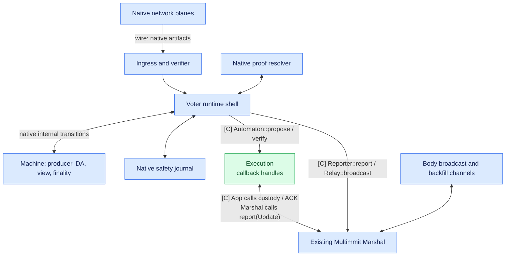
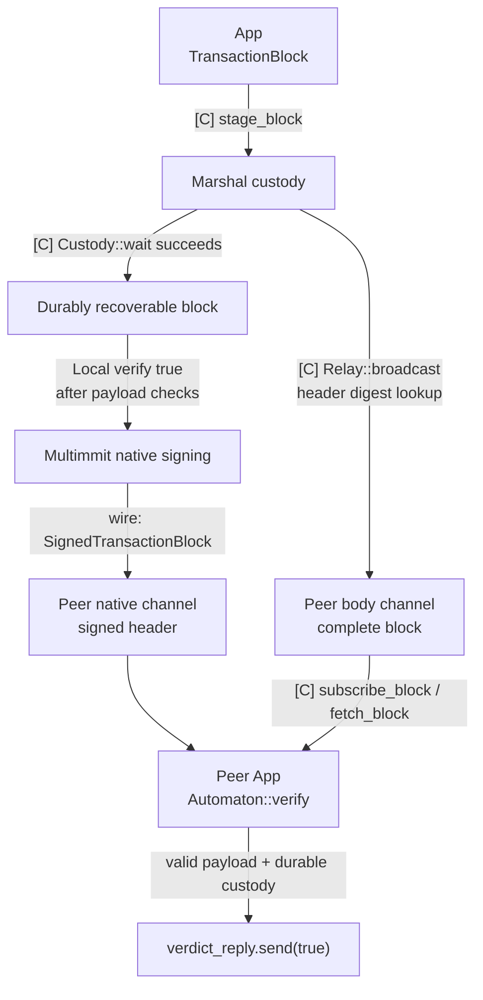
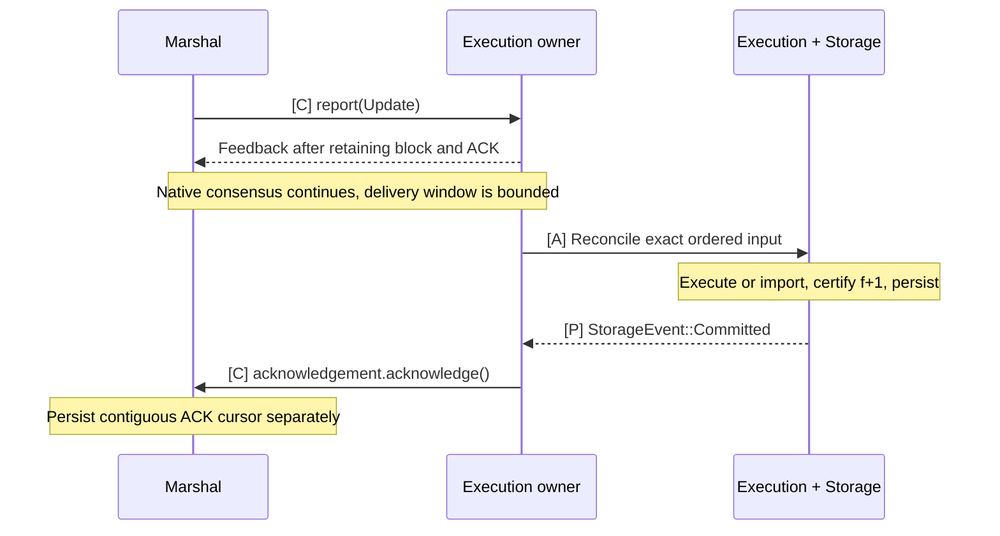
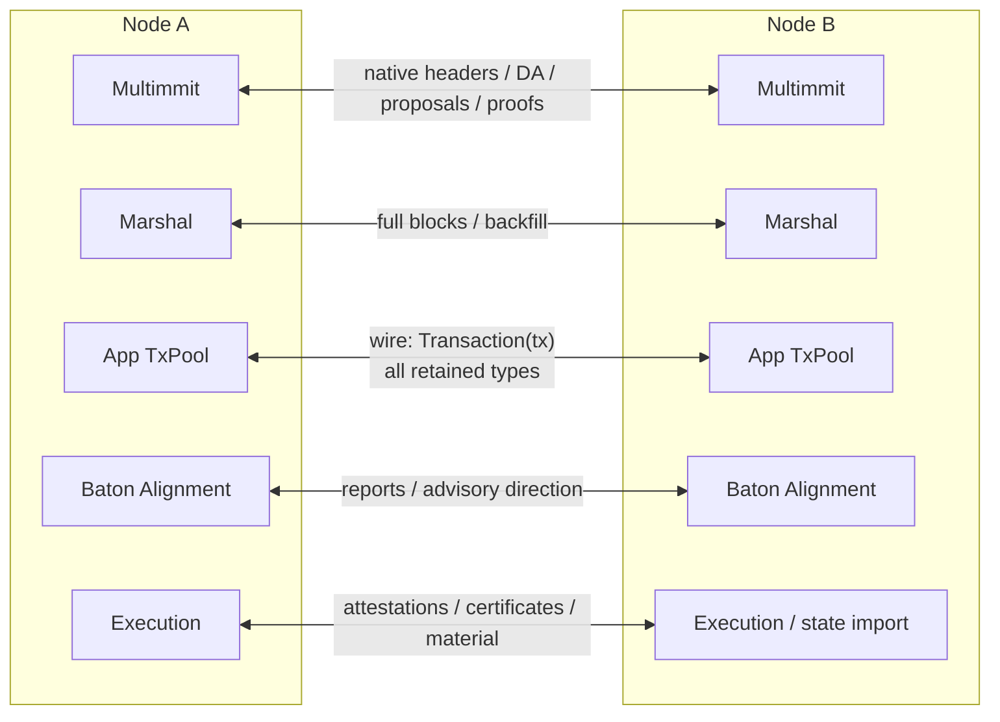

# Node

`baton-node` is the runtime-owning binary (`baton`). It configures and assembles `baton-tx-pool`, `baton-alignment`, `baton-execution`, `baton-storage` and the existing Commonware Engine/Marshal/network graph.

## Responsibilities and state

Own configuration, construction, service lifetimes, startup readiness and supervised shutdown here. Native consensus, custody and ordered delivery remain implemented by Commonware. The sections below describe how to connect those native modules; this crate does not implement a replacement consensus or block service.

## Communication interfaces

| Partner | Interface | Meaning |
|---|---|---|
| Execution | `Execution::open(pool, alignment, storage); Execution::start(mailbox)` | Construct shared callback/Update ownership in recovering state |
| Marshal | `marshal::open`, `Service::start`, existing Mailbox | Body custody, backfill, native reporting and ordered delivery |
| Multimmit | `Engine::open`, `Engine::start` | Recover native state, then start consensus after custody can be served |
| Native networking | Existing Sender/Receiver channels | Separate native planes from App result/report traffic |

Follow the [assembly sequence](../docs/03-reference/07-development-order.md#body-assembly-to-implement) and [startup/recovery E2E](../docs/02-e2e/09-startup-and-recovery.md). Construction parameters, backend/runtime policy and supervision remain NODE-01 work; `main` deliberately stops at `todo!()` until that contract is implemented.

Node derives `LaneContext` from the trusted native epoch/producer configuration and the agreed routing rule, then constructs the pool with `TxPool::open(lanes)`. Supply the same context to proposal handling. Admission retains valid transactions by type independently of local proposal eligibility; all retained types remain available for sharing.

Native lane identity does not define transaction types. POOL-01 owns the epoch/lane-to-type selection policy; NODE-01 supplies its agreed configuration and epoch transitions. Type buckets and indexes remain internal to TxPool; see [lane context and sharing](../tx-pool/README.md#pool-lane-context-and-sharing).

## Implementation tasks and completion

**All TODO operations remain unimplemented.** Read the linked assignment for inputs, prerequisites, failure handling and acceptance tests before replacing a stub. `Spec:` paths in this crate resolve relative to its directory.

| Task | Required work and acceptance criteria |
|---|---|
| NODE-01 | [Supervised assembly, readiness and shutdown](../docs/03-reference/07-development-order.md#node-01) |

Verify with focused deterministic tests after implementation, plus the [workspace checks](../README.md#validate-a-change). Compilation and documentation checks do not prove protocol behavior.

## Detailed behavior

- [Multimmit: native consensus](#multimmit)
- [Marshal: block custody and exchange](#marshal-custody)
- [Marshal: ordered delivery and ACK](#marshal-delivery)
- [P2P: channels and messages](#networking)

## Multimmit: native consensus

**Connect Execution to the existing Multimmit Engine and Multimmit Marshal.** Engine owns producer lanes, DA, voting and finality. Marshal owns complete block custody, history/body backfill, canonical ordering and delivery. Node injects the separate TxPool, Alignment and Storage implementations into Execution.

This page follows the current parent checkout at [6233438985d8249d2b2bc1204191d5d405652288](https://github.com/0xEyrie/monorepo/tree/6233438985d8249d2b2bc1204191d5d405652288). The earlier `534af0...` research pin predates this Marshal implementation. See [source status](../docs/03-reference/09-sources.md).

Diagram labels: **[C]** existing Commonware interface; **[A]** App-owned processing; **[P]** proposed App trait; **[X]** required native extension; **wire** peer message. See the [interface map](../docs/03-reference/01-communication-contracts.md#diagram-notation) for contracts and implementation ownership.

### Native actors and source layout

[Open full-size diagram](../docs/assets/diagrams/diagram-16.svg)

Unlabelled edges and native-transition labels show internal actor/data dependencies, not additional public method calls. The labelled App crossings use the existing interfaces in the communication table below.

### Communication interfaces

| Existing boundary | Caller → implementation | App work |
|---|---|---|
| `Automaton::propose(Context)` | Engine → App ingress | Select transactions, build/stage a complete block, return its **body digest** |
| `Automaton::verify(Context, body_digest)` | Engine → App ingress | Obtain exact durable custody, validate payload, record eligible speculative work, resolve the verdict without waiting for execution |
| `Relay::broadcast(header_digest, ())` | Engine → existing Marshal Relay | Reuse the supplied Relay to broadcast the staged complete block |
| `Reporter<Activity>` | Engine → Marshal and optional App observer | Marshal consumes native observations; App may use them for candidate provenance/telemetry |
| `Reporter<Update<Block>>` | Marshal → App output ingress | Accept canonical index/block, reconcile execution, durably apply, acknowledge |

These are shared Commonware traits. Pass Marshal's mailbox directly as Engine's reporter. If App also consumes native Activity, use a separate typed handle from its finalized Update reporter: `Reporter` has one associated Activity type, even when both handles reach the same Execution owner. The existing [example assembly](https://github.com/0xEyrie/monorepo/blob/6233438985d8249d2b2bc1204191d5d405652288/examples/log-multimmit/src/node.rs#L260) shows the optional fanout. No additional public BlockService, Execution or Orderer trait is required.

Multimmit uses `n ≥ 5f+1`; Baton comparisons use `n=5f+1`. Keep native tip extraction, extension, signing and recovery. App transaction execution is separate from the private native `AppExecutor`, which dispatches local `propose`/`verify` jobs and returns completions to the machine. [Application contract and fault model](https://github.com/0xEyrie/monorepo/blob/6233438985d8249d2b2bc1204191d5d405652288/consensus/src/multimmit/mod.rs#L50), [callback execution](https://github.com/0xEyrie/monorepo/blob/6233438985d8249d2b2bc1204191d5d405652288/consensus/src/multimmit/actors/voter/actor/app.rs#L64).

### Native source files

| Current source | Responsibility |
|---|---|
| `examples/log-multimmit/src/node.rs` | Register four native planes and two Marshal channels; construct/start App, Marshal and Engine |
| `consensus/src/multimmit/engine/mod.rs` | Validate config, recover stores and build actors in `open`; spawn them in `start` |
| `actors/ingress`, `actors/verifier` | Decode hostile native traffic and perform native cryptographic work |
| `actors/resolver` | Fetch native view proofs |
| `actors/voter/actor` | Execute machine capabilities; correlate async completions, publication and persistence |
| `actors/voter/chain_plane.rs` | Select ready producer validation jobs and call App `verify` |
| `machine` | Deterministic protocol state and transitions |
| `marshal` | Custody, native history/order reconstruction, backfill and acknowledged output delivery |

`Engine::open` can call `verify` while restoring retained payloads. Start App custody handlers and Marshal before opening Engine; waiting for `Running::ready` before servicing those callbacks deadlocks recovery. Readiness is separate from App execution progress. [Open/start](https://github.com/0xEyrie/monorepo/blob/6233438985d8249d2b2bc1204191d5d405652288/consensus/src/multimmit/engine/mod.rs#L446), [recovered verification](https://github.com/0xEyrie/monorepo/blob/6233438985d8249d2b2bc1204191d5d405652288/consensus/src/multimmit/storage/recovery.rs#L466).

Native producer `propose` builds one lane's payload. Leader blocks and certificates do not pass through Automaton. Baton policy needs the explicit [native proposal integration](../docs/03-reference/05-native-open-decisions.md#todo-bind-baton-prefix-and-policy-to-cut-proposals); adding an App scheduler does not authenticate a new ordering policy.

### Commonware primitives in the consensus layer

Use current `multimmit::marshal::{open, Mailbox, Relay, Update}` with buffered broadcast, the supplied resolver bridge and `SchemeVerifier`. Marshal already composes its catalog, synchronizer, delivery and retention mechanisms. App implements body codec/digest and transaction validity. [Marshal module](https://github.com/0xEyrie/monorepo/blob/6233438985d8249d2b2bc1204191d5d405652288/consensus/src/multimmit/marshal/mod.rs), [concrete assembly](https://github.com/0xEyrie/monorepo/blob/6233438985d8249d2b2bc1204191d5d405652288/examples/log-multimmit/src/marshal.rs#L126).

`Activity` is best-effort and idempotent. Always give native activities to Marshal as the example does. Use [Marshal Update](#marshal-delivery) for canonical application input and [verify](../execution/README.md#coordination) for opportunistic early work. `CertificateRecorded` has a special retention release contract already consumed by Marshal. [Activity semantics](https://github.com/0xEyrie/monorepo/blob/6233438985d8249d2b2bc1204191d5d405652288/consensus/src/multimmit/types/activity.rs#L58).

For signed candidate provenance, correlate the retained candidate's exact header identity with `TransactionProposed.block` or `ProtocolAccepted` containing `Artifact::TransactionBlock`; neither supplies App execution or body custody. This meaning is artifact-specific: native DA shares are structurally prechecked before aggregate recovery. [Producer-header authentication](https://github.com/0xEyrie/monorepo/blob/6233438985d8249d2b2bc1204191d5d405652288/consensus/src/multimmit/scheme/bls12381_threshold/claims.rs#L234), [DA share admission](https://github.com/0xEyrie/monorepo/blob/6233438985d8249d2b2bc1204191d5d405652288/consensus/src/multimmit/actors/verifier/verify.rs#L92).

When adding App observation, put it beside the supplied Marshal mailbox in `Reporters`, without an intervening lossy App queue. Marshal routes releases to a per-chain coalescing catalog lane and retains/coalesces L-QC synchronization inputs under queue pressure. Header/history/direct-finality hints may be dropped; later proof-driven backfill can recover needed material, not replay every observation. Engine ignores Reporter feedback, so `Backoff` requests no retry and `Closed` requires node lifecycle handling. [Marshal ingress policy](https://github.com/0xEyrie/monorepo/blob/6233438985d8249d2b2bc1204191d5d405652288/consensus/src/multimmit/marshal/mailbox.rs#L99), [synchronizer policy](https://github.com/0xEyrie/monorepo/blob/6233438985d8249d2b2bc1204191d5d405652288/consensus/src/multimmit/marshal/actors/synchronizer/mailbox.rs#L152).

## Marshal: block custody and exchange

**App builds and validates transaction bodies; existing Multimmit Marshal stores and exchanges complete blocks.** Put the TxPool inside App. `Automaton::propose` triggers `TxPool::select` to choose eligible type pools from the epoch/lane and construct a body; `Automaton::verify` obtains durable custody and makes valid eligible blocks available to the App scheduler.

### Two paths for the same block

[Open full-size diagram](../docs/assets/diagrams/diagram-24.svg) · [PNG](../docs/assets/diagrams/diagram-24.png)

Header and body may arrive in either order. Fetch or buffered lookup supplies bytes; successful subscription, put or custody wait establishes the durability needed for the verdict.

### Communication interfaces

| App need | Existing call | Completion condition |
|---|---|---|
| Submit a built block | `marshal.stage_block(block)` | Accepted storage work; returned Custody token may still be pending |
| Wait for durable submission | `custody.wait()` or `marshal.put_block(block)` | Block durably recoverable |
| Wait for expected bytes | `marshal.subscribe_block(reference)` | Exact complete block under durable custody; starts no active peer fetch |
| Explicit peer fetch | `marshal.fetch_block(reference)` | Resolve requested complete block through existing backfill |
| Local lookup | `marshal.get_block(reference)` | Read local material without initiating peer fetch |
| Publication | Existing `marshal::Relay` | Request buffered broadcast of the staged complete block |

The earlier Tempo/Alto investigation established the buffer/resolver/storage composition. Current native `log-multimmit` supplies directly compatible assembly: buffered full-block broadcast → `marshal::open` → resolver bridge → `Service::relay` → `Service::start`. Start from [that code](https://github.com/0xEyrie/monorepo/blob/6233438985d8249d2b2bc1204191d5d405652288/examples/log-multimmit/src/marshal.rs#L126). Other chain versions remain [historical references](../docs/03-reference/07-development-order.md#reference-versions-are-not-one-compatible-dependency-graph).

Accepted DA evidence may independently trigger backfill that fulfills a subscription. `get_block` can read buffered local material, and `fetch_block` can complete after buffered admission before its storage sync. Neither success alone establishes the verify custody fence. Use successful `subscribe_block`, `put_block`, or a staged Custody token's successful wait; a successful subscription needs no redundant second flush. [Mailbox contracts](https://github.com/0xEyrie/monorepo/blob/6233438985d8249d2b2bc1204191d5d405652288/consensus/src/multimmit/marshal/mailbox.rs#L327).

If missing broadcast requires active retrieval, start `fetch_block(reference)` without waiting for the pending subscription to finish. When fetch supplies the exact valid block first, `put_block(block).await` can establish custody and the superseded subscription can be canceled. Do not assume a successful fetch wakes every earlier subscription: a subscription whose backfill wait failed may still be waiting only on buffered ingress. This uses the existing APIs; a subscription that already succeeded needs no extra put. [Subscription race](https://github.com/0xEyrie/monorepo/blob/6233438985d8249d2b2bc1204191d5d405652288/consensus/src/multimmit/marshal/service/router.rs#L330).

### Interface overview

| Value | Meaning |
|---|---|
| Body / body digest | Application transactions and the hash of their committed representation |
| `TransactionBlockHeader` | Epoch, producer chain, height, producer-header parent and body digest |
| Header digest | Hash of the complete contextual header; the existing Relay lookup key |
| `BlockRef` | Producer chain, height and header digest together; the exact reference used by Marshal block APIs |
| `TransactionBlock<H, B>` | Existing native header plus `Arc<B>` application body |
| `SignedTransactionBlock` | Signed header and attestation on native wire, without body bytes |

Implement the body's existing `Codec` and `Digestible` requirements. The `Body<H>` marker is blanket-implemented for matching types. `TransactionBlock::from_context` constructs the pair; `TransactionBlock::new` verifies a body commitment against an existing header. [Native block types](https://github.com/0xEyrie/monorepo/blob/6233438985d8249d2b2bc1204191d5d405652288/consensus/src/multimmit/types/block.rs#L265).

Concretely, implement `Write`, `Read`, and `EncodeSize` (or `FixedSize`) for the body; these supply `Codec`. `Digestible` additionally requires `Clone + Send + Sync + 'static`. The body's `Read::Cfg` has those same bounds and supplies Marshal's `body_codec_config`; use it to bound untrusted body decoding. `TransactionBlock` already implements the shared consensus `Block` trait. [Codec requirements](https://github.com/0xEyrie/monorepo/blob/6233438985d8249d2b2bc1204191d5d405652288/codec/src/codec.rs#L197), [digest requirements](https://github.com/0xEyrie/monorepo/blob/6233438985d8249d2b2bc1204191d5d405652288/cryptography/src/lib.rs#L233), [Marshal configuration](https://github.com/0xEyrie/monorepo/blob/6233438985d8249d2b2bc1204191d5d405652288/consensus/src/multimmit/marshal/config.rs#L339).

App supplies the bounded body codec and correct commitment implementation. The marker and header/body digest comparison do not implement transaction signatures, payload policy or VM semantics. Marshal checks native identity and custody; App's validity/execution code handles those application rules. No additional block-validation trait is required.

The producer-header parent differs from the execution-state parent. Alignment/execution state records its own exact checkpoint, input sequence and runtime identity. Identical body bytes in different producer contexts do not give an interchangeable block/execution identity.

### Select transactions and build a block

1. Engine issues `propose(context)`. App calls `TxPool::select` to choose eligible type pools for that epoch/lane and pack a bounded batch, preserving transactions until internal canonical cleanup permits retirement.
2. App builds `TransactionBlock::from_context(context, body)` and calls `stage_block`. Successful staging admits storage work; the proposal receiver may return the **body digest** before all storage I/O finishes.
3. Native constructs the same header and calls local `verify(context, body_digest)`. App waits on exact durable custody and validates the payload before resolving true. Native signs its header after this fence.
4. Native calls the supplied Relay with the **header digest** and publishes the signed header on its data plane. Relay broadcasts the full staged block on the body channel.

This is the example's [build/stage/answer](https://github.com/0xEyrie/monorepo/blob/6233438985d8249d2b2bc1204191d5d405652288/examples/log-multimmit/src/application/actor.rs#L309) and native [custody sequence](https://github.com/0xEyrie/monorepo/blob/6233438985d8249d2b2bc1204191d5d405652288/consensus/src/multimmit/actors/voter/actor/app.rs#L121). Waiting for `put_block` before the proposal answer also satisfies the contract. Neither requires speculative execution completion.

The callback futures yield oneshot receivers. Keep temporary missing input pending; a definite proposal decline may close its receiver. Returning a digest commits App to verifying that contextual payload. An uncanceled local verification failure is a fatal Engine error (internally `Fatal::Automaton`); resource pressure cannot become payload invalidity. [Automaton contract](https://github.com/0xEyrie/monorepo/blob/6233438985d8249d2b2bc1204191d5d405652288/consensus/src/lib.rs#L134), [local failure](https://github.com/0xEyrie/monorepo/blob/6233438985d8249d2b2bc1204191d5d405652288/consensus/src/multimmit/actors/voter/actor/live.rs#L578).

### Body dissemination, lookup, and custody

Headers and bodies have separate channels. A receiver may authenticate a header first and wait for its body, or buffer a body before native header admission. Sender-side Relay submission before native transmission does not guarantee receiver arrival order. [Native publication](https://github.com/0xEyrie/monorepo/blob/6233438985d8249d2b2bc1204191d5d405652288/consensus/src/multimmit/actors/voter/actor/publish.rs#L124), [supplied Relay](https://github.com/0xEyrie/monorepo/blob/6233438985d8249d2b2bc1204191d5d405652288/consensus/src/multimmit/marshal/relay.rs#L107).

For a remote lane, native authentication/ancestry eligibility precedes `verify`. A producer parent may still be pending application validation; dispatch does not prove all predecessor payloads are already valid/available for App scheduling. App reconstructs the expected header from context/body digest, subscribes by its exact BlockRef, checks application bytes, retains eligible scheduler candidate state and resolves true. Execution then runs asynchronously when its exact execution parent is ready. True does not wait for speculative execution, report collection or result certification. [Remote dispatch](https://github.com/0xEyrie/monorepo/blob/6233438985d8249d2b2bc1204191d5d405652288/consensus/src/multimmit/actors/voter/chain_plane.rs#L522), [custody verification](https://github.com/0xEyrie/monorepo/blob/6233438985d8249d2b2bc1204191d5d405652288/examples/log-multimmit/src/application/actor.rs#L70).

`verify` also runs for this node's own block and during Engine recovery. Interpret another-lane availability only after successful verification, lane classification and lifecycle checks; callbacks are not one-to-one network receipt events. Local verification precedes signing. If candidate policy requires signed provenance, retain the prepared local candidate and admit it on the later `TransactionProposed` observation. That observation is best-effort; a missed observation can reduce speculation but cannot remove canonical Update handling.

For a producing validator, derive the local lane from the epoch's `Protocol::producer_chain(participant)` before comparing it with `context.chain()`: participant and chain indices need not match. A nonproducing validator has no local lane to exclude. [Producer assignment](https://github.com/0xEyrie/monorepo/blob/6233438985d8249d2b2bc1204191d5d405652288/consensus/src/multimmit/config/protocol.rs#L197).

The shared Automaton contract describes requests as single-shot and reserves closure for terminal inability. Current Multimmit remote validation nevertheless maps a closed receiver to `Unavailable` and schedules that block again; local closure is fatal and recovery closure makes `Engine::open` fail. Keep temporary absence pending instead of using this remote behavior as a retry API, and tolerate repeated calls even without restart. [Remote rescheduling](https://github.com/0xEyrie/monorepo/blob/6233438985d8249d2b2bc1204191d5d405652288/consensus/src/multimmit/machine/eligibility.rs#L326).

Deduplicate exact contextual block identities, skip already applied blocks for scheduling and fence stale/canceled work. Removing a speculative candidate does not invalidate its payload or cancel Engine's remaining custody requirements. Missing bytes/dependencies keep a live verdict pending; false means permanent invalidity. Storage failure cannot become true. Speculative queue pressure must not lose canonical input or make a valid block invalid. See [App handlers](../execution/README.md#coordination).

`stage_block` can return `Busy` when router intake is full, and explicit `fetch_block` can return `Busy` at the pending-fetch bound. `subscribe_block` waits for a caller slot instead of rejecting that intake pressure; its acquisition and custody can still fail. Handle recoverable pressure within the live request's cancellation/lifecycle policy, without returning false or claiming custody. `Closed` signals a stopped service; a `Failed` result needs its underlying cause assessed. Failed mutable storage requires recovery of that instance. [Request/error paths](https://github.com/0xEyrie/monorepo/blob/6233438985d8249d2b2bc1204191d5d405652288/consensus/src/multimmit/marshal/mailbox.rs#L313), [public errors](https://github.com/0xEyrie/monorepo/blob/6233438985d8249d2b2bc1204191d5d405652288/consensus/src/multimmit/marshal/types.rs#L178).

Marshal already bounds native custody retention with `CertificateRecorded`, floors and the durable ACK cursor. During ordinary delivery, `prune` protects outputs beyond the current ACK cursor and blocks Engine may reverify. A coordinated floor installation replaces the delivery boundary; it does not install App state itself. App separately retains live execution/checkpoint/result material. [Retention API](https://github.com/0xEyrie/monorepo/blob/6233438985d8249d2b2bc1204191d5d405652288/consensus/src/multimmit/marshal/mailbox.rs#L449).

`CertificateRecorded.released` is a per-producer custody bound that trails the certified height by the native pipeline depth; it is not the App's applied index. A previously dispatched verify can still reach App after release, but Engine ignores its settled verdict. Do not recreate speculative work for that stale request. Route native activities to Marshal so its existing retention can use the release; no release conservatively keeps bodies. App transaction/result/query retention has separate obligations. [Release contract](https://github.com/0xEyrie/monorepo/blob/6233438985d8249d2b2bc1204191d5d405652288/consensus/src/multimmit/types/activity.rs#L104).

## Marshal: ordered delivery and ACK

**Existing Multimmit Marshal sends the App complete blocks in canonical order.** Connect `Reporter<Activity = marshal::Update<Block>>` to an App output ingress. The App uses that sequence to select/reuse/repair execution, durably applies it, then acknowledges. Baton scheduling does not reconstruct or reorder this stream.

### Delivery and two durability points

[Open full-size diagram](../docs/assets/diagrams/diagram-25.svg) · [PNG](../docs/assets/diagrams/diagram-25.png)

A crash between App durability and Marshal cursor durability can redeliver an already-applied block. Match its recovered identity and ACK without applying it twice.

### Communication interfaces

| Direction | Call or value | Completion means |
|---|---|---|
| Multimmit → Marshal | Native `Reporter::report(Activity)` | Native observations feed Marshal's history/custody machinery; this is not an App state commit |
| Marshal → Execution owner | `Reporter::report(Update)` → `Feedback` | Complete indexed block and Exact token retained by App |
| Execution owner → Marshal | `update.acknowledgement.acknowledge()` | That exact delivery is covered by certified durable App state |
| App import/recovery coordination → Marshal | Existing floor operations | Native delivery recovery only; matching durable App state is established separately |

Marshal owns native history interpretation, dense delivery, its outstanding ACK window and its cursor. The Execution owner retains tokens and drives execution/storage; Marshal does not execute transactions or verify App execution certificates.

### Consensus and Baton integration

Native Engine finality is sparse and chain-local. Marshal verifies L-QCs, resolves history and ancestry, derives continuous native order, obtains bodies and assigns `OutputIndex`. Its supplied service already owns these responsibilities. `Activity::LeaderFinalized` is an observation of native finality; `Update` is the App's canonical ordered input. [Native finality boundary](https://github.com/0xEyrie/monorepo/blob/6233438985d8249d2b2bc1204191d5d405652288/consensus/src/multimmit/mod.rs#L93), [Marshal ownership](https://github.com/0xEyrie/monorepo/blob/6233438985d8249d2b2bc1204191d5d405652288/consensus/src/multimmit/marshal/mod.rs).

An Update contains:

| Field | App interpretation |
|---|---|
| `index: OutputIndex` | Position in the canonical finalized output stream |
| `block: Arc<Block>` | Complete native header and application body |
| `acknowledgement: Exact` | Retain until the App has durably applied this block |

[Update definition](https://github.com/0xEyrie/monorepo/blob/6233438985d8249d2b2bc1204191d5d405652288/consensus/src/multimmit/marshal/types.rs#L128).

`Reporter::report` is synchronous. Its handler retains the full Update and wakes App processing; it does not run transaction execution or wait for disk I/O inline. The App processes the next canonical index against its durable applied position. A matching already-applied identity can be acknowledged on replay. A new index selects the exact-parent valid speculative result or executes/repairs the required suffix; the same application writer commits state and linked applied-position metadata. A gap or conflicting identity stops application, rather than guessing an order.

An Update can be App's first encounter with that block, including for an Observer or skipped speculation. Perform the application checks needed for execution, or reuse exact validated work, without requiring an earlier local `verify` or scheduler entry. Marshal's authoritative local order does not implement App transaction semantics; App does not need a second native proof/order verifier.

The retained stream first informs `Alignment::commit(ordered)` of continuous finalized ordering without waiting for execution. Execution verifies matching `f+1` result certification before requesting Storage commit, for direct work and imports alike. Only after certified application durability does App consume the token with `acknowledge()`. Completed speculation cannot bypass the certificate gate. The token itself performs no I/O and does not make state durable.

#### Delivery backpressure and recovery

Marshal can report multiple Updates before receiving their ACKs, up to configured `max_pending_acks`. It advances the oldest contiguous acknowledged prefix and synchronizes its own durable cursor separately. Native voting, views and finality do not await application ACKs. A full delivery window pauses further App delivery, while native consensus continues. [Delivery loop](https://github.com/0xEyrie/monorepo/blob/6233438985d8249d2b2bc1204191d5d405652288/consensus/src/multimmit/marshal/actors/delivery/actor.rs#L235), [ACK window](https://github.com/0xEyrie/monorepo/blob/6233438985d8249d2b2bc1204191d5d405652288/consensus/src/multimmit/marshal/actors/delivery/acks.rs#L1).

For ordinary delivery within one generation, give Updates a non-dropping owned queue whose capacity accounts for that delivery window; do not share a lossy notification queue. Delivery checks `Feedback::Closed`, but a `Backoff` return does not request an Update retry. Keep its ACK while queued and while application work runs. All cloned Exact handles must acknowledge; dropping any unacknowledged clone cancels the waiter and fails delivery. [Report handling](https://github.com/0xEyrie/monorepo/blob/6233438985d8249d2b2bc1204191d5d405652288/consensus/src/multimmit/marshal/actors/delivery/actor.rs#L303), [Exact semantics](https://github.com/0xEyrie/monorepo/blob/6233438985d8249d2b2bc1204191d5d405652288/utils/src/acknowledgement.rs#L38).

A crash after App state is durable but before Marshal's ACK cursor is durable can redeliver the block. Persist enough exact applied identity/state/certificate linkage to verify replay without applying transaction effects twice or collecting fresh signatures. An ACK must not mean only that the Update entered an inbox or reached Alignment: the contract requires **certified durable application**. Marshal's cursor storage and App state storage are separate transactions. Coordinate state-sync floor installation with matching certified durable App state and fence older workers/updates before changing writer authority.

The next bounded signing unit must fit the active delivery capacity. Execute its internal blocks on private checkpoints and sign its result before applying the whole certified unit; ACK covered Updates afterwards. Input needed for certification must not depend on those same ACKs. See the [certification-unit contract](../execution/README.md#certification-certification-units-and-delivery-progress).

A floor installation resets Marshal's delivery generation and discards its old waiters; it does not remove Update values already retained by App. The new generation can deliver another window, so `max_pending_acks` alone does not bound old plus new App-held work. Update has no generation field. App owns the floor/import lifecycle and must serialize and fence that handoff, reconcile old retained input/tokens, and budget any overlap before resuming ordinary delivery. Exact switching and crash sequencing remain implementation work. [Native reset](https://github.com/0xEyrie/monorepo/blob/6233438985d8249d2b2bc1204191d5d405652288/consensus/src/multimmit/marshal/actors/delivery/actor.rs#L423).

The example's headless reporter immediately acknowledges synthetic output; it has no transaction-state database. Use it as a wiring example, not an application durability contract. [Example output reporter](https://github.com/0xEyrie/monorepo/blob/6233438985d8249d2b2bc1204191d5d405652288/examples/log-multimmit/src/application/reporter.rs#L33).

### Reuse proof verification and storage

| Existing Marshal component/API | Supplied responsibility | App responsibility |
|---|---|---|
| `SchemeVerifier`, backfill and synchronizer | Verify native evidence; fetch certificates/history/bodies; reconstruct native order | Supply the configured trusted committee/scheme and bounded body codec |
| Catalog and custody stores | Persist complete blocks, committed output rows, native recovery material and floors | Implement application validity; retain independent execution material as needed |
| Delivery and ACK cursor | Ordered Update window, cursor sync and restart redelivery | Exact application-state apply, durable applied identity, idempotent replay, ACK |
| `floor_at`, `install_floor`, `prune` | Verified Marshal floor/recovery/retention operations; ordinary pruning respects its current ACK cursor | Coordinate imported application state and App retention/writer fences |

Reuse these owners directly. A second Baton proof archive, global-order interpreter, delivery cursor database or public Orderer contract would duplicate existing code. [Mailbox APIs](https://github.com/0xEyrie/monorepo/blob/6233438985d8249d2b2bc1204191d5d405652288/consensus/src/multimmit/marshal/mailbox.rs#L449).

Fresh-namespace `Start::Floor { floor_generation, floor }` is a caller-authenticated import: authenticate the anchor signature and bind the emitted frontier and positive monotone `floor_generation` to the App snapshot before opening. `Config::validate` and `marshal::open` check structure/history linkage, not that anchor's signature; a recovered checkpoint takes precedence over Start. For a peer-served floor, the native source recommends `Start::Genesis` followed by verified `install_floor`. Reuse that verifier path while App authenticates and durably installs the matching state; no second App order interpreter is needed. [Startup authority](https://github.com/0xEyrie/monorepo/blob/6233438985d8249d2b2bc1204191d5d405652288/consensus/src/multimmit/marshal/config.rs#L164).

Current Marshal follows native history traversal and positional/extension passes, including final-sweep halt conditions. It does not expose an App-selected ordering comparator. Missing required history or included bodies cannot be treated as empty slots. [Native order reconstruction](https://github.com/0xEyrie/monorepo/blob/6233438985d8249d2b2bc1204191d5d405652288/consensus/src/multimmit/marshal/protocol/order.rs#L361).

Full Baton needs authenticated prefix/policy semantics added consistently to native proposal construction, validation, continuation/recovery and Marshal's interpretation. `Update` does not carry that missing policy automatically. App must never implement Baton by sorting finalized Updates. Those [native integration obligations](../docs/03-reference/05-native-open-decisions.md#todo-bind-baton-prefix-and-policy-to-cut-proposals) remain open; basic PreCut and App execution can attach to the existing stream today.

## P2P: channels and messages

**Reuse one Commonware network and the existing Multimmit/Marshal channels.** App transaction, report/direction and execution-result messages can use additional logical channels on that network. They need no second networking stack.

### Separate message planes

[Open full-size diagram](../docs/assets/diagrams/diagram-33.svg) · [PNG](../docs/assets/diagrams/diagram-33.png)

These are logical message owners; concrete App wire codecs and channel allocation remain open. Existing Commonware Sender/Receiver handles carry the traffic. Transaction transport shares all retained types; each receiving TxPool independently validates and retains them by type. Epoch/lane eligibility is resolved only for proposal selection. Invalid payloads are not relayed, and exact duplicate metadata suppresses repeated insertion and relay loops.

### Responsibility and communication

Commonware transport supplies authenticated peer connections and registered channels. Multimmit and Marshal own native message handling; App ingress, Baton policy and Execution result processing validate their own message content. Transport receipt establishes neither transaction admission, final ordering nor certified durability.

### P2P connections and message planes

| Plane | Payload | Current example channel |
|---|---|---|
| Native data | Signed producer headers, DA votes and DA certificates | `0` |
| Native consensus | Leader proposals, votes, no-votes and nullification messages | `1` |
| Native certificates | Nullification, V-QC and L-QC certificates | `2` |
| Native resolver | Native view proofs and recovery material | `3` |
| Marshal resolver | Exact block/history/certificate backfill | `4` |
| Marshal broadcast | Complete `TransactionBlock` values with header and body | `5` |
| App transactions | Bounded messages / inventory covering retained valid transactions of all types | Undecided |
| App Baton reports / direction | Signed intended-order reports, window context and advisory direction | Undecided |
| App execution results / state sync | Exact statements, signatures, result certificates, material and queries | Undecided |

The first six IDs are an example node's assembly choices, not protocol-mandated IDs. Pre-cut has no Baton report/direction channel. Transport peer authentication does not establish application statement validity or epoch signer membership. Report, body and transaction floods still compete for processing and bandwidth; queues, quotas and runtime placement must keep native work serviceable.

### Reuse the existing network handles

The [current log-multimmit node](https://github.com/0xEyrie/monorepo/blob/6233438985d8249d2b2bc1204191d5d405652288/examples/log-multimmit/src/node.rs#L242) registers all channels with `network.register(channel, quota)`, starts the network, then starts Marshal and the App before opening Engine. The old example/signature mismatch recorded in historical reviews is not the current wiring.

| Connection | Existing mechanism | App responsibility |
|---|---|---|
| Complete block broadcast | `buffered::Engine` and Marshal's existing `Relay` | Define bounded body codec/digest and stage exact local blocks |
| Missing block/history retrieval | Generic resolver plus Marshal's `BackfillBridge` | Request exact references through Marshal; do not recreate a fetch/cache engine |
| Native activity → Marshal | Marshal `Mailbox` implements `Reporter<Activity>` | Compose with optional App observation using existing `Reporters` |
| Finalized blocks → App | App handle implements `Reporter<Update<TransactionBlock>>` | Retain every accepted Update, process in order, ACK after durable apply |
| Typed App P2P | Existing codec wrapping and registered channel handles | Bounded decode, schema, subject validation and per-message semantics |

Follow the [existing Marshal assembly](https://github.com/0xEyrie/monorepo/blob/6233438985d8249d2b2bc1204191d5d405652288/examples/log-multimmit/src/marshal.rs#L126) for buffer, resolver, service, verifier and Relay. These components already own their wire types. Raw channel pairs passed to them must use compatible public-key and runtime types; an extra typed wrapper is useful only for an actual App message loop.

`subscribe_block` establishes durable custody from local storage or buffered ingress and does not start an explicit peer fetch. `fetch_block` initiates retrieval through the existing resolver. Native headers and complete bodies travel independently, so header-first reception is expected. [Body exchange](../docs/02-e2e/02-block-exchange.md)

`Relay::broadcast` returns local `Feedback`, not a remote receipt or custody ACK. Even `Ok` can mean that no matching staged block was found and nothing was sent. Reuse the existing Relay and its bounded staged lookup. [Relay implementation](https://github.com/0xEyrie/monorepo/blob/6233438985d8249d2b2bc1204191d5d405652288/consensus/src/multimmit/marshal/relay.rs#L107)

Provide usable App body access before `Engine::open` can issue recovered verify requests. Keep native and Marshal resolver channels distinct; application execution readiness must not create a cycle in native custody recovery. [Startup sequence](../docs/02-e2e/09-startup-and-recovery.md#startup-prepare-custody-before-native-recovery)

Bound complete encoded messages and outstanding requests/subscriptions, not only mailbox item count. Application result signers are the authenticated epoch identities in the exact signed subject, not arbitrary connected peers. Concrete wire formats, numerical budgets, transaction propagation and result transport remain open.

### Messages used in diagrams

`wire:` labels describe peer-message content, not trait methods. Existing native artifacts retain their native codecs. The App names below are logical contracts; they do not declare new Rust structs or settle their wire encoding.

| Diagram label | Contract / definition |
|---|---|
| `Transaction(tx)` | Share all retained types under the [pool contract](../tx-pool/README.md#pool). The receiver validates and retains by type independently of local proposal eligibility; transport receipt is not retention or inclusion. |
| `WindowAnnouncement(context, deadline)` | Baton report-window context and fixed closure deadline under the [report rules](../alignment/README.md#alignment); authentication and exact context checks are required. |
| `SignedReport(context, intended_order)` | Original authenticated intended-order report, counted once per eligible identity in the fixed window; not execution evidence. |
| `SignedDirection(context, order)` | Authenticated advisory direction under the same context; [pending-order rules](../docs/02-e2e/05-direction-and-execution.md) constrain adoption. It does not establish native finality. |
| `ExecutionAttestation(statement, signature)` | Original eligible validator signature over the exact direct-execution subject under [result certification](../execution/README.md#certification-result-certification-inside-execution). |
| `ExecutionCertificate(statement, signatures)` | Matching full subject and distinct eligible `f+1` evidence; Execution verifies it before requesting Storage commit. |
| `MaterialRequest(verified_target)` / `StateMaterial(target, data, outputs)` | Request and applicable state/output material bound to the same certified target under [state sync](../execution/README.md#certification-state-sync-from-certified-execution-results); a certificate alone is not material. |
| `TransactionBlock` / `SignedTransactionBlock` | Existing complete block / signed producer-header artifacts; [body exchange](#marshal-custody) explains their independent paths. |
| DA vote/certificate, `LeaderBlock`, native votes and proof artifacts | Existing [native protocol messages](#multimmit), not App execution-result certificates. Future policy encoding in diagram 12 remains an unresolved native extension. |

The generic internal dispatch wakeup and `StorageEvent` use local App communication. They are not peer wire formats. Execution/material traffic on the PreCut overview denotes the execution-result rows above; native broadcast/backfill traffic denotes the existing native/Marshal planes.

### Continue with E2E flows

The component pages establish ownership and communication contracts. Start [Transaction to durable state](../docs/02-e2e/01-transaction-to-state.md) to follow those connections in time: pool selection, native custody, Alignment admission, Execution work, ordered Update, result certification, Storage durability and ACK. The later cases expand one part of that same flow, including failure and recovery.
