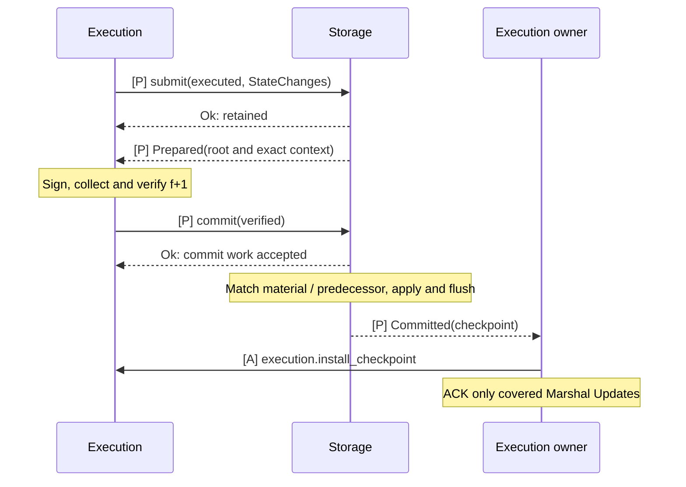

# Storage

`baton-storage` implements the persistence interface defined by `baton-execution`. It owns pinned cold state, accepted changes, deterministic root preparation, import material and one canonical durable writer.

## Responsibilities and state

Keep storage batching, roots, databases and recoverable records here. Execution verifies `f+1` evidence and supplies `VerifiedCertificate`; Storage checks applicability and persists matching state/output/evidence. Only certified recoverable completion emits `StorageEvent::Committed`.

## Communication interfaces

| Partner | Interface | Meaning |
|---|---|---|
| Execution | `Storage::read(view, key)` | Exact pinned value, verified absence or error |
| Execution canonical worker | `Storage::submit(executed, changes)` | Retain the complete ordered unit; acceptance is separate from disk flush |
| Execution via App | `Storage::commit(verified)` | Accept verifier-authorized matching material for the canonical writer |
| App event routing | `StorageEvent::{Prepared, Committed, Failed}` | Root readiness, certified durability or scoped failure |
| App import/recovery | `Storage::verify_material`, `Storage::recover` | Retain applicable material or return candidates for Execution re-verification |

Import/recovery use the same Storage trait as reads, submissions and commits. Execution owns the input/result contracts; this crate implements their material and persistence behavior. Read the [Execution certification and import flow](../execution/README.md#certification) and [shared Storage contract](../docs/03-reference/01-communication-contracts.md#proposed-storage-interface). MODEL-01 must define exact retained views and validated construction of prepared/durable values with their producers; placeholder fields are not a completed usable interface.

## Implementation tasks and completion

**All TODO operations remain unimplemented.** Read the linked assignment for inputs, prerequisites, failure handling and acceptance tests before replacing a stub. `Spec:` paths in this crate resolve relative to its directory.

| Task | Required work and acceptance criteria |
|---|---|
| MODEL-01 | [Material and recovery representations](../docs/03-reference/07-development-order.md#model-01) |
| STORE-01 | [Pinned reads, roots and one durable writer](../docs/03-reference/07-development-order.md#store-01) |
| IMPORT-01 | [Verified material and recovery handoff](../docs/03-reference/07-development-order.md#import-01) |

Verify with focused deterministic tests after implementation, plus the [workspace checks](../README.md#validate-a-change). Compilation and documentation checks do not prove protocol behavior.

## Detailed behavior

- [Storage: reads and durable state](#persistence)

## Storage: reads and durable state

**Storage owns cold state, commitment preparation and certified durable application.** Execution sends state changes and later requests commit with a verified result certificate; Storage chooses database batches and flush timing. A committed event carries a usable checkpoint back through the Execution owner to Execution.

### Prepare first, persist after certification

[Open full-size diagram](../docs/assets/diagrams/diagram-30.svg) · [PNG](../docs/assets/diagrams/diagram-30.png)

`submit` acceptance, `commit` acceptance and `Committed` are different milestones. Only the last establishes recoverable certified state.

### Responsibilities

| Responsibility | Owned state or work |
|---|---|
| Serve exact-base reads | Retained read-only views backed by pinned versions or access fences |
| Retain ordered execution progress | Bounded StateChanges bound to exact input, predecessor, runtime and accepted job identity |
| Prepare commitments | Deterministic material and roots for the agreed signing unit |
| Apply certified state | Match Execution-verified commit authority to the prepared root, exact material, ordering and current predecessor under one writer |
| Recover and import | Linked state, outputs, applied identity, certificate evidence and direct/imported provenance |
| Publish durable progress | Retained events and a usable canonical checkpoint for App consumers |

Storage owns database handles and physical retention. Execution coordination retains Marshal Updates and their ACK tokens; Execution owns transaction computation, memory checkpoints and `f+1` certification; Storage owns root preparation and persistence.

### Communication interfaces

| Direction | Call or event | Completion means |
|---|---|---|
| Execution → Storage | `Storage::read(view, key)` | `Ok(Some(value))` or `Ok(None)` at the exact pinned base; failure is `Err(StorageError)` |
| Execution → Execution owner → Storage | `Storage::submit(executed, changes)` | `Ok(())` accepts and retains ordered work; it may still be memory-only |
| Storage → Execution, through App routing | `StorageEvent::Prepared(prepared)` | Exact commitments ready to combine with direct-execution evidence for signing |
| Execution → Storage | `Storage::commit(verified)` | `Ok(())` accepts persistence work for an Execution-verified result; it does not establish durability |
| Storage → Execution owner | `StorageEvent::Committed(applied)` | The covered certified prefix and its evidence are recoverable; `applied.checkpoint` supplies usable state access |
| Storage → Execution owner | `StorageEvent::Failed(failure)` | A scoped asynchronous failure; no ACK or unsupported progress follows |

The [canonical Storage contract](../docs/03-reference/01-communication-contracts.md#proposed-storage-interface) specifies the proposed trait, logical types, errors and event retention. Calls and later events have separate completion conditions. Material verification and recovery are also part of this trait so Execution can use the injected backend without depending on its concrete type.

### Reads and accepted changes

Execution checks memory and parent overlays first. A tombstone resolves deletion locally; only a genuine miss reads the pinned Storage view. A pruned, unavailable or conflicting view must fail rather than answer from current state.

The Execution owner binds changes to an exact bounded ordered range. For direct execution, the canonical worker awaits execution of the whole unit and then `submit(...).await`; `Ok(())` completes that handoff before the worker advances to the next ordered unit. Storage checks the predecessor chain and can retain successive accepted units before earlier units flush. Rejection or backpressure leaves the caller responsible for retryable changes and does not advance the handoff; after acceptance Storage owns their retention. On crash, only recovered certified durable progress is authoritative, and lost accepted work is replayed or reexecuted.

### Preparation, certification and durability

Storage materializes exact changes, prepares roots for the chosen unit and sends `Prepared` to Execution. Execution binds the state root to its direct-execution evidence and irrevocable input, signs and verifies `f+1` distinct eligible matching signatures. It then calls `Storage::commit(verified)`. Storage matches this locally verified subject to its prepared material and rechecks ordering and the current predecessor before application. Signature collection and quorum verification belong to Execution.

Physical persistence may batch successive authorized units while preserving signed roots, operation history and unit boundaries. Flush policy must drain within delivery-window, idle and shutdown constraints. Missing certification keeps prepared work pending. Mutable-store or durability failure stops that store instance until recovery.

Persist state, outputs, applied position, certificate evidence and provenance with recoverable linkage before emitting `Committed`. A readable root or completed QMDB write alone does not establish that linkage. [QMDB operations](../docs/03-reference/03-qmdb.md#commit-a-branch-to-canonical-state) are the backend reference.

### Checkpoint handoff

The Execution owner retains `applied.checkpoint` and forwards it through `execution.install_checkpoint`. Execution installs the compatible base, skips covered work, retires conflicts and preserves valid descendants. Memory/views stay retained until workers and references release them. The owner ACKs exactly covered Updates after certified durability; installation and pool maintenance add no approval round.

Verified [state import](../execution/README.md#certification-state-sync-from-certified-execution-results) and recovery use this same writer and retained checkpoint handoff. Imported work cannot become local direct-signing evidence. A recovered certified applied record supports idempotent redelivery without reapplying effects or collecting a new certificate. On restart, Storage loads a checkpoint candidate and original evidence; Execution revalidates that evidence before Storage confirms the durable record and emits `Committed`. Configured genesis supplies the initial trust anchor.

Continue with [result certification and state sync](../execution/README.md#certification) to see how direct and imported results reach the same durable checkpoint handoff. Once the components are familiar, follow [ordered input to durable application](../docs/02-e2e/06-ordered-application.md), [state import](../docs/02-e2e/08-state-import.md) and [recovery](../docs/02-e2e/09-startup-and-recovery.md) as E2E cases.
