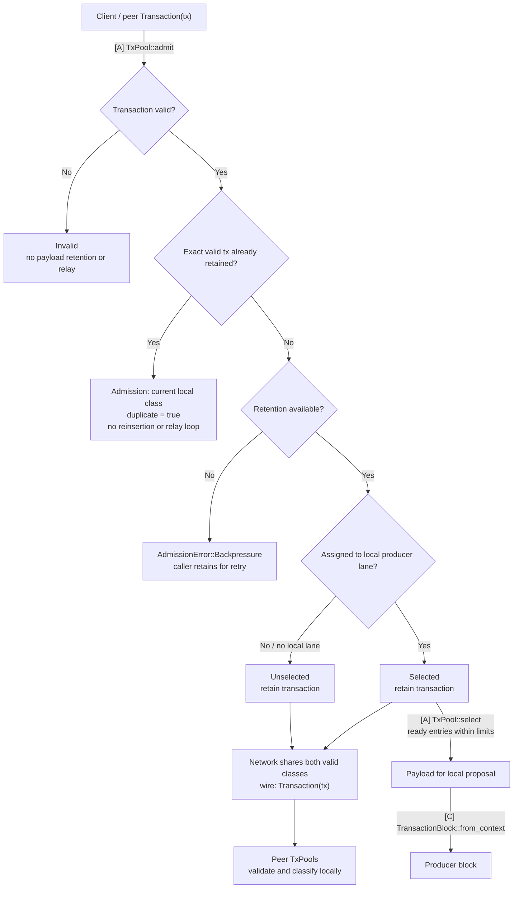

# Transaction pool

`baton-tx-pool` owns transaction admission, retention, proposal selection, durable-outcome maintenance and the shared payload codec. It has no Execution, Alignment or Storage dependency.

## Responsibilities and state

Classify transactions as Selected, Unselected or Invalid. Retain and share both valid classes under bounded resources; only Selected transactions enter this node's proposal candidates. Lane mismatch alone never permits discarding a valid transaction. Selection does not retire transactions. The payload contains transaction bytes and exposes bounded codec/digest operations; Execution wraps it in the native producer block and performs custody/context checks.

## Communication interfaces

| Caller | Concrete method / value | Contract |
|---|---|---|
| Network assembly | `TxPool::open(lanes)` | Install trusted `LaneContext`: epoch, local producer lane, producer-lane set and shared assignment rule |
| Transaction ingress through Execution/network wiring | `TxPool::admit(transaction)` → `Result<Admission, AdmissionError>` | Return local classification and duplicate metadata; retain both valid classes or report backpressure |
| Execution proposal handling | `TxPool::select(context, limits)` → `Payload` | Use `SelectionContext` projected by Execution; retain selected bytes |
| Execution durable completion | `TxPool::reconcile(update)` | Apply `PoolUpdate` with exact transaction outcomes and applied-unit identity |
| Execution / native body transport | `Payload::{read_cfg, write, encode_size, digest}`, `PayloadLimits` | Agreed bounded canonical body representation; wire format remains open |

`PoolUpdate` is a maintenance input, not a state certificate or ACK. Pool completion does not gate native consensus or durable delivery ACK. The crate defines its input values so it never needs an Execution checkpoint or Storage database handle.

## Three transaction classes

| Classification | Meaning on this node | Retain | Share with peers | Local proposal candidate |
|---|---|---|---|---|
| `Selected` | Valid and assigned to this node's producer lane | Yes | Yes | Yes, subject to readiness and batch limits |
| `Unselected` | Valid and assigned elsewhere, or this node has no producer lane | Yes | Yes | No |
| `Invalid` | Fails agreed transaction validity rules | No payload retention | No | No |

`Selected` means lane eligibility, not inclusion in a constructed block or canonical commitment. The same transaction can be Selected on its assigned producer and Unselected on other nodes. A peer's classification is never authoritative: every receiving pool validates and classifies locally.

`Admission` carries `classification: TransactionClass` and a separate `duplicate` flag. An exact already-retained valid transaction returns its current local class with `duplicate = true`, without another insertion or immediate relay loop. Duplicate is not a fourth class. A valid new transaction that cannot be retained returns `AdmissionError::Backpressure`; the caller retains it for retry instead of treating it as Invalid or claiming successful admission. A transaction assigned elsewhere must not be rejected merely for that assignment.

## Lane context and sharing

Network derives the local optional producer lane and the epoch's producer-lane set from the trusted native configuration, then supplies the pool-owned `LaneContext` to `TxPool::open`. The common assignment rule remains an open policy; it must give each pool the same target lane for the same transaction and routing context. Execution supplies the proposal's exact epoch/lane through `SelectionContext`; selection must match the installed context.

RPC and peer ingress both call `admit`. Network shares newly retained Selected and Unselected transactions using the existing transaction transport. Both classes remain available for bounded inventory, missing-transaction requests or catch-up under the selected transport policy. Do not restrict dissemination or serving to the local Selected set. Invalid payloads are not relayed; peer echo suppression, deduplication and retransmission bounds prevent forwarding loops. Receiving bytes alone does not establish pool retention.

On a lane assignment or epoch change, retained valid transactions need revalidation where required and reclassification against the new trusted context before proposal selection. Losing local assignment moves a still-valid transaction to Unselected; it does not remove it from shared retention. Context replacement and outstanding proposal fencing remain implementation work. Routing, reassignment on producer failure and concrete wire/retention policies are still open; the three classes and sharing of both valid classes are fixed.

## Implementation tasks and completion

**TODO operations remain unimplemented.** Read the linked assignment for inputs, prerequisites, failure handling and acceptance tests. A source `Spec:` path resolves from its crate directory.

| Task | Required work and acceptance criteria |
|---|---|
| MODEL-01 | [Selection context and durable pool-maintenance inputs](../docs/03-reference/07-development-order.md#model-01) |
| PAYLOAD-01 | [Bounded body codec and digest](../docs/03-reference/07-development-order.md#payload-01) |
| POOL-01 | [Retained transaction admission/selection](../docs/03-reference/07-development-order.md#pool-01) |

Use focused deterministic tests after implementation and the [workspace checks](../README.md#validate-a-change). Compilation and documentation checks do not establish protocol behavior.

## Detailed behavior

## TxPool: admission and selection

**TxPool retains transactions and supplies bounded batches for local proposals.** It owns the three-way transaction classification, shared valid retention, lane selection, duplicate handling and canonical maintenance. App callbacks call its concrete operations; these do not require a public TxPool trait.

### Transaction lifecycle

[Open full-size diagram](../docs/assets/diagrams/diagram-27.svg) · [PNG](../docs/assets/diagrams/diagram-27.png)

Selection preserves the chosen bytes and both valid classes stay shared. `TxPool::reconcile(PoolUpdate)` applies durable canonical outcomes from any lane to both classes; proposing, forwarding or losing local assignment does not itself retire a transaction.

### Communication interfaces

| Direction | Call or value | Completion means |
|---|---|---|
| Client/peer ingress → TxPool | `pool.admit(tx)` → `Result<Admission, AdmissionError>` | Selected/Unselected retained with separate duplicate metadata; Invalid not retained; Backpressure leaves retry ownership with caller |
| Execution propose handler → TxPool | `pool.select(ctx, limits)` → `Payload` | Stable selected bytes fit dependency, count, work and full-body limits |
| Execution durable-outcome handling → TxPool | `pool.reconcile(applied_outcomes)` | Exact applied outcomes reconciled with the chosen backend |

These concrete calls are defined in the [communication reference](../docs/03-reference/01-communication-contracts.md#private-pool-and-execution-calls). The [App callback](../execution/README.md#coordination-automatonpropose-pool-to-staged-block) packs selected bytes into a producer block. Pool selection never substitutes for canonical inclusion.

Admission verifies encoding, signature/domain and agreed transaction validity rules, then computes lane assignment under the installed context. Both RPC and peer paths use the same local classification. Selected candidates may enter local batches; valid Unselected candidates remain retained and shared. These are logical classes within one pool. Temporary state readiness, unresolved dependencies and node load do not turn a valid transaction into Invalid; they constrain scheduling or cause explicit backpressure.

Selection uses the supplied Multimmit producer context. Its `parent` is a producer-header parent, not the application execution checkpoint or current canonical state. Dependency-aware packing cannot bypass an excluded required predecessor. Bound visited work and encoded body bytes as well as returned transaction count. Retain the selected bytes so proposal cancellation, pool replacement or concurrent admission cannot change a constructed body's commitment. Selection alone does not retire a transaction canonically.

Local pool membership, selection and readiness govern this node's proposals; peer or canonical blocks are validated under the agreed payload rules without requiring their transactions to have been locally admitted or selected.

The [proposal flow diagram](../execution/README.md#coordination-automatonpropose-pool-to-staged-block) shows selection → block construction → staging → body-digest reply.

Execution invokes these public concrete TxPool operations across crates. Follow the canonical [verify handler](../execution/README.md#coordination-automatonverify-validity-custody-and-scheduling) and [Update handler](../execution/README.md#coordination-marshal-reportupdate-canonical-input-and-ack) for scheduling, reconciliation and ACK. Pool maintenance consumes recoverable durable outcomes; it adds no required pool-processing ACK to canonical delivery or native consensus. Reconcile missed maintenance before relying on the backend's readiness state.

Transaction ID, body digest and native header digest identify different objects. Maintain selected bytes → body → exact header/context → applied output correspondence.

### Connect one existing backend

The chosen backend must preserve stable proposal bytes, dependency-aware selection and reconciliation from durable outcomes. Backend choice, transaction codec/identity, validity rules, lane assignment, sharing protocol, quotas and physical retention remain open. Each choice must preserve the three-class and shared-retention contract above.

The [pool backend survey](../docs/03-reference/04-pool-backends.md#backend-operation-mapping) compares Nunchi, Reth and Constantinople operations and their integration limits. Read it when selecting an implementation; the communication contract above applies to each candidate.
