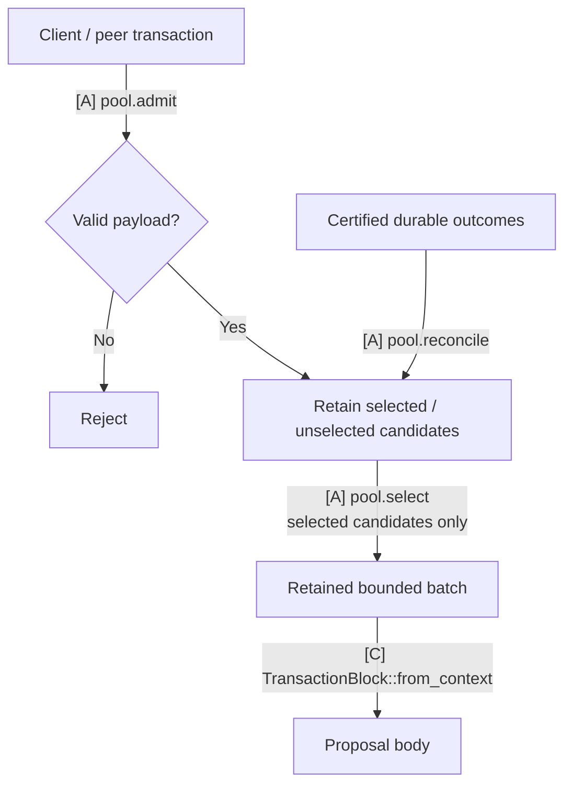

# Transaction pool

`baton-tx-pool` owns transaction admission, retention, proposal selection, durable-outcome maintenance and the shared payload codec. It has no Execution, Alignment or Storage dependency.

## Responsibilities and state

Retain selected and unselected transactions under one agreed bounded pool policy. Selection does not retire transactions. The payload contains transaction bytes and exposes bounded codec/digest operations; Execution wraps it in the native producer block and performs custody/context checks.

## Communication interfaces

| Caller | Concrete method / value | Contract |
|---|---|---|
| Transaction ingress through Execution/network wiring | `TxPool::admit(transaction)` → `Admission` | Apply static validation, deduplication and retention policy |
| Execution proposal handling | `TxPool::select(context, limits)` → `Payload` | Use `SelectionContext` projected by Execution; retain selected bytes |
| Execution durable completion | `TxPool::reconcile(update)` | Apply `PoolUpdate` with exact transaction outcomes and applied-unit identity |
| Execution / native body transport | `Payload::{read_cfg, write, encode_size, digest}`, `PayloadLimits` | Agreed bounded canonical body representation; wire format remains open |

`PoolUpdate` is a maintenance input, not a state certificate or ACK. Pool completion does not gate native consensus or durable delivery ACK. The crate defines its input values so it never needs an Execution checkpoint or Storage database handle.

## Implementation tasks and completion

**TODO operations remain unimplemented.** Read the linked assignment for inputs, prerequisites, failure handling and acceptance tests. A source `Spec:` path resolves from its crate directory.

| Task | Required work and acceptance criteria |
|---|---|
| MODEL-01 | [Selection context and durable pool-maintenance inputs](../docs/03-reference/07-development-order.md#model-01) |
| PAYLOAD-01 | [Bounded body codec and digest](../docs/03-reference/07-development-order.md#payload-01) |
| POOL-01 | [Retained transaction admission/selection](../docs/03-reference/07-development-order.md#pool-01) |

Use focused deterministic tests after implementation and the [workspace checks](../README.md#validate-a-change). Compilation and documentation checks do not establish protocol behavior.

## Detailed behavior

## TxPool: admission and selection

**TxPool retains transactions and supplies bounded batches for local proposals.** It owns admission, selected/unselected classification, duplicate handling and canonical maintenance. App callbacks call its concrete operations; these do not require a public TxPool trait.

### Transaction lifecycle

[Open full-size diagram](../docs/assets/diagrams/diagram-27.svg) · [PNG](../docs/assets/diagrams/diagram-27.png)

Selection preserves the chosen bytes. Canonical maintenance follows durable outcomes, so selecting or proposing a transaction does not retire it.

### Communication interfaces

| Direction | Call or value | Completion means |
|---|---|---|
| Client/peer ingress → TxPool | `pool.admit(tx)` → `Admission` | Bounded input validated and retained as selected/unselected, or rejected |
| Execution propose handler → TxPool | `pool.select(ctx, limits)` → `Payload` | Stable selected bytes fit dependency, count, work and full-body limits |
| Execution durable-outcome handling → TxPool | `pool.reconcile(applied_outcomes)` | Exact applied outcomes reconciled with the chosen backend |

These concrete calls are defined in the [communication reference](../docs/03-reference/01-communication-contracts.md#private-pool-and-execution-calls). The [App callback](../execution/README.md#coordination-automatonpropose-pool-to-staged-block) packs selected bytes into a producer block. Pool selection never substitutes for canonical inclusion.

Admission verifies encoding, signature/domain and chosen stateless rules, then applies payload-based policy. Both RPC and peer paths use the same classification. Selected candidates may enter local batches. Valid unselected candidates remain only for the chosen retention/propagation policy. Invalid input is dropped. These classes need no second pool, actor or physical connection. Static classification uses immutable payload facts; live balances, canonical nonces and node load belong to separate readiness checks.

Selection uses the supplied Multimmit producer context. Its `parent` is a producer-header parent, not the application execution checkpoint or current canonical state. Dependency-aware packing cannot bypass an excluded required predecessor. Bound visited work and encoded body bytes as well as returned transaction count. Retain the selected bytes so proposal cancellation, pool replacement or concurrent admission cannot change a constructed body's commitment. Selection alone does not retire a transaction canonically.

Local pool membership, selection and readiness govern this node's proposals; peer or canonical blocks are validated under the agreed payload rules without requiring their transactions to have been locally admitted or selected.

The [proposal flow diagram](../execution/README.md#coordination-automatonpropose-pool-to-staged-block) shows selection → block construction → staging → body-digest reply.

Execution invokes these public concrete TxPool operations across crates. Follow the canonical [verify handler](../execution/README.md#coordination-automatonverify-validity-custody-and-scheduling) and [Update handler](../execution/README.md#coordination-marshal-reportupdate-canonical-input-and-ack) for scheduling, reconciliation and ACK. Pool maintenance consumes recoverable durable outcomes; it adds no required pool-processing ACK to canonical delivery or native consensus. Reconcile missed maintenance before relying on the backend's readiness state.

Transaction ID, body digest and native header digest identify different objects. Maintain selected bytes → body → exact header/context → applied output correspondence.

### Connect one existing backend

The chosen backend must preserve stable proposal bytes, dependency-aware selection and reconciliation from durable outcomes. Backend choice, transaction codec/identity, duplicate semantics, static policy, quotas and physical retention remain open.

The [pool backend survey](../docs/03-reference/04-pool-backends.md#backend-operation-mapping) compares Nunchi, Reth and Constantinople operations and their integration limits. Read it when selecting an implementation; the communication contract above applies to each candidate.
