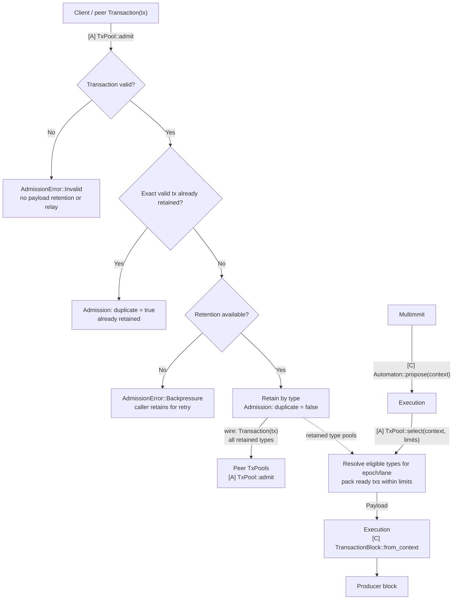

# Transaction pool

`baton-tx-pool` owns transaction admission, retention, proposal selection, durable-outcome maintenance and the shared payload codec. It has no Execution, Alignment or Storage dependency.

## Responsibilities and state

Validate and retain transactions by type under bounded resources, and share retained transactions across lanes. When Multimmit calls `Automaton::propose`, Execution calls `TxPool::select` to choose eligible type pools for the proposal's epoch/lane and build a bounded Payload. Admission does not depend on local proposal eligibility. Selection preserves retention; Execution wraps the payload in the native producer block and performs custody/context checks.

## Communication interfaces

| Caller | Concrete method / value | Contract |
|---|---|---|
| Network assembly | `TxPool::open(lanes)` | Install trusted `LaneContext`: epoch, local producer lane, producer-lane set and shared assignment rule |
| Transaction ingress through Execution/network wiring | `TxPool::admit(transaction)` → `Result<Admission, AdmissionError>` | Validate and retain by type with duplicate metadata; return Invalid or retryable Backpressure on failure |
| Execution proposal handling | `TxPool::select(context, limits)` → `Payload` | Choose eligible type pools for the projected epoch/lane, then pack ready transactions within limits |
| Execution durable completion | `TxPool::reconcile(update)` | Apply `PoolUpdate` with exact transaction outcomes and applied-unit identity |
| Execution / native body transport | `Payload::{read_cfg, write, encode_size, digest}`, `PayloadLimits` | Agreed bounded canonical body representation; wire format remains open |

`PoolUpdate` is a maintenance input, not a state certificate or ACK. Pool completion does not gate native consensus or durable delivery ACK. The crate defines its input values so it never needs an Execution checkpoint or Storage database handle.

## Admission and retention

| Result | Completion |
|---|---|
| `Ok(Admission { duplicate: false })` | Valid transaction newly retained by type and available for bounded sharing |
| `Ok(Admission { duplicate: true })` | Same valid transaction already retained; no reinsertion or immediate relay loop |
| `Err(AdmissionError::Invalid)` | Fails agreed validity rules; no payload retention or relay |
| `Err(AdmissionError::Backpressure)` | Valid new input could not be retained; caller keeps bytes for retry |

`Admission` records successful validation and retention with a `duplicate` flag. Proposal eligibility is computed by `select` from the current context, not stored as a per-transaction status. Admission follows the same rules on producers and non-producers, including for types the local lane will not propose.

## Lane context and sharing

Network derives the local optional producer lane and the epoch's producer-lane set from the trusted native configuration, then supplies the pool-owned `LaneContext` to `TxPool::open` with the agreed application assignment policy. Multimmit supplies lane/epoch identity; transaction-type assignment is an application policy. All pools must agree on eligibility for the same transaction, epoch and lane under that policy. Execution supplies the proposal's exact epoch/lane through `SelectionContext`; selection must match the installed context.

Retain valid transactions by transaction type internally. On `Automaton::propose(context)`, Execution calls `TxPool::select(context, limits)`; the pool resolves eligible types for `(epoch, lane)` and packs ready transactions from those type pools. The same retained type can serve different lanes in different epochs. Type buckets and indexes are private implementation choices; there is no separate stored proposal-eligibility class.

The POOL-01 developer owns the type taxonomy, internal buckets/indexes, epoch-to-lane/type assignment, load distribution, overlap or uncovered-type handling, and context-transition mechanism. Coordinate trusted configuration with NETWORK-01 and input values with MODEL-01. Whether one lane serves one or several types, or several lanes serve one type, remains a policy decision. Keep these details behind the existing TxPool interface; Execution needs the proposal context and returned Payload, not bucket handles or a new trait per type.

RPC and peer ingress both call `admit` and validate the transaction and its type locally. Network shares newly retained valid transactions using the existing transaction transport. All retained types remain available for bounded inventory, missing-transaction requests or catch-up under the chosen transport policy, regardless of local proposal eligibility. Invalid payloads are not relayed; peer echo suppression, deduplication and retransmission bounds prevent forwarding loops. Receiving bytes alone does not establish pool retention.

On an epoch or type-assignment change, update the trusted selection context and revalidate retained transactions only where validity rules require it. Selection uses the new mapping; losing local proposal eligibility does not remove a transaction from its type pool or shared retention. Fence stale selection requests while preserving already constructed proposal bytes. Context replacement, producer-failure reassignment and concrete wire/retention policies remain developer-owned implementation work.

## Implementation tasks and completion

**TODO operations remain unimplemented.** Read the linked assignment for inputs, prerequisites, failure handling and acceptance tests. A source `Spec:` path resolves from its crate directory.

| Task | Required work and acceptance criteria |
|---|---|
| MODEL-01 | [Selection context and durable pool-maintenance inputs](../docs/03-reference/07-development-order.md#model-01) |
| PAYLOAD-01 | [Bounded body codec and digest](../docs/03-reference/07-development-order.md#payload-01) |
| POOL-01 | [Retained transaction admission/selection](../docs/03-reference/07-development-order.md#pool-01) |

Use focused deterministic tests after implementation and the [workspace checks](../README.md#validate-a-change). Compilation and documentation checks do not establish protocol behavior.

## Detailed behavior

## TxPool: admission and selection

**TxPool retains transactions by type and supplies bounded batches for local proposals.** It owns validation, shared retention, context-based type selection, duplicate handling and canonical maintenance. App callbacks call its concrete operations; these do not require a public TxPool trait.

### Transaction lifecycle

[Open full-size diagram](../docs/assets/diagrams/diagram-27.svg) · [PNG](../docs/assets/diagrams/diagram-27.png)

Selection preserves the chosen bytes and all retained types stay shared. `TxPool::reconcile(PoolUpdate)` applies durable canonical outcomes from any lane across type pools; proposing, forwarding or losing local eligibility does not itself retire a transaction.

### Communication interfaces

| Direction | Call or value | Completion means |
|---|---|---|
| Client/peer ingress → TxPool | `pool.admit(tx)` → `Result<Admission, AdmissionError>` | Valid input retained by type with duplicate metadata; Invalid rejected; Backpressure leaves retry ownership with caller |
| Execution propose handler → TxPool | `pool.select(ctx, limits)` → `Payload` | Eligible type pools chosen by epoch/lane; stable bytes fit dependency, count, work and full-body limits |
| Execution durable-outcome handling → TxPool | `pool.reconcile(applied_outcomes)` | Exact applied outcomes reconciled with the chosen backend |

These concrete calls are defined in the [communication reference](../docs/03-reference/01-communication-contracts.md#private-pool-and-execution-calls). The [App callback](../execution/README.md#coordination-automatonpropose-pool-to-staged-block) packs selected bytes into a producer block. Pool selection never substitutes for canonical inclusion.

Admission verifies encoding, signature/domain and agreed transaction validity rules, then retains valid input by type. RPC and peer ingress use the same validation and retention rules. Temporary state readiness, unresolved dependencies and node load do not turn a valid transaction into Invalid; they constrain selection or cause explicit backpressure.

Selection uses the supplied Multimmit producer context. Its `parent` is a producer-header parent, not the application execution checkpoint or current canonical state. Dependency-aware packing cannot bypass an excluded required predecessor. Bound visited work and encoded body bytes as well as returned transaction count. Retain the selected bytes so proposal cancellation, pool replacement or concurrent admission cannot change a constructed body's commitment. Selection alone does not retire a transaction canonically.

Local pool membership, selection and readiness govern this node's proposals; peer or canonical blocks are validated under the agreed payload rules without requiring their transactions to have been locally admitted or selected.

The [proposal flow diagram](../execution/README.md#coordination-automatonpropose-pool-to-staged-block) shows selection → block construction → staging → body-digest reply.

Execution invokes these public concrete TxPool operations across crates. Follow the canonical [verify handler](../execution/README.md#coordination-automatonverify-validity-custody-and-scheduling) and [Update handler](../execution/README.md#coordination-marshal-reportupdate-canonical-input-and-ack) for scheduling, reconciliation and ACK. Pool maintenance consumes recoverable durable outcomes; it adds no required pool-processing ACK to canonical delivery or native consensus. Reconcile missed maintenance before relying on the backend's readiness state.

Transaction ID, body digest and native header digest identify different objects. Maintain selected bytes → body → exact header/context → applied output correspondence.

### Connect one existing backend

The chosen backend must preserve stable proposal bytes, dependency-aware selection and reconciliation from durable outcomes. Backend choice, transaction codec/identity, validity rules, type assignment, sharing protocol, quotas and physical retention remain open. Each choice must preserve admission independent of proposal eligibility, context-based type selection and shared retention.

The [pool backend survey](../docs/03-reference/04-pool-backends.md#backend-operation-mapping) compares Nunchi, Reth and Constantinople operations and their integration limits. Read it when selecting an implementation; the communication contract above applies to each candidate.
